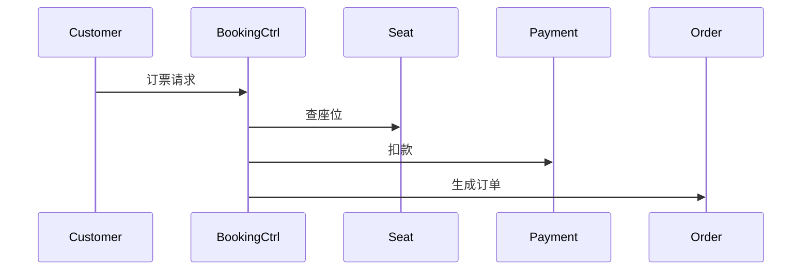

# 交互图的应用（以BookingSystem为例）

## 它是什么

在南京邮电大学《软件建模与设计》第 6 章“动态建模-交互图”中，交互图用来展示对象之间如何通过消息传递完成一个用例。以 `BookingSystem`（预订系统）为例，我们常见两类交互图：

- **顺序图**：强调消息的时间顺序；
- **通信图**：强调对象之间的结构关系与消息流。

课件中提到一个关键概念：**集成通信图**。

> [!IMPORTANT]
> 集成通信图是==所有支持相关用例的通信图的合成==，而不是单个用例的通信图，也不是把静态类图里的对象简单拼起来。

对应真题答案就是选项 **B**。

## 为什么需要

单看一个用例的通信图，只能知道“订票”或“取消订票”里谁和谁说话；但如果把多个相关用例合成起来，就能看到 `BookingSystem` 中对象协作的全貌，避免重复设计和职责冲突。

## 怎么做：以 BookingSystem 为例

先问一句：订票时，顾客向谁发请求？如果多个用例都要查座位、扣款、生成订单，这些对象是不是应该复用？

我们可以用顺序图理清时间线：

而如果用通信图表现集成，就是把多个用例（订票、退票、改签）的通信路径合并，展现出 `BookingCtrl`、`Seat`、`Payment`、`Order` 等对象之间的整体协作。

另外，课件与考题中还涉及**顺序性服务**的设计：

> [!TIP]
> 顺序性服务由==一个响应客户端请求的对象==来设计，对应真题答案为 **A**，不是多个对象或多个子系统。

## 与相近概念的区别

| 概念 | 范围 | 重点 |
|---|---|---|
| 单个通信图 | 一个用例 | 对象链与消息 |
| 集成通信图 | 多个相关用例合成 | 整体协作结构 |
| 顺序图 | 一个/多个场景 | 消息时间先后 |
| 顺序性服务 | 单次请求 | 单个对象响应 |

## 常见坑

> [!WARNING]
> 不要把“集成通信图”写成“实现某一个用例的所有对象通信图”（选项 C 错），也不要当成静态模型中类的直接拼接（选项 D 错）。

## 一个算对了的例子

题目问“什么是集成通信图”，应判断为覆盖多个相关用例的合成结果。由于 `BookingSystem` 中订票、退票、改签都涉及 `BookingCtrl` 与 `Seat`、`Payment`、`Order`，把它们的通信图合成，才是集成通信图，所以选 **B**。
