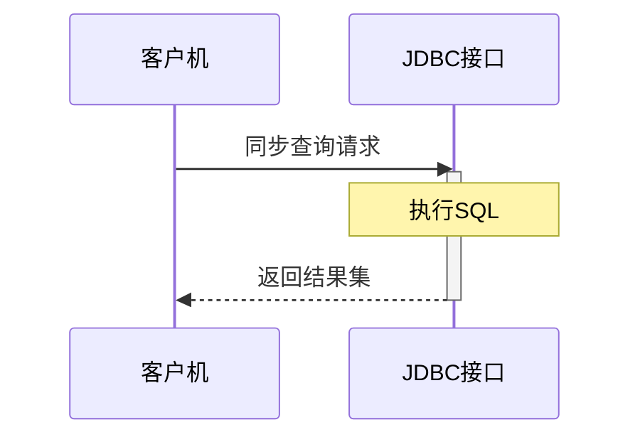

# 交互图的概念与分类（顺序图、通信图）

## 交互图是什么与为什么需要

在软件体系结构的动态视图中，我们不仅要知道系统由哪些对象组成，更要清楚它们==如何通过消息传递协作完成用例==。交互图正是描述对象间消息传送时间顺序与协作关系的图形化工具。如果只画类图而没有交互图，就无法验证“借阅图书”或“生成送货单”等具体行为是否能在对象间正确流转。

> [!IMPORTANT]
> 交互图属于UML动态建模核心，主要用于==用例实化==，即把抽象的用例描述转化为具体的对象交互序列。

## 顺序图：强调时间序列

顺序图（Sequence Diagram）采用二维布局：横轴表示参与交互的对象，纵轴表示时间流逝。它最核心的价值是清晰展示消息执行的先后顺序。

- **消息类型**：分为同步消息（实线实心箭头，发送者==等待应答==）和异步消息（虚线/实线空心箭头，发送者==不等待应答==）。
- **激活期**：用细长矩形框表示对象处于活跃状态的时间段，返回消息通常隐含在激活期底端。
- **自调用**：对象调用自身操作时，箭线返回给发送者，可加构造型 `<<self>>`。

> [!TIP]
> 顺序图中消息编号不是必须的，因为垂直位置已天然表达了时间顺序；但层次编号有助于追踪复杂嵌套调用。

## 通信图：强调结构关系

通信图（Communication Diagram，旧称协作图）语义上与顺序图==完全等价且可相互转换==，但布局以对象间的链接关系为核心，消息通过带编号的箭头标注在链路上。

| 对比维度 | 顺序图 | 通信图 |
| :--- | :--- | :--- |
| 核心关注点 | 时间顺序 | 对象结构与角色 |
| 激活/销毁 | 可显式表示 | 无法表示 |
| 迭代标记 | UML2.x用交互片段 | 仍使用迭代标记 `*` |
| 适用场景 | 验证时序逻辑 | 分析对象拓扑关系 |

> [!WARNING]
> 若需表达对象的创建、销毁或精确的激活/去激活状态，==必须选择顺序图==，通信图不具备这些能力。

## 常见误区与真题辨析

很多同学在区分同步与异步消息时容易混淆。关键判断标准只有一个：==发送方是否阻塞等待响应==。

> [!CAUTION]
> “生产者进入休眠”或“等待超时”都不是消息类型的定义特征，只有“是否等待应答”才是本质区别。

**真题示例**：一个生产者向消费者发送消息，哪种情况是异步消息通信？
- A. 生产者等待消费者的应答 → 这是==同步消息==
- B. 生产者不等待消费者的应答 → ✅ ==异步消息==
- C/D. 休眠/超时 → 干扰项，非消息类型判定依据

答案选B。同理，若题目问“带回复的同步信息通信”，则选A。记住：==同步必等待，异步不等待==，这是交互图消息语义的基石。
