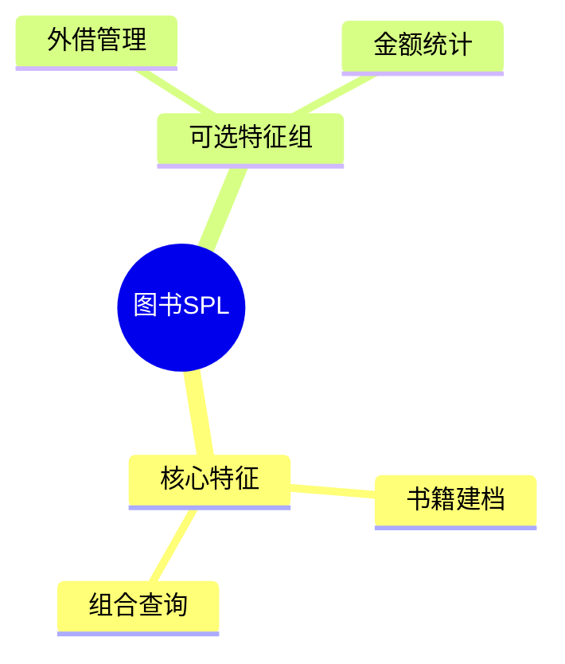
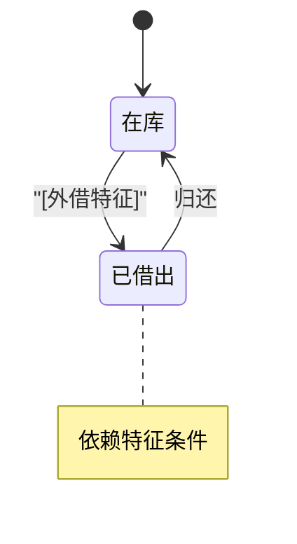

# 产品线中的可变性（Variability）管理

> [!IMPORTANT]
> 产品线中的可变性（Variability）管理，是指在软件产品线（SPL）体系结构中，系统地识别、建模并控制==不同产品成员之间差异==的机制。

## 为什么需要可变性管理

试想：如果你要开发一个“家庭图书管理系统”，只给自己用，写死所有功能就行。但如果你的公司要为 100 个不同的图书馆定制系统呢？有的需要外借记录，有的只要库存查询；有的按计算机/非计算机分类，有的按中图法分类。如果每个系统从零开发，成本极高。

这就是 OMG 等组织强调配置与变更管理的背景——软件规模越来越大，缺乏有效管理对企业极为不利。软件产品线工程（SPL）通过==复用核心资产+管理可变部分==来批量生产软件，而可变性管理就是决定“哪些能变、怎么变”的核心技术。

## 怎么做：核心概念与建模

### 用例层的可变性：可选用例

在用例建模中，不是所有用例都会出现在每一个具体的产品里。

> [!NOTE]
> **什么是可选用例？**
> 答案是：==部分产品线成员所需的用例==（对应考题选 C）。它不是“可以不用开发的用例”，也不是“有着可选步骤的用例”。例如在家庭图书管理中，“外借情况记录”对某些小型内部版本可能是可选的。

### 需求层的可变性：特征与特征组

- **SPL 特征**：一个或者多个 SPL 成员提供的需求或者特性（对应考题选 A）。比如“自动生成书号”就是一个特征。
- **SPL 特征组**：一个 SPL 成员中有着特定使用约束的一组特征（对应考题选 B）。

### 设计层的可变性：类与状态机

在 UML 模型中，我们用构造型（Stereotype）来标记可变性：

- **类的建模**：用来建模 SPL 类的两种构造型是==核心（Core）和可选（Optional）==（对应考题选 A）。核心类在所有产品中都存在（如 `书籍` 类），可选类只在特定产品中存在。
- **状态机的建模**：如何在 SPL 状态机中使用特征条件？用于==确定某特征在状态机中是否被选择==（对应考题选 C）。例如，若未选择“外借管理”特征，则对象的状态机图中直接不包含“已借出”这一状态。

## 相近概念的区别

| 概念 | 关注点 | 作用层级 | 举例 |
| :--- | :--- | :--- | :--- |
| **可变性管理** | 跨产品的==差异==如何表达与控制 | 整个 SPL 生命周期 | 特征模型、核心/可选构造型 |
| **配置管理** | 开发期间软件产物的==依赖与版本== | 项目管理环境 | 包图（模型管理图）、部署图 |
| **变更管理** | 需求或代码修改时的==流程控制== | 维护阶段 | 变更请求审批流 |

> [!WARNING]
> 不要将“配置管理”（课件中反复提到的建立开发期间软件产物依赖关系）与“可变性管理”混淆。前者管的是版本和构建，后者管的是产品线家族中的功能差异。

## 常见的坑

> [!CAUTION]
> 易错点：认为“特征组”就是“互斥特征”。实际上，特征组强调的是==有着特定使用约束==（如必须全选、最多选一、至少选一），互斥只是其中一种约束形式。

> [!TIP]
> 记忆口诀：**用例看可选，特征定需求，类分核与选，状态加条件。** 做题时看到“SPL/产品线”，立刻联想“差异/复用”，排除那些描述单体系统的选项。

## 算对了的例子

**题目**：什么是 SPL 特征组？
A. 一组特征
B. 一个 SPL 成员中有着特定使用约束的一组特征
C. 一组互斥特征
D. 一个 SPL 成员中有着特定使用约束的一组可选特征

**解析**：
特征组不仅仅是特征的简单集合（排除 A），也不局限于互斥（排除 C）。它不仅包含可选特征，也可能包含必选特征的组合约束（排除 D）。其本质定义是：在一个 SPL 成员中，受到特定使用规则（约束）限制的一组特征。因此正确答案为 ==B==。
