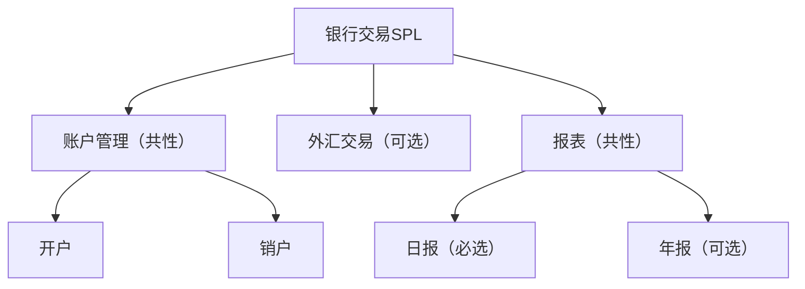

# 软件产品线（Software Product Line）的概念与核心资产

## 软件产品线：概念与核心资产

先想一个问题：一家公司做银行系统，客户有国有大行、城商行、农商行，每家需求七成相似、三成不同。如果每个项目都从零开发，成本会怎样？显然，公共部分被反复重写，维护成本成倍放大。

==软件产品线（Software Product Line, SPL）== 正是为解决这类问题而提出的：它是一组共享一组共性的软件系统，其中==每个成员都从一组核心资产（Core Asset）通过预定义的方式定制而来==。它不是“把多个产品放在一个仓库里”，而是**有组织的复用**。

> [!IMPORTANT]
> 核心定义：SPL = 共性资产 + 受控可变性，产出的每一个具体系统称为 **SPL 成员**。

---

## 为什么需要 SPL

单产品开发的问题在于“项目思维”：每个项目独立立项、独立设计、独立维护。随着产品数量增加，维护 N 个相似系统的成本近似线性甚至超线性增长。

SPL 把视角从“一次开发一个系统”切换为“一次开发一族系统”：

| 维度 | 传统单系统开发 | 软件产品线 |
|---|---|---|
| 分析对象 | 单个客户需求 | 产品族的共性需求与变化点 |
| 设计单位 | 单个系统体系结构 | 产品线体系结构（支持变化） |
| 复用方式 | 代码拷贝/偶然复用 | 核心资产系统化复用 |
| 变更影响 | 逐系统排查修改 | 在资产层修改，统一传播 |

---

## 核心资产是什么

核心资产是 SPL 中最关键的工程概念。它指在多个成员开发中**可以被复用的一切工件**，包括：

- 需求模型（特征模型、用例模型）
- 体系结构描述
- 软件构件及源码
- 测试用例、测试计划
- 开发过程中的决策记录与约束文档

> [!TIP]
> 记忆角度：核心资产 ≈ 一条产品线中**开发任何成员都要用到的“公共家底”**，不是某个成员独有的实体类。

核心资产的组织围绕两个概念展开：**共性（Commonality）** 与**可变性（Variability）**。共性在所有 SPL 成员中保持一致；可变性则通过**变化点**显式声明，通过**变体**具体实现。

---

## 特征的建模

下图的特征模型展示了一个“银行核心交易 SPL”的结构：根特征为产品线全局能力，向下分解为共性特征与可选特征。

> [!NOTE]
> 特征与类的区别：特征是**系统向用户/客户提供的一项能力或需求**，不等于类，也不等于用例。一个特征可能由多个类和多个用例协作实现。

---

## 核心系统与核心类

在体系结构设计时，SPL 用一个**核心系统**来刻画产品线的“最小公共骨干”。

> [!IMPORTANT]
> SPL 核心系统 = 仅由==核心类==以及部分==默认类==组成的成员，它是产品线的“最小可用版本”。

- **核心类**：所有 SPL 成员都必须包含的类，承载共性行为。
- **默认类**：虽非所有成员都需要，但对多数成员是默认组成部分的类。
- **可选类**：只有在特定成员的变体被选中时，才被引入系统的类。

在 UML 建模时，可以给 SPL 中的类施加构造型：

| 构造型 | 含义 | 是否所有成员包含 |
|---|---|---|
| `<<core>>` | 核心类 | 是 |
| `<<optional>>` | 可选类 | 否，按特征选择 |
| `<<default>>` | 默认类 | 多数成员包含 |

---

## 常见的坑

> [!WARNING]
> SPL 不是“一组完全相同的系统”。它的本质是==共性构件 + 可控可变构件==。如果所有成员完全一样，就不需要产品线，只需要单产品发布多次。

> [!CAUTION]
> 可变性不能只写在代码注释里。SPL 的可变性必须在特征模型、体系结构与构件接口中**显式建模**，否则后期成员数量增多时，配置组合爆炸会失控。

---

## 算对了的例子

回到那道选择题：“什么是软件产品线（SPL）？”

- B 的描述是“一条装配线”，这是把制造领域的比喻当作定义；SPL 借用的是“产品线”的理念，但本身是**软件系统的集合**，不是物理生产线。
- C 强调“完全相同”，没有可变性，不符合 SPL。
- D 说“一个公司销售的多个软件产品”，太宽泛——公司可能卖操作系统、办公软件、银行系统，彼此无共性，也不构成 SPL。

正确答案只能是 **A：有着共性构件和可变构件的一组软件系统**。可以把这个判断过程再推进一步：验证 A 是否成立，只需要问两个问题——这些系统是否有共享的核心资产？是否有显式管理的差异点？两者都满足，才能称为 SPL。
