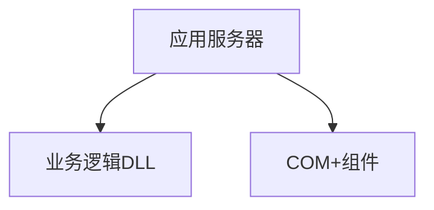

# 基于产品线的产品派生与配置

## 什么是配置视图与派生

在软件产品线中，我们拥有大量可复用的核心资产，但如何将这些逻辑上的“工作产品构件”转化为特定客户需要的、可在物理环境中运行的具体产品？这就需要==基于产品线的产品派生与配置==。

> [!IMPORTANT]
> 配置视图（Deployment View）描述系统的==物理配置特征==，用配置图表示，核心任务是将逻辑构件映射到物理节点上。

试想，如果只有代码而没有部署方案，系统能在服务器上跑起来吗？显然不能。配置视图正是解决“软件在哪里运行”以及“由哪些物理文件组成”的关键。它主要包含两个核心概念：

-   **节点（Node）**：代表计算机资源，通常为处理器（Processor）或其他硬件设备。
-   **配置构件（Deployment Component）**：构成可执行系统的必需构件，如 DLL、EXE 等。它是根据工作产品构件建立的，并作为制品（Artifact）配置在节点上。

## 派生与配置的实施流程

产品派生不是重新开发，而是通过“选择+绑定”实现定制化。其过程可抽象为以下模型：

在具体操作中，需遵循以下步骤：

1.  **识别变体点**：从产品线体系结构中确定当前产品需要哪些可选特性。
2.  **构件实例化**：根据变体选择结果，从核心资产中提取对应的工作产品构件。
3.  **物理映射**：将生成的配置构件（如 COM+ 构件、Java Beans）分配到具体的硬件节点上。
4.  **环境适配**：结合配置与变更管理项目管理环境，确保依赖库、配置文件等制品正确就位。

> [!TIP]
> 记忆口诀：==逻辑选变体，物理配节点，构件成制品，部署即产品==。

## 易混淆概念辨析

复习时最容易将“配置构件”与“工作产品构件”搞混，二者虽有关联但层次不同：

| 维度 | 工作产品构件 | 配置构件 |
| :--- | :--- | :--- |
| 抽象层次 | 逻辑/设计层 | 物理/实现层 |
| 表现形式 | 类图、接口、模型 | DLL、EXE、JAR包 |
| 关注点 | 功能复用与变体 | 运行时环境与部署 |
| 关系 | 源 | 根据源建立的目标 |

> [!WARNING]
> 常见误区：认为配置图只是画服务器连线。实际上，==配置构件是连接逻辑设计与物理运行的桥梁==，缺少它就无法完成从产品线资产到具体产品的派生。

## 典型配置示例解析

以课件中“应用服务器”节点为例，一个正确的配置建模应包含以下要素：

在该示例中，“应用服务器”是节点（处理器资源），而“业务逻辑DLL”和“COM+组件”是配置构件。它们不是凭空产生的，而是根据产品线中对应的业务模块（工作产品构件）编译、打包后形成的制品。

> [!CAUTION]
> 做题陷阱：若题目问“配置构件的来源”，切勿回答“用户需求”或“硬件规格”。标准答案必须是==根据工作产品构件建立==。这是南邮本课程考核的高频采分点，务必精准记忆术语。
