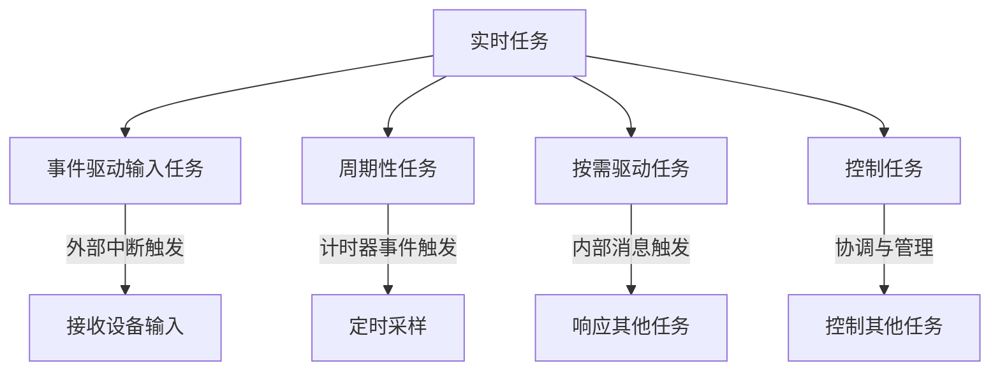
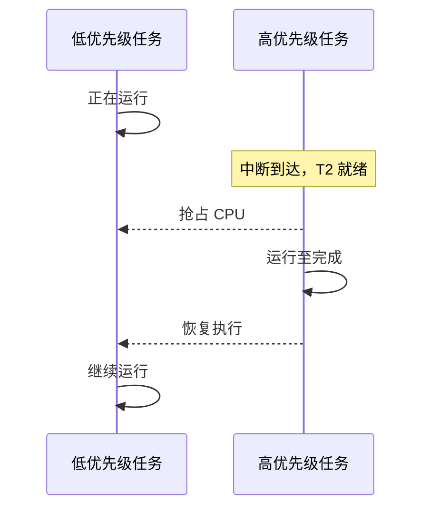

# 实时系统中的任务调度与优先级

## 它是什么

在并发与实时系统中，==任务调度就是决定哪个任务先获得 CPU==，而优先级是调度决策的核心依据。实时任务按触发方式分成不同类型，每种类型的优先级安排策略不同。

## 为什么需要

实时系统对时间有硬性约束：错过截止时间，结果就没有意义，甚至造成事故。如果所有任务"排队轮流执行"，紧急任务可能被低优先级的长任务阻塞，导致系统失效。因此需要==基于优先级的抢占式调度==：高优先级任务一旦就绪，立刻打断当前低优先级任务。

## 怎么做：区分任务类型与安排优先级

关键判断线索是"谁触发了这个任务"：

| 任务类型 | 触发源 | 典型特征 | 优先级倾向 |
|---------|--------|---------|-----------|
| 事件驱动输入任务 | 外部设备中断 | 接收外部输入，需快速响应 | 高 |
| 周期性任务 | 计时器事件 | 固定周期反复执行 | 按截止时间安排 |
| 按需驱动任务 | 其他任务的内部消息或事件 | 被动等待唤醒 | 视调用者而定 |
| 控制任务 | 内部逻辑 | 控制、协调其他任务 | 通常较高 |

调度策略的要点：
- ==坚持只解决最高优先级的任务==：CPU 始终运行当前就绪队列中优先级最高者。
- 优先实现高优先级的功能：开发顺序上用例的"优先级"字段（满意度与不满意度均为 5 表示最高）直接决定先做什么。

## 例题

**题目：什么是事件驱动输入任务？**

- A. 每几秒钟执行一次的任务
- B. 控制其他任务的任务
- C. 从产生中断的外部设备接收输入的任务
- D. 用于检查是否存在来自外部设备新的输入的任务

分析触发源：题目强调"事件驱动"+"输入"，触发源是==外部设备产生的中断==，且职责是接收输入。选项 A 靠时间触发（周期性），B 是控制任务的定义，D 描述的是轮询而非中断驱动。答案选 **C**。

> [!TIP]
> 记口诀："外部中断→事件驱动输入，计时器→周期性，内部消息→按需驱动，控制别人→控制任务"。四个类型各对一句话，考试选择题直接匹配即可。

## 常见的坑

> [!WARNING]
> 不要混淆"按需驱动"与"事件驱动"。两者都是"被触发"的，区别在于触发源：==按需驱动来自系统内部其他任务的消息，事件驱动来自外部设备中断==。这是选择题最高频的干扰项。

> [!CAUTION]
> 优先级安排不能只看"任务重不重要"，还要看时间约束。一个语义上重要但截止时间宽松的任务，其调度优先级可能低于一个简单但必须在 1ms 内响应的中断处理任务。

> [!NOTE]
> 用例模板中的"优先级"字段（满意度/不满意度 0~5）与运行时调度优先级是两个层面的事：前者决定开发顺序，后者决定运行时谁先占用 CPU，但二者思想一致——把最紧急、最有价值的放在最前面。
