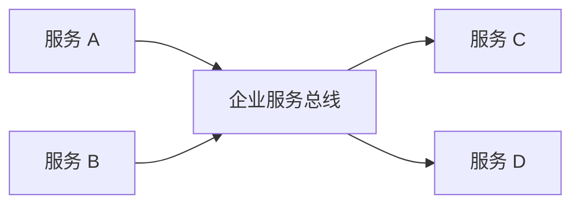
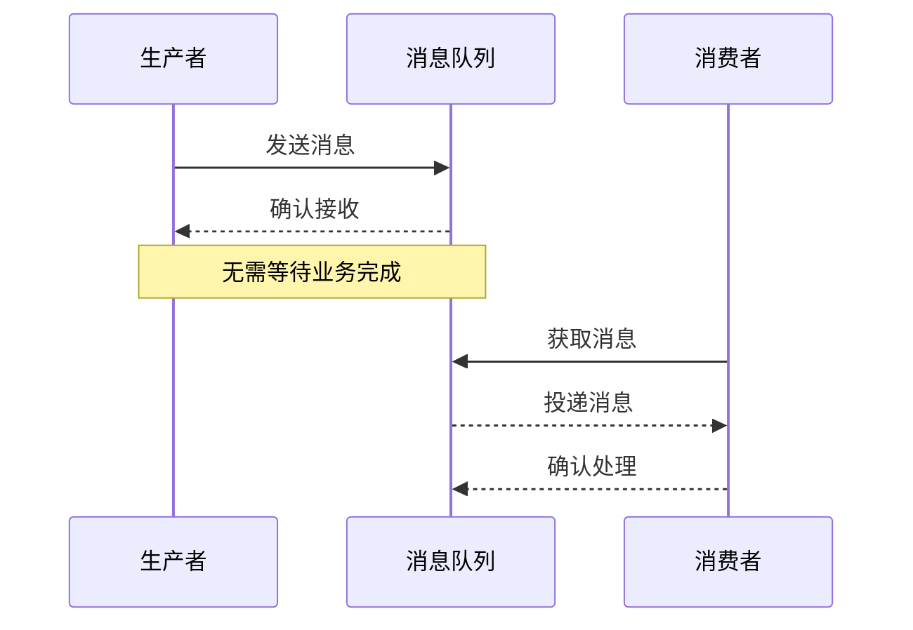

# 企业服务总线（ESB）与消息队列

## 为什么需要 ESB 与消息队列

面向服务的软件体系结构（SOA）把系统拆成多个服务。若服务之间直接两两调用，调用方就要知道对方的位置、接口和通信方式；一旦服务迁移、接口变化或暂时不可用，调用方也容易受到影响。

因此需要解决两个问题：

- 服务怎样统一接入、查找和通信？
- 服务之间能否不必同时在线，并减少直接依赖？

前者通常由**企业服务总线（ESB）**承担，后者常借助**消息队列（MQ）**实现。

## ESB：服务之间的通信中枢

ESB 是 SOA 中连接各类服务的基础设施。服务不直接建立复杂的点对点连接，而是接入总线，由总线提供消息路由、协议转换、数据格式转换、服务寻址等能力。

例如，服务 A 使用 HTTP 发送 XML 数据，而服务 C 只接受另一种协议和格式。A 不必自行修改，ESB 可以完成协议适配、数据转换，并把请求路由到 C。

> [!IMPORTANT]
> ==ESB 的核心价值是集中提供服务连接与集成能力==，降低服务之间的耦合，而不是简单地把所有业务功能都放进总线。

## 消息队列：用消息实现异步协作

消息队列保存生产者发送的消息，消费者再从队列中取得并处理消息。生产者通常不必等待消费者完成业务处理，双方也不必始终同时在线。

其典型作用包括：

- **异步通信**：发送方不必同步等待处理结果。
- **解耦**：生产者不必直接了解消费者的具体实现。
- **削峰填谷**：请求突增时先进入队列，消费者按自身能力处理。
- **缓冲故障**：消费者暂时不可用时，消息可按配置保留，待恢复后处理。

## 一个正确的应用例子

某选课系统在高峰期每秒收到 $1000$ 个请求，而后台每秒只能处理 $400$ 个。若持续高峰 $10$ 秒，则积压消息数为

$$
(1000-400)\times 10=6000\text{ 条}.
$$

高峰过后，新请求降为每秒 $100$ 个，后台每秒可净消化

$$
400-100=300\text{ 条}.
$$

因此清空原有积压约需

$$
6000\div 300=20\text{ 秒}.
$$

这里队列把瞬时压力转化为延后处理，但请求总量长期超过处理能力时，队列仍会持续积压。

## 与相近概念的区别

| 概念 | 主要关注点 | 典型通信方式 | 不能简单等同于 |
|---|---|---|---|
| ESB | 服务接入、路由、转换与集成 | 可支持同步或异步 | 普通消息队列 |
| 消息队列 | 消息存储、投递与异步解耦 | 通常为异步 | 完整 SOA |
| Web Service | 服务接口及远程调用技术 | 常见为请求—响应 | ESB 本身 |
| 微服务 | 系统拆分与服务组织方式 | 可采用多种通信方式 | SOA 的同义词 |

> [!NOTE]
> ESB 与消息队列可以结合：ESB 负责服务集成，消息队列作为其中一种异步传输或缓冲机制。二者不是互斥替代关系。

## 常见的坑

> [!WARNING]
> “异步”不等于“消息一定不会丢”，也不等于“只处理一次”。网络重试、消费者处理成功后确认失败等情况，都可能造成重复投递。

实际设计还要关注消息持久化、确认机制、超时重试、幂等处理和顺序要求。例如扣款服务收到重复消息时，应依据业务编号识别已处理请求，避免重复扣款。

另一个常见误区是把 ESB 理解成“所有服务必须同步经过的中心业务模块”。总线过度承载业务逻辑，会形成新的集中依赖；队列也只能缓冲压力，不能无限提高后台的实际处理能力。
