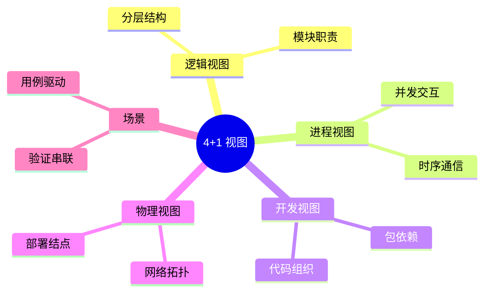
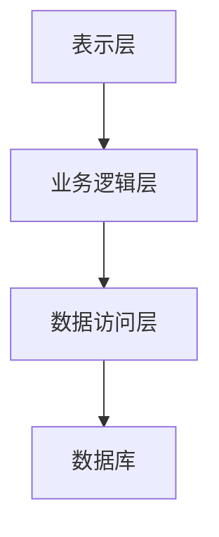
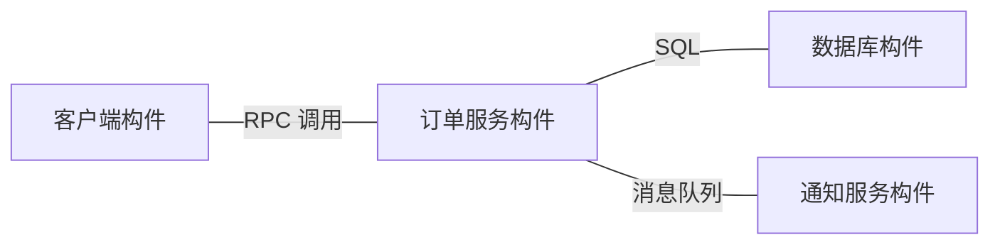
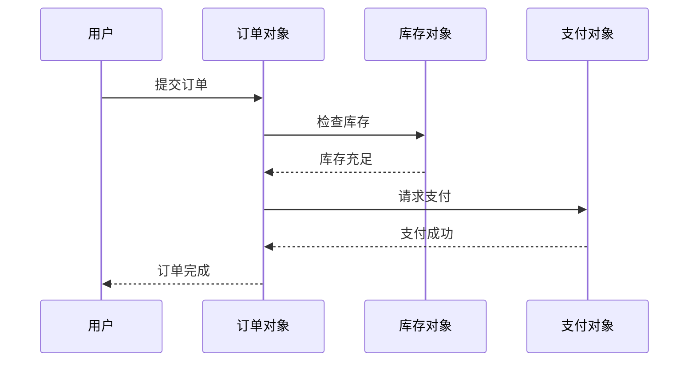
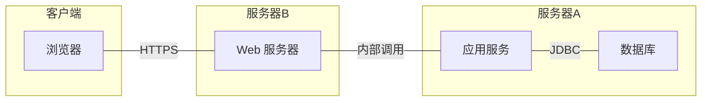

# 体系结构的4+1视图模型

## 从“一栋房子”到 4+1 视图：为什么一个图不够

你可以先想一个问题：如果让你向不同的人介绍一座大楼，你会画同一张图吗？

- 给住户看，要画**户型图**——房间怎么隔、门朝哪开；
- 给施工队看，要画**结构图**——梁柱怎么撑、钢筋怎么布；
- 给物业看，要画**管线图**——水电暖通怎么走；
- 给城市规划看，要画**总平面图**——楼在哪、周围路怎么接。

软件体系结构也是这样。Philippe Kruchten 在 1995 年提出的 ==4+1 视图模型==，核心思想就是：**没有一张图能同时回答所有人的问题**，所以用四个互补的架构视图从不同侧面描述系统，再用一组关键场景（+1）把四张图串起来验证。

> [!IMPORTANT]
> 南邮考试题把 4+1 视图做了**简化对应**：结构视图 → 构件和连接器；动态视图 → 对象和消息；部署视图 → 结点和互联关系的物理配置。你首先要能把这个对应关系脱口而出，再理解背后的含义。

## 四个视图各自回答什么问题

四个视图分别对应不同角色关心的问题，下面用一张表先看清全貌。

| 视图 | 核心关键词 | 回答的问题 | 考试题中的表述 |
|:---|:---|:---|:---|
| 逻辑视图 | 模块、分层、职责 | 系统**功能**上由哪些逻辑部件组成？ | 模块层次的视图 |
| 结构视图（构件视图） | 构件、连接器、接口 | 运行时**计算单元**怎么通过连接器交互？ | ==构件和连接器的视图== |
| 动态视图（进程视图） | 对象、消息、时序、并发 | 系统**运行时**对象怎么协作？进程怎么同步？ | ==对象和消息的视图== |
| 部署视图（物理视图） | 结点、网络、物理配置 | 软件跑在**哪些硬件**上？网络怎么连？ | ==结点和互联关系的物理配置视图== |
| 场景（+1） | 用例、交互序列 | 用哪些**关键用例**验证四个视图一致？ | 场景驱动 |

## 逐一拆解：每个视图“长什么样”

### 逻辑视图（Logical View）

逻辑视图描述系统的**功能分解**——系统由哪些模块组成，模块之间是什么分层、依赖关系。它最像传统软件工程里的“体系结构图”，常见画法是 UML 包图或分层图。

> [!NOTE]
> 考试中“体现为模块层次的视图”就是指逻辑视图。它关心的是**静态的功能组织**，不关心进程和部署。

### 结构视图（Structural / Component View）

结构视图把系统看成一组==运行时构件（Component）==和==连接器（Connector）==。构件是具有明确接口的独立计算单元，连接器描述构件之间的通信机制（如调用、消息队列、管道）。

> [!TIP]
> 记忆窍门：**结构视图 = 构件 + 连接器**。看到题目选项里同时出现“构件”和“连接器”，直接选它。

### 动态视图（Dynamic / Process View）

动态视图描述系统**运行时刻**的行为：对象之间怎样通过消息协作完成任务，进程/线程怎样并发和同步。常用 UML 顺序图（时序图）、通信图来表达。

> [!TIP]
> 记忆窍门：**动态视图 = 对象 + 消息**。题目里看到“对象和消息”，就是动态视图。

### 部署视图（Deployment / Physical View）

部署视图描述软件的**物理部署拓扑**——哪些软件构件部署在哪些硬件结点（服务器、终端、路由器）上，结点之间通过什么网络互联。

> [!TIP]
> 记忆窍门：**部署视图 = 结点 + 互联关系**，关键词是“物理配置”。题目选项里出现“结点”，答案就是部署视图。

## 那“+1”的场景是什么？

四个视图各自独立描述系统的不同侧面，但**它们描述的是同一个系统**，必须互相一致。场景就是连接四个视图的“粘合剂”——选定若干关键用例，在每个视图中都走一遍，检查是否自洽。

> [!IMPORTANT]
> 例如“用户下单”这个场景：
> - 逻辑视图：需要订单模块、库存模块；
> - 结构视图：订单构件通过连接器调用库存构件；
> - 动态视图：订单对象向库存对象发送“检查库存”消息；
> - 部署视图：订单构件部署在应用服务器，库存数据在数据库结点。
>
> 四张图对同一个场景的描述必须对得上。

## 常见误区

> [!WARNING]
> 最大的坑是把**逻辑视图**和**结构视图**混淆。两者听起来都像“结构”，但逻辑视图讲的是**模块划分**（编译期思维），结构视图讲的是**构件和连接器**（运行期思维）。考试题的区分点就在这里：选项里写“模块层次”选逻辑视图，写“构件和连接器”选结构视图。

> [!CAUTION]
> 动态视图 ≠ 结构视图。有些同学看到“运行时”就以为动态视图是结构视图，其实结构视图关心**构件之间的静态拓扑**，动态视图关心**对象之间消息流的时序**。判断标准：有没有“消息”在对象之间流动。

> [!TIP]
> 快速记忆表（考前 30 秒版）：
> - 模块层次 → 逻辑视图
> - 构件连接器 → 结构视图
> - 对象消息 → 动态视图
> - 结点互联 → 部署视图

## 一个算对了的例子

把本文开头那几道选择题放在一起看：

**选择 6** 问“部署视图是什么”——选项 C “体现为结点和互联关系的物理配置视图”，关键词 **结点、物理配置**，选 `C`。

**选择 7** 问“动态视图是什么”——选项 D “体现为对象和消息的视图”，关键词 **对象、消息**，选 `D`。

**选择 8** 问“结构视图是什么”——选项 B “体现为构件和连接器的视图”，关键词 **构件、连接器**，选 `B`。

对照上面的记忆表，==每道题都能在 10 秒内锁定答案==：先看题干要哪个视图，再到选项里找对应的关键词组，匹配即选。
