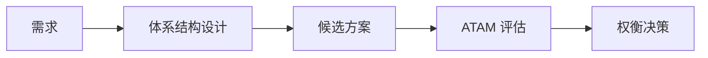
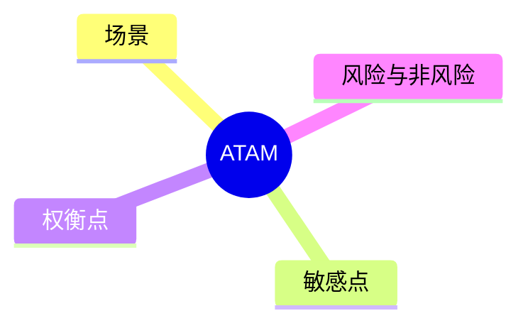

# 体系结构设计方法与评估（ATAM等方法）

## 它是什么

先想一个问题：如果让你在一堆候选方案里挑一个“最合适”的软件体系结构，你靠什么判断？除了看功能是不是满足，还得看它在性能、安全性、可修改性、可用性这些**质量属性**上表现如何。

**体系结构设计方法与评估**，就是研究怎么把体系结构“设计出来”以及“评出好坏”的一套方法。ATAM（Architecture Tradeoff Analysis Method，体系结构权衡分析方法）是其中最常考的一种，属于第 10 章里的评估方法。

> [!IMPORTANT]
> ATAM 不是设计方法本身，而是对已有体系结构候选方案做==质量属性权衡与风险评估==的方法。

## 为什么需要

很多同学会混淆：体系结构风格（如分层、C/S）是“设计方案”，而 ATAM 是“打分工具”。没有评估，就可能选了一个功能满足但一改就崩、高并发就瘫的方案。

用 mermaid 看 ATAM 在整体里的位置：

## 怎么做（ATAM 四阶段）

课件里一般把它分成几步，你可以按这个流程记：

1. **场景与需求收集**：把利益相关方（用户、开发、运维）的质量属性要求变成具体场景。
2. **体系结构描述**：把候选方案的构件、连接件、约束讲清楚。
3. **属性分析与权衡**：针对每个质量属性（性能、安全、可修改性等）分析敏感点、权衡点。
4. **风险判定**：哪些决策会导致将来改不动或达不到指标，就是风险。

用一张图表示核心概念关系：

- **敏感点**：某个构件参数稍变，某质量属性剧烈变化的地方。
- **权衡点**：同时影响多个质量属性，必须做取舍的位置。
- **风险**：可能导致质量目标达不到的架构决策。

## 和相近概念的区别

| 概念 | 作用 | 是否产生方案 |
|------|------|--------------|
| 体系结构风格 | 提供构件组织模式 | 是 |
| 体系结构设计 | 产出候选架构 | 是 |
| ATAM | 评估候选架构并权衡 | 否 |

> [!NOTE]
> 设计方法是“生成解”，ATAM 是“选和解的权衡”，两者常配合但不是一回事。

## 常见的坑

> [!WARNING]
> 容易把“敏感点”和“权衡点”写反：==敏感点只影响一个属性，权衡点才涉及多个属性互相冲突==。

另一个坑是以为 ATAM 在需求都没清楚时就能用——其实它必须先有候选架构和场景。

## 一个算对了的例子

课件复习题常问：某系统要求“交易响应时间 < 200ms”且“新增支付方式要在 2 人日内完成”，ATAM 评估时发现支付路由模块既改性能又改扩展方式，这是什么点？

答：它同时动了性能和可修改性两个属性，因此是 **权衡点**；若只改线程池大小只影响响应时间，则是**敏感点**；若发现该模块耦合计费导致永远做不到 2 人日，就是**风险**。
