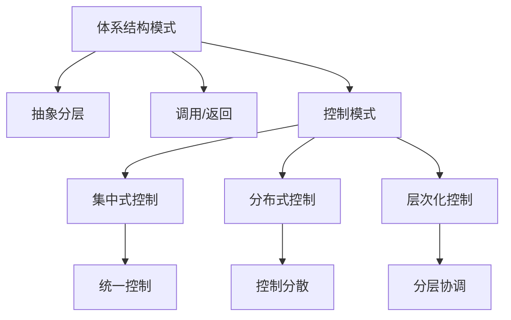

# 体系结构风格（Architectural Styles）概览

## 什么是体系结构风格

软件体系结构描述系统的**构件、连接件及其组织方式**。当某种组织方式在不同系统中反复出现，并能解决一类相似问题时，就形成了体系结构风格或模式。

> [!IMPORTANT]
> ==体系结构模式是在不同系统中重复出现的体系结构==，不是某个具体系统的子系统清单，也不等同于一组协作对象。

引入这些模式，是为了复用已经验证的结构经验：设计者不必每次重新决定“如何分层、由谁控制、对象怎样交互”，而应根据系统的调用关系、控制范围与分布需求选择模式。

## 常见模式及判别

| 模式 | 核心组织方式 | 判别关键词 |
|---|---|---|
| 抽象分层 | 系统划分为多层，下层为上层提供服务 | 相邻下一层 |
| 调用/返回 | 调用操作直接调用被调用对象的方法 | 方法调用 |
| 集中式控制 | 一个控制构件统一控制 | 整体控制、执行顺序 |
| 分布式控制 | 控制功能分散在多个控制构件中 | 分别处于多个构件 |
| 层次化控制 | 多个控制构件分层组织，上层协调下层 | 协调多个控制构件 |

### 抽象分层与调用/返回

抽象分层模式关注**服务方向**：每一层只能使用相邻下一层的服务，而不是使用上一层服务，也不是各层完全独立。这样可限制依赖方向，降低修改的影响范围。

调用/返回模式关注**交互方式**：调用对象中的调用操作，调用被调用对象中的操作（方法）。它描述的是方法调用，不应仅因存在对象交互就选成“发送消息”。

### 三种控制模式

先看控制功能放在哪里，再看是否存在协调关系：

- **集中式控制**：控制集中于一个控制构件，负责整个系统的控制并提供执行顺序。
- **分布式控制**：控制功能分别处于多个控制构件中，强调控制职责的分散。
- **层次化控制**：控制也分布于多个构件，但构件具有层次，上层通过协调多个控制构件提供整体控制。

> [!WARNING]
> “多个控制构件”并不足以判定为层次化控制。分布式控制强调**分散**，层次化控制还必须体现==分层协调==；集中式控制则强调统一控制整个系统。

## 解题示例

题目：“对于层次化控制体系结构模式，哪个表述正确？”

- A：控制功能分别处于多个控制构件中——只说明分散，是分布式控制的典型特征。
- B：对多个客户端子系统提供整体控制——“多个客户端”不是层次化控制的判据。
- C：通过协调多个控制构件提供整体控制——同时体现多个构件与协调关系。
- D：对多个 I/O 对象提供分布式控制——描述对象不对，且落入分布式控制表述。

因此选 **C**。

> [!TIP]
> 做题先抓模式特征：分层看“相邻下一层”，调用看“调用方法”，集中看“统一顺序”，分布看“控制分散”，层次看“协调构件”。
