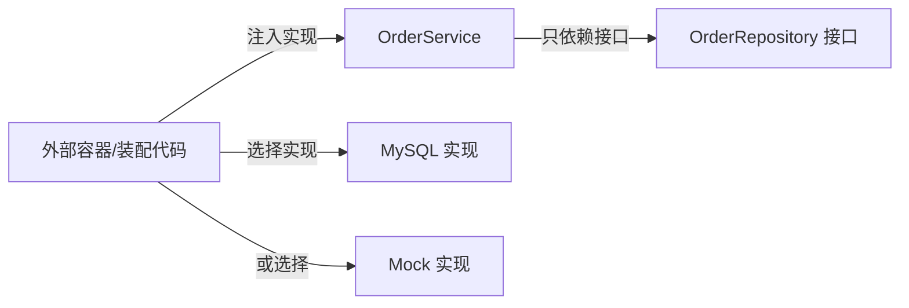

# 依赖注入（Dependency Injection）与控制反转（Inversion of Control）

## 依赖注入与控制反转

先从一个问题开始：如果类 `OrderService` 内部直接 `new` 了一个 `MySQLOrderRepository`，当某天要换成 `OracleOrderRepository` 或测试用的 `MockRepository` 时，你不得不改 `OrderService` 的源码。**谁在控制“创建哪个具体依赖对象”这件事？** 答案是：`OrderService` 自己。这就把上层业务逻辑和底层实现焊死了。

### 什么是控制反转

==控制反转（Inversion of Control, IoC）== 的核心思想是：**把“创建依赖对象”的控制权从类内部转移出去**，交给外部的容器、框架或装配代码。`OrderService` 不再自己 `new`，而是声明“我需要一个 `OrderRepository` 接口”，至于给它 `MySQL` 实现还是 `Mock` 实现，由外部决定。

打个比方：普通模式是你自己买菜做饭（类自己创建依赖）；IoC 模式是你点外卖，你只说要吃什么，由外卖平台决定哪家店做、怎么送来（外部容器注入依赖）。你从“主动创建者”变成了“被动接收者”——控制权反转了。

### 什么是依赖注入

==依赖注入（Dependency Injection, DI）== 是实现 IoC 的一种具体手段（另一种常见手段是 Service Locator，但 DI 在实践和考试中更主流）。它做的事情是：容器在创建对象时，**自动把该对象所依赖的其他对象“注入”进去**，而不是让对象自己去获取。



注入方式通常有三种：

| 注入方式 | 做法 | 适用场景 |
|---------|------|---------|
| 构造器注入 | 通过构造函数参数传入依赖 | 依赖必须存在对象才可用，**最推荐** |
| Setter 注入 | 通过 setter 方法设置依赖 | 依赖可选，或运行时可更换 |
| 接口注入 | 实现特定接口，由容器调用注入 | 较少见，侵入性较强 |

### 为什么需要它

如果不用 IoC/DI，高层模块直接依赖低层实现，系统的**可测试性**和**可扩展性**都会变差：单元测试难以用 Mock 替换真实数据库；新增一种存储方案就要修改业务代码。面向对象设计原则中的==依赖倒置原则（Dependency Inversion Principle, DIP）==说的正是：高层模块不应依赖低层模块，二者都应依赖抽象。IoC/DI 是落实这一原则的工程机制。

> [!IMPORTANT]
> 核心考点：**IoC 是思想/原则，DI 是实现手段**。“控制反转”反转的是_创建依赖对象的控制权_；“依赖注入”指容器把这个依赖_注入_给对象，而非对象自己主动查找。

### 一个具体例子

假设 `OrderService` 需要一个计算折扣的策略：

```java
// 没有 IoC：OrderService 自己创建具体策略
class OrderService {
    private DiscountStrategy strategy = new VIPDiscountStrategy(); // 写死了
}

// 使用构造器注入
class OrderService {
    private final DiscountStrategy strategy;
    public OrderService(DiscountStrategy strategy) {  // 由外部传入
        this.strategy = strategy;
    }
}
```

测试时注入 `MockDiscountStrategy`，生产环境注入 `VIPDiscountStrategy`，`OrderService` 一行不用改。这就是 DI 带来的灵活性。

### 常见的坑

> [!WARNING]
> **误区一：IoC 就是 DI。** 不准确。IoC 还包括框架调用你的代码（如模板方法模式、事件回调）等更广义的“控制反转”场景；DI 只是其中依赖管理这一支的典型实现。
>
> **误区二：用了 DI 框架就一定解耦。** 如果所有类都直接依赖具体实现类再注册到容器，耦合依旧存在。DI 的前提是**面向接口编程**——依赖的是抽象，不是具体类。

> [!TIP]
> 记忆口诀：**“自己不 new，等别人给”**。判断一个类是否用了 DI，看它有没有在内部 `new` 具体依赖；判断是否面向接口，看字段类型是接口还是实现类。
