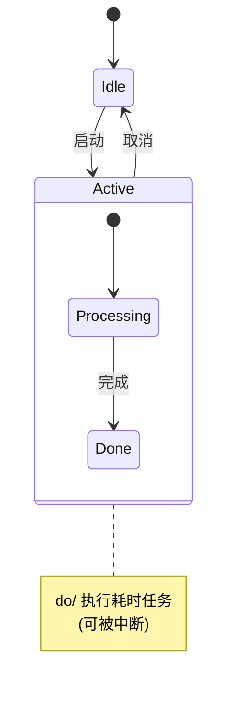

# 状态中的动作（Action）与活动（Activity）

# 状态中的动作（Action）与活动（Activity）

在《软件建模与设计》的动态建模中，状态机图不仅描述对象“在哪里”（状态），更关键的是描述对象“做什么”以及“何时做”。理解 **动作（Action）** 与 **活动（Activity）** 的区别，是掌握状态机语义的核心。

## 核心概念辨析

==动作（Action）== 是一个可执行的**原子计算**。它不可中断，执行时间极短（理想情况下瞬间完成），通常导致状态变更或返回值。
==活动（Activity）== 是在状态机中进行的**非原子执行**。它由一系列动作组成，需要一定的时间跨度，且**可能被外部事件中断**。

> [!IMPORTANT]
> **本质区别**：动作是原子的、瞬时的；活动是非原子的、耗时的、可中断的。

| 特性 | 动作 (Action) | 活动 (Activity) |
| :--- | :--- | :--- |
| **原子性** | 是（不可分割） | 否（由多个动作组成） |
| **持续时间** | 瞬时（忽略不计） | 有限时间段 |
| **可中断性** | 不可中断 | **可被事件中断** |
| **表示法** | `entry/`, `exit/`, `do/` | `do/` 后接复杂行为或子状态机 |

## 为什么需要区分？

如果混淆两者，会导致模型无法反映真实系统的并发与中断机制。例如，在电话系统中，“拨号”是一个持续过程，若用户中途挂断（事件），拨号必须停止。若将“拨号”建模为原子动作，则无法响应中途的挂断事件。

> [!TIP]
> **记忆技巧**：动作像“拍照”（瞬间完成），活动像“录像”（持续进行，可随时停止）。

## 状态内的行为规范

在 UML 状态图中，行为通过以下子句定义：

1.  **entry / action**：进入状态时立即执行的原子动作。
2.  **exit / action**：离开状态时立即执行的原子动作。
3.  **do / activity**：进入状态后开始执行的活动。只要状态保持活跃，该活动就持续进行，直到状态转移或活动自然结束。

## 常见误区与陷阱

> [!WARNING]
> **易错点**：认为 `do/` 只能用于简单动作。实际上，`do/` 常关联一个**子状态机**（即组合状态），此时“活动”表现为一系列子状态的流转。

-   **内部转移（Internal Transition）**：执行动作但**不离开当前状态**，因此不会触发 `exit` 和 `entry` 动作。
-   **历史状态（History State）**：当对象重新进入组合状态时，若指向历史状态，将恢复到上次离开时的**最后一个活动子状态**，并重新执行入口动作。

## 实例解析：ATM 验卡过程

假设 ATM 处于“验证卡片”状态。

1.  **Entry**：插入卡片，读取磁条（原子动作，瞬间完成）。
2.  **Do**：连接银行主机验证密码（活动，耗时，可能因超时或用户取消而中断）。
3.  **Exit**：弹出卡片或吞卡（原子动作）。

若在“Do”阶段用户按下“取消”键，活动被中断，触发转移至“空闲”状态，执行 Exit 动作。若将验证密码视为原子动作，则无法处理“取消”事件，这不符合实际逻辑。

> [!NOTE]
> **结论**：在建模耗时且可交互的行为时，务必使用 **Activity**（通常体现为 `do/` 或组合状态），而非简单的 Action。
