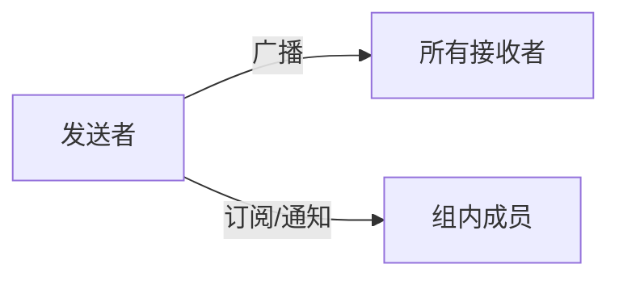
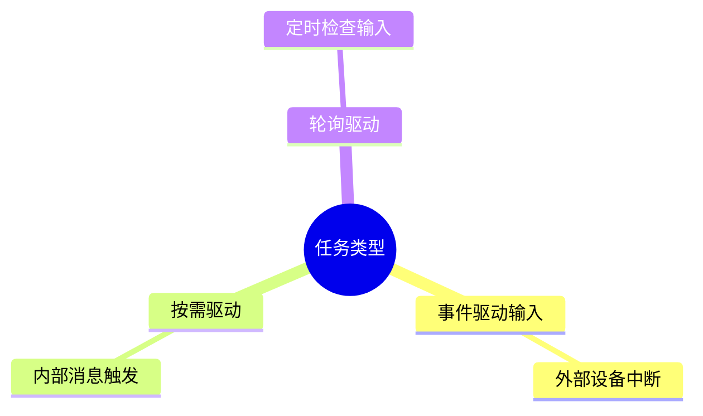

# 进程间同步与通信机制（信号量、互斥锁、消息队列）

---
requires: [操作系统/进程管理]
---

在并发和实时软件体系结构中，多个任务（进程/线程）同时运行。如果它们共享数据或需要协作，会发生什么？一个任务还没写完数据，另一个就去读，结果会怎样？这就引出了==进程间同步与通信机制==的必要性。

## 为什么需要同步与通信

并发任务之间存在两类基本需求：
- **同步**：保证多个任务访问共享资源时不发生冲突（互斥），或按特定顺序执行（协调）。
- **通信**：任务之间需要交换数据或触发事件。

如果没有这些机制，系统将陷入竞态条件、死锁或数据不一致。

## 核心机制怎么做

### 互斥锁与信号量

**互斥锁（Mutex）**是最简单的同步工具，只有两个状态：锁定和解锁。同一时刻只允许一个任务持有它，用于保护临界区。

**信号量（Semaphore）**是互斥锁的推广，内部维护一个整型计数器 $S$。通过两个原子操作控制：
- `wait(S)`（P操作）：若 $S > 0$，则 $S = S - 1$，继续执行；否则阻塞。
- `signal(S)`（V操作）：$S = S + 1$，唤醒等待队列中的任务。

当 $S=1$ 时，信号量退化为互斥锁。

> [!IMPORTANT]
> 互斥锁强调"谁加锁谁解锁"的所有权概念；信号量强调"资源数量"的计数概念。

### 消息队列与通信模式

消息队列允许任务通过发送和接收消息来通信，实现解耦。课件中常考以下几种通信模式：

| 通信模式 | 目标范围 | 特点 |
| :--- | :--- | :--- |
| 点对点 | 某个特定接收者 | 一对一精确投递 |
| 广播 | ==所有接收者== | 无差别全局发送 |
| 订阅/通知 | ==一个组的所有接收成员== | 基于主题/组的定向分发 |

## 任务触发机制的区别

在实时软件体系结构设计中，任务的驱动方式决定了它何时被调度执行。这是考试的高频辨析点：

- **事件驱动输入任务**：由产生中断的外部设备接收输入而触发。它不主动查询，而是被动响应硬件事件。
- **按需驱动的任务**：被来自于其他任务的==内部消息或事件==触发。注意它与事件驱动的区别——触发源是系统内部的另一个任务，而非外部硬件。

> [!WARNING]
> 常见坑：将"按需驱动"误认为是对外部事件的响应。记住：按需驱动的触发源是==内部消息==，事件驱动输入任务的触发源是==外部中断==。

## 算对了的例子

结合历年真题，我们来看两道典型辨析：

**例题 1**：什么是广播消息通信？
A. 一个发送给若干接收者的消息
B. 一个发送给某个特定接收者的消息
C. 一个发送给所有接收者的消息
D. 一个发送给一个组的所有接收成员的消息

**解析**：广播（Broadcast）的字面含义即向全域发送。选项 D 描述的是订阅/通知模式（发给特定组的成员）。因此正确答案是 ==C==。

**例题 2**：什么是按需驱动的任务？
A. 对每个接收到的消息做出响应的任务
B. 被来自于其他任务的内部消息或事件触发的任务
C. 被外部事件触发的任务
D. 被输入事件触发的任务

**解析**：根据定义，按需驱动的核心在于"按需"，即依赖其他任务发来的内部消息来激活，而非外部硬件中断。选项 C 和 D 属于事件驱动输入任务的范畴。因此正确答案是 ==B==。

> [!TIP]
> 记忆口诀：**广播找全体，订阅找组员；事件靠外断，按需靠内信。**
