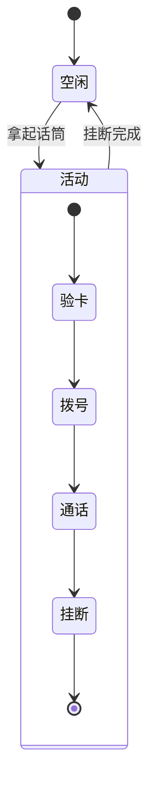
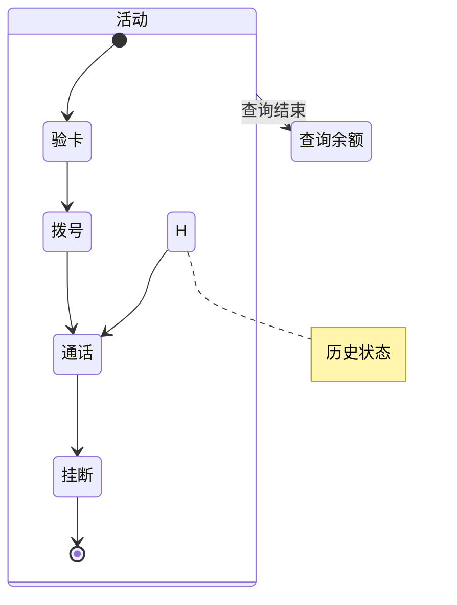

# 复合状态（Composite State）与子状态（Substate）

## 复合状态与子状态：是什么

一个状态机图如果只有一层状态，状态一多就会乱成一锅粥。**复合状态（Composite State，又称组合状态/超状态）** 就是把一组相关的状态"打包"成一个高级状态，其内部嵌套一张子状态机图，被嵌套的状态称为**子状态（Substate）**。子状态本身还可以继续是复合状态，形成多层嵌套。

> [!IMPORTANT]
> UML 对一个状态的描述包含：名字、入口动作与出口动作、内部转移、嵌套子状态、延迟事件等。复合状态 = 普通状态 + 嵌套子状态机，子状态机所在区域**必有自己的初始状态和终结状态**。

## 为什么需要

思考一个问题：电话从"空闲"到"占用"，中间要经历验卡、拨号、通话、挂断等多个阶段，如果全画在同一层，"空闲"和"占用"之间就会出现大量转移线，图变得不可读。怎么办？——把"活动"建模为一个复合状态，把"验卡""拨号""通话""挂断"作为它的**顺序子状态**藏在内部。这样顶层图只看到"空闲→活动→空闲"，简洁清晰。

被嵌套的状态机图所表示的子状态机，都对应于该超状态内正在进行的一个活动。

## 顺序子状态与并发子状态

复合状态内的子状态机有两种组织方式：

| 类型 | 特点 | 适用场景 |
|---|---|---|
| 顺序子状态 | 任一时刻只有一个子状态处于活动 | 同一时刻只干一件事的对象 |
| 并发子状态 | 多个子状态机并发运行，各自有初始/终结状态 | 同一时刻并行做多件事的对象 |

> [!TIP]
> 每次进入复合状态，子状态机从它的**子初始状态**开始运作——除非转移直接指向某个特定子状态。

## 历史状态：回到离开的地方

再想一个问题：通话中突然需要查询余额，离开"活动"状态，查完回来难道要从"验卡"重新开始吗？显然不合理。解决办法是**历史状态（History State）**。

> [!IMPORTANT]
> 历史状态代表**上次离开复合状态时的最后一个活动子状态**。转移到历史状态时，对象恢复该子状态并执行入口动作。

> [!WARNING]
> 历史状态只是一个**伪状态**的图形标记：只能出现在某个复合状态内部，**不能在顶层状态机图中使用**；可以有任意多个来自外部状态的入转移，但**至多有一个无标签的出转移**指向子状态机中的某个子状态。

## 活动状态 vs 非活动状态

这两个词容易混淆，注意区分：

- **活动状态（Active State）**：转移**进入**的状态，它将执行入口动作；
- **非活动状态（Inactive State）**：转移**离开**的状态。

## 常见误区

> [!CAUTION]
> - 认为复合状态内部的子状态机可以没有初始状态——错，==子状态机图所在区域必有自己的初始状态和终结状态==。
> - 把历史状态当成普通状态使用——它是伪状态，仅作"恢复入口"。
> - 并发子状态中各子状态机共享一个初始状态——错，==每个并发子状态机各自有自己的初始状态和终结状态，活动并发进行==。

> [!NOTE]
> 考试建模题（如 PRMS 系统状态、电话状态机）的通用套路：先识别顶层状态，再把内部有明确阶段划分的状态提炼为复合状态，用顺序子状态组织内部流程；若某状态可被"打断后恢复"，在复合状态内加一个历史状态即可。
