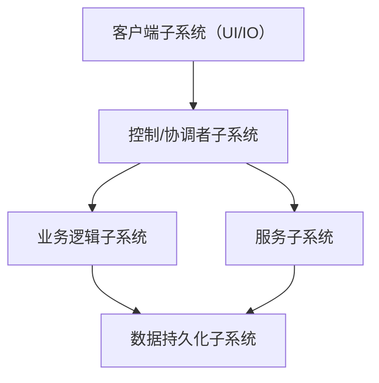

# 子系统（Subsystem）的划分原则与粒度

## 子系统的划分原则与粒度

子系统划分是从“混乱”走向“秩序”的关键步骤。当我们面对几十上百个类时，如果不加以组织，模型会变得难以理解、难以维护。子系统就像书架的**隔层**——把联系紧密的书放在一起，让找书的人（开发者）能快速定位。

> [!IMPORTANT]
> ==子系统是高内聚、低耦合的功能集合==，对外暴露有限接口，对内封装复杂实现。在 UML 中用构造型 `<<subsystem>>` 修饰一个包来表示。

### 为什么要划分子系统

把一个大系统拆成若干子系统，不是为了凑数，是为了解决三个现实问题：
- **控制复杂度**：人脑同时处理的单元数有限（通常 7±2），子系统让高层视图保持在可理解范围。
- **分而治之**：不同子系统的团队可以并行开发，只要接口契约不变，内部修改互不影响。
- **问题隔离**：一个子系统崩溃不应拖垮全系统，故障被“关在”隔层里。

### 粒度怎么定

粒度是“拆多细”的问题。拆太粗，子系统内部依然一团麻；拆太细，子系统数量爆炸，接口满天飞。

一个经典经验法则：==一个系统控制在 20 个用例左右==。如果用例数远超这个范围，说明你应该考虑拆出子系统来承载不同领域的用例。

判断粒度的常见标准：

| 标准 | 应划入同一子系统 | 应划入不同子系统 |
|------|----------------|----------------|
| **地理位置** | 部署在同一节点的对象 | 地理位置不同的对象 |
| **控制范围** | 状态相关控制对象与其所控对象 | 控制对象与无关实体 |
| **组合关系** | 属于同一复合对象的部分 | 松散关联的独立对象 |
| **服务性质** | 提供相似服务的对象 | 客户端与服务端 |
| **变更频率** | 因同一类需求变动的类 | 变化节奏不同的类 |

>[!WARNING]
>**常见坑**：把用户接口对象和实体对象放进同一个子系统，理由是“它们都要更新同一个数据”。但这恰恰把显示逻辑与业务逻辑耦合死了——界面一改，实体也得跟着动。正确的做法是分层：界面归界面，实体归实体。

### 典型划分结构

- **客户端子系统**：负责与外界交互（用户接口、外部设备 I/O）。
- **协调者子系统**：`==当需要协调其他子系统的执行时==`才引入。它自己不干业务，只做调度。
- **服务子系统**：为其他子系统提供通用能力，它==本身不太可能是客户端子系统==。

### 接口设计的关键约束

>[!IMPORTANT]
>==一个外部对象应与一个子系统建立接口==，而不是与多个子系统各自建立接口。这遵循“门面原则”——外部系统看到一个统一的入口，子系统内部的变化不影响外部调用方。

如果一个外部对象同时与多个子系统直接耦合，那么任何子系统的接口变更都会波及它，这就失去了子系统封装的意义。

### 一个算对了的例子

**场景**：你正在为一个在线考试系统划分子系统。需求包括考生答题、自动评分、成绩统计、监考视频流。

**第一步**：按地理位置分——监考视频流部署在边缘节点，其余部署在中心服务器，立刻把视频处理独立成一个子系统。

**第二步**：按服务性质分——答题交卷是客户端交互逻辑，评分是业务逻辑，成绩统计是另一个独立服务。于是切出：
- 考试交互子系统（客户端）
- 评分引擎子系统（服务）
- 成绩分析子系统（服务）

**第三步**：检查控制范围。考生提交答卷后，既要触发评分，又要通知监考端状态变更。如果让考试交互子系统直接调用评分和监考，耦合度太高。引入一个**协调者子系统**来编排整个交卷流程。

最终结构合理，每个子系统职责单一，接口清晰，满足了“一个外部对象只对接一个子系统”的要求。
