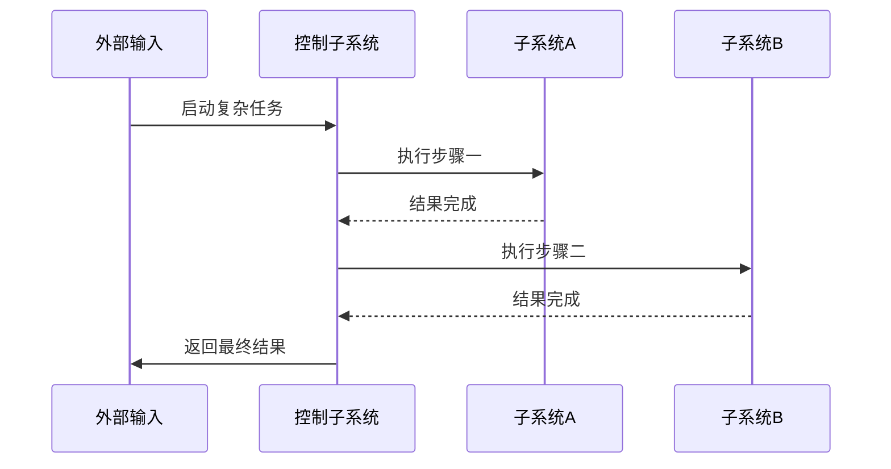

# 子系统之间的接口设计与依赖管理
在构建一个软件系统时，我们通常会将其分解为多个子系统（或分层）。这带来了一个关键问题：==子系统之间如何通信，以及它们之间的依赖关系该如何管理==。如果接口设计不当，子系统会高度耦合，导致“牵一发而动全身”。

### 为什么需要设计接口与依赖

想象一个校园信息系统，包含“教务子系统”和“财务子系统”。如果“教务子系统”在查询学生选课时，直接去访问“财务子系统”的数据库表来判断该生是否欠费，会发生什么？

一旦“财务子系统”的数据库表结构发生变更（例如为了安全，把“金额”字段从明文改成了密文），那么“教务子系统”也必须停机修改代码。这显然是不合理的。

因此，我们需要在设计时明确：**子系统应该通过一个稳定、明确的接口对外暴露服务，同时隐藏内部实现细节**。

### 外部对象与子系统的接口原则

在软件体系结构中，客户端或外部对象访问系统时，不应该直接跨入多个子系统内部。这遵循了**门面模式（Facade Pattern）**的思想。

-   **原则**：一个外部对象应该与==一个子系统建立接口==。
-   **做法**：系统可以为外部客户端提供一个统一的入口点（即门面子系统）。客户端的请求先到达这个入口，再由该子系统根据内部逻辑，协调或转发给其他子系统。

```mermaid
flowchart LR
    A[外部客户端] --> B["门面子系统<br/>(统一入口)"]
    B --> C[子系统A]
    B --> D[子系统B]
    C --> E[数据库]
    D --> E

    Note right of B: 对外隐藏内部结构
```

-   **反例**：如果客户端可以直接与多个子系统交互，那么客户端就必须了解系统内部复杂的拓扑结构和各子系统的接口。当系统内部任何一个子系统发生变动，客户端都可能需要修改，这严重违背了高内聚、低耦合原则。

> [!IMPORTANT]
> 外部对象尽量只与一个领域内的顶层子系统交互，这个顶层子系统负责编排对其他子系统的调用。这就是“入口子系统”或“门面控制器”的角色。

### 控制子系统：协调与编排

当系统变得复杂，尤其是存在多个并行执行或需要严格顺序控制的子系统时，我们不应该让这些子系统彼此直接依赖。

> [!NOTE]
> 什么时候需要一个控制子系统？
> 答案是：==当需要控制其他子系统的执行时==。

控制子系统本身不包含核心业务逻辑，它的职责是**编排**。它像是一个指挥家，知道在什么时间、什么条件下，激活哪个子系统去执行任务。



这种设计的好处是：

1.  **解耦执行流**：子系统 A 和 B 互不知道对方的存在，它们只听从控制子系统的调度。
2.  **易于变更**：如果业务流程变了（例如，原来是“先A后B”，现在要改为“A和B并行执行”），我们只需要修改控制子系统的编排逻辑，而无需修改子系统 A 或 B 的内部代码。

### 依赖管理的常见误区

1.  **循环依赖**：子系统 A 调用子系统 B，而子系统 B 又反向调用子系统 A。这会导致系统在编译或部署时出现“先有鸡还是先有蛋”的死锁问题，也使测试变得极为困难。
2.  **跨层直接依赖**：在分层架构中，上层子系统跨越中间层，直接访问底层子系统的内部实现。例如，UI 层直接访问数据库。
3.  **满屏接口**：一个外部对象同时与所有子系统建立接口。这完全失去了划分子系统的意义，整个系统仍然是一团乱麻。

> [!CAUTION]
> 依赖管理中最危险的坑就是**循环依赖**。如果你发现两个子系统互相需要调用对方，通常意味着它们应该被合并，或者你需要引入一个它们共同依赖的第三个子系统（如接口或抽象基类）来打破这个环。

### 算对了的例子

回到开篇的考题：

-   **问题**：一个外部对象与系统的接口应该如何设计？
-   **分析**：根据门面模式和解耦原则，为降低客户端的复杂度和系统间耦合，我们应为客户端提供单一入口。
-   **答案**：A. 它应该与一个子系统建立接口。

-   **问题**：什么时候需要一个控制子系统？
-   **分析**：当流程的复杂性体现在多个子系统的协作与执行顺序上时，需要一个“指挥家”来编排。控制子系统的核心职责就是控制其他子系统的执行，而不仅仅是控制内部对象或 I/O 设备。
-   **答案**：D. 当子系统需要控制其他子系统的执行时。
