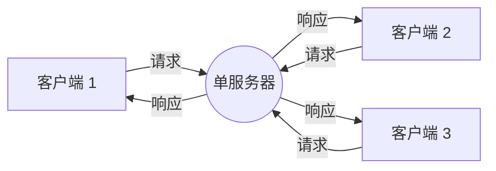
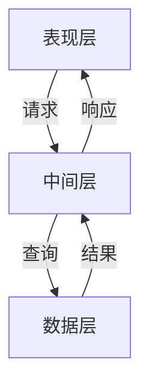

# 客户端/服务器（C/S）体系结构的基本模型

> [!IMPORTANT]
> 客户端/服务器（C/S）体系结构的基本模型，是指==多个客户端请求服务，一个服务完成客户端请求==的架构模式。

## 它是什么与为什么需要

思考一个问题：如果医院诊疗系统里，每个医生的电脑都各自存一份病人档案，数据冲突了听谁的？

为了解决**数据一致性**和**集中管理**的问题，我们需要把“提供功能”和“使用功能”的角色分开。在 C/S 基本模型中：

- **服务器**：==向多个客户端提供一个或多个服务的软硬件系统==。
- **客户端**：发送请求并等待响应的子系统（如用户交互、控制或输入/输出子系统）。

## 怎么做：从基本到多层

基本模型是“多对一”。但当业务变复杂时，单台服务器扛不住所有逻辑，怎么办？引入**多层 C/S 体系结构**。

以课件中的“医院诊疗系统部署图”为例，建立部署图的一般步骤包括识别物理节点（如应用服务器）、将软件构件分配到节点上。在多层结构中，除了最顶层的客户端和最底层的数据服务器，中间会出现**应用服务器**等节点。

> [!NOTE]
> 中间层具有双重身份：对于下层数据库，它是发出请求的客户端；对于上层界面，它是提供业务逻辑的服务端。因此，==中间层既是客户端层也是服务层==。

## 相近概念的区别

考试常考角色辨析，请对比以下子系统的归属：

| 子系统类型 | 属于客户端？ | 说明 |
| :--- | :---: | :--- |
| 用户交互子系统 | ✅ | 负责界面展示与用户输入 |
| 控制子系统 | ✅ | 负责协调流程，向服务发请求 |
| 输入/输出子系统 | ✅ | 负责设备读写，属于前端行为 |
| ==服务子系统== | ❌ | 负责处理核心业务，提供服务 |

> [!TIP]
> 记忆口诀：“交互、控制、I/O 都在前（客户端），服务在后端”。看到“服务子系统”，直接排除出客户端行列。

## 常见的坑

> [!WARNING]
> 别把“服务器”仅仅理解为一台物理机器！在软件体系结构设计语境下，服务器是一个==提供服务的软硬件系统==，而不是单纯的硬件盒子。选项中说“服务于客户的软硬件系统”不够精确，必须强调它是“向**多个**客户端提供**一个或多个**服务”。

> [!CAUTION]
> 基本模型严格指“多客户端、单服务”。如果题目出现“多个服务完成客户端请求”，那是多服务器或对等网络模型，不是基本 C/S 模式。

## 真题实战

**题目**：一个多层客户端/服务器体系结构模式中，以下哪个关于中间层的描述是正确的？
A. 中间层是客户端层
B. 中间层是服务层
C. 中间层既是控制层也是服务层
D. 中间层既是客户端层也是服务层

**解析**：
1. 问自己：中间层向上看还是向下看？
2. 向上看，它为表现层提供业务计算，此时它是服务端。
3. 向下看，它需要访问数据库，向数据层发请求，此时它是客户端。
4. 综合两者，中间层兼具两种角色。

**答案**：==D==
