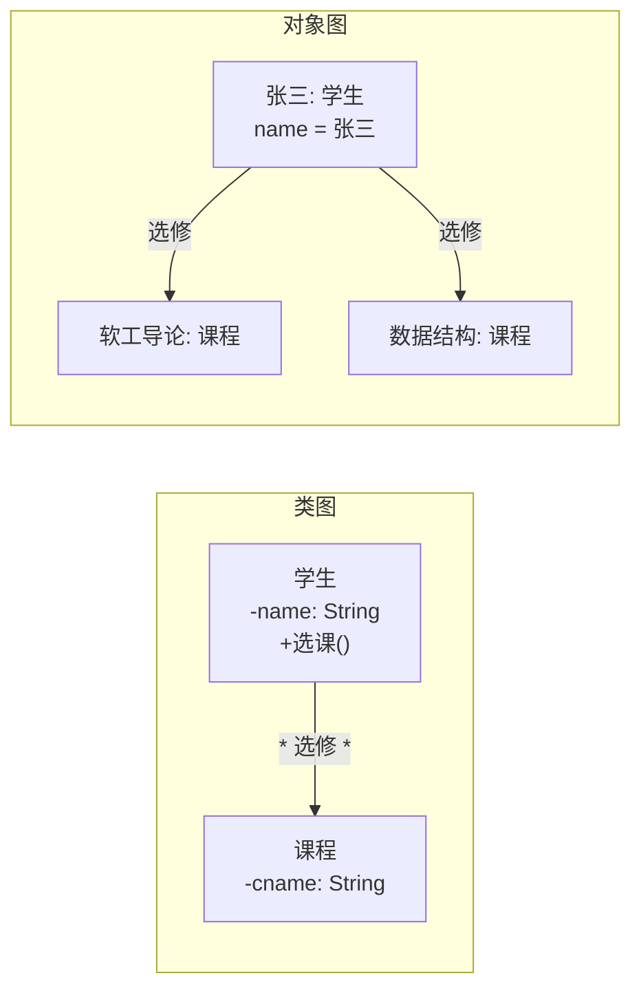
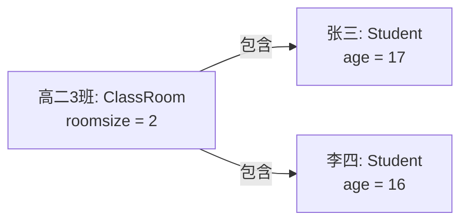

# 对象图（Object Diagram）与类图的关系

## 对象图与类图的关系

先想一个问题：类图已经描述了系统中“有哪些类、类之间有什么关系”，为什么还需要对象图？

因为类图描述的是**抽象规则**，而程序实际运行时，同一个类可以产生很多个不同状态的对象。比如“学生”是一个类，但张三、李四这两个对象，选课不同、年龄不同、和别人的链接也不同。==要描述某一时刻系统里具体有哪些对象、它们之间的链接长什么样，就必须用对象图。==

> [!IMPORTANT]
> **对象图是类图的实例**：类图描述所有可能的情况，对象图描述系统在某个具体时刻的快照。

---

### 类图与对象图的对应关系

下面用一张表对照两者的核心元素：

| 类图元素 | 对象图元素 | 说明 |
|---------|-----------|------|
| 类（Class） | 对象（Object） | 类有操作框，对象图标**没有操作框** |
| 属性有类型 | 属性有具体值 | 如 `age: int` → `age = 20` |
| 关联 | 链接（Link） | 链接是关联的实例 |
| 多重性 `*` | 具体的数量 | 如“一个学生选多门课” → 张三链接到 3 门课 |

用一张图直观对比：

可以看出：

- 对象名字下面有**下划线**，格式是 `对象名: 类名`。
- 对象图标是一个矩形框，只分**上下两格**（对象名 + 属性值），==不再有第三格操作框==。
- 多重性从“任意多个”变成了**具体的两条链接**。

---

### 什么情况下需要对象图

对象图一般不是用来“从零做设计的”，而是作为类图的**补充说明**，帮人看懂复杂的类关系在实际中如何运转。典型用途：

[!NOTE]
> 在课前复习题中如果给出“某个时刻系统中对象之间的链接”，要能判断这里讲的是对象图而非类图，判断依据就是出现了**带有属性值的具体对象**。

主要应用场景：

- 解释一个复杂的递归结构或树形结构（如目录树）在某一时刻长什么样子。
- 展示一个典型的运行快照，验证类图是否真的能表达当前数据状态。
- 表达设计模式中的协作例子，例如观察者模式里此时有哪些观察者挂在了哪个主题上。

---

### 一个算对了的例子

假设类图规定：**一个班级（ClassRoom）有若干学生（Student）**。

设计一个具体场景：高二（3）班此刻有两位学生——张三和李四。张三 17 岁，李四 16 岁。正确的对象图应为：

检查要点：

1. 每个对象名都有下划线，格式为 `对象名: 类名`；
2. 属性写的是**值**而不是类型，`age = 17` 而非 `age: int`；
3. 对象矩形的框里**没有操作框**，只有上下两部分；
4. 链接是类图中“包含”关联的具体实例，原来多重性 `*` 变成了 2 条具体链接。

---

### 常见易错点

[!WARNING]
> 不要把对象图和类图画混：类图不会给张三和李四这两个具体的人画框；对象图也不应该出现“操作”这一格。

[!CAUTION]
> 对象没有独立的“操作”这一栏，这是南邮课件中明确强调的考点。对象图上如果出现了第三格（操作），就是类图而不是对象图。

易错情况对照：

| 易错点 | 正确做法 |
|-------|---------|
| 对象框画了第三格写 `+选课()` | 只画两格，最多写属性和值 |
| 对象名叫 `Student`（没有下划线，没有具体名） | 写 `张三: Student` 并加下划线 |
| 链接两端写多重性 `*` | 链接就是具体的 1 条边，不标 `*` |
| 把对象图说成“类图的一种简化” | 对象图是**类图的实例**，不是简化 |

---

最后记住一句话：

> 类图回答“**可以怎样**”，对象图回答“**此刻是什么样**”。
