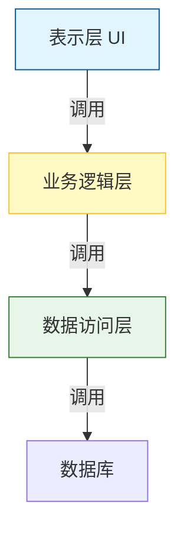

# 层次化体系结构（Layered Architecture）

# 层次化体系结构（Layered Architecture）

## 它是什么与为什么需要

==层次化体系结构==是将系统组织为一系列层，每层提供一组服务给上一层使用，并作为下一层的客户。这种结构的核心在于**抽象分层**。

想象一下，如果所有代码都混在一起，修改一个界面按钮可能导致数据库崩溃。分层通过**封装变化**解决了这个问题：
- **可维护性**：只需替换某一层（如更换数据库），不影响其他层。
- **可复用性**：下层服务（如网络通信）可被多个上层复用。
- **标准化**：层间接口清晰，便于团队并行开发。

## 怎么做：严格分层 vs 松散分层

在实现时，必须遵守依赖规则。课件中强调的**抽象分层模式**通常指**严格分层**：

> [!IMPORTANT]
> 每一层只能使用**相邻的下一层**的服务。严禁跨层调用（如表示层直接调数据层）。

| 特性 | 严格分层 (Strict) | 松散分层 (Relaxed) |
| :--- | :--- | :--- |
| **依赖方向** | 仅指向紧邻下层 | 可指向任意下层 |
| **耦合度** | 低，易替换 | 较高，牵一发而动全身 |
| **性能** | 可能略低（透传开销） | 略高（减少中间层） |
| **南邮考点** | ==默认考察此模式== | 较少涉及 |

## 常见坑与辨析

做题时最容易混淆的是“谁能调用谁”。请记住：**上层依赖下层，下层不知道上层的存在**。

> [!WARNING]
> **常见错误**：认为层之间是双向交互或独立的。
> **纠正**：依赖是单向的。选项 D “一层相对于其他层而言都是独立的”是错误的，因为层间存在强依赖关系。

此外，需区分**层次化控制**与**分层架构**。层次化控制侧重于控制构件的协调（如主从控制），而分层架构侧重于功能模块的垂直切分。

> [!TIP]
> **解题技巧**：看到“层次化”，先找“相邻”、“下一层”、“单向依赖”。若出现“跨层”、“双向”、“独立”，通常为干扰项。

## 算对了的例子

回顾真题：*在抽象分层模式中会发生什么？*

- A. 每一层都只能使用相邻的下一层的服务
- B. 每一层都只能使用相邻的上一层的服务
- C. 每一层都只能使用相邻的上一层和下一层的服务
- D. 一层相对于其他层而言都是独立的

**解析**：
1.  **排除 B/C**：下层不应依赖上层，否则形成循环依赖，违背分层初衷。
2.  **排除 D**：层间通过接口紧密协作，并非独立。
3.  **确认 A**：符合==严格分层==定义，即 $Layer_i$ 仅调用 $Layer_{i-1}$。

再看一题业务逻辑类的封装：*下列哪一项不太可能被封装在业务逻辑类中？*
- A. 业务规则
- B. 对实体类操作的调用
- C. 余额判断逻辑
- D. 对话框

**解析**：
业务逻辑层（Business Logic Layer）负责核心规则处理。**对话框**属于用户界面（表示层）元素，若出现在业务层，会导致 UI 与逻辑耦合，违反分层原则。故选 **D**。
