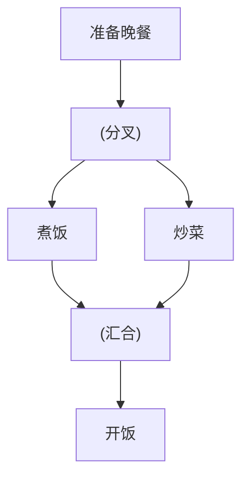

# 活动图中的并发（分叉与汇合）与同步

## 什么是分叉与汇合

在活动图中，如果多个动作必须==同时开始、全部完成后才能继续==，该如何表达？这就需要用到并发控制机制。

> [!IMPORTANT]
> 分叉（Fork）将单一控制流拆分为多个并发流；汇合（Join）将多个并发流同步为单一控制流。两者均使用==同步条（Synchronization Bar）==表示，通常为一条粗水平线或竖线。

- **分叉**：1条入转移 + ≥2条出转移。触发时，所有出转移对应的活动==立即并行启动==。
- **汇合**：≥2条入转移 + 1条出转移。只有当==所有入转移对应的活动都完成==后，才触发出转移。

## 为什么需要配对与平衡

从分叉到汇合的每一条路径称为一个“线程”。若分叉出的线程数与汇合接收的线程数不一致，模型就会出现死锁或逻辑遗漏。因此，==分叉与汇合必须严格配对且平衡==。

[!TIP]
记忆口诀：一进多出是分叉，多进一出是汇合；线程数量要相等，嵌套配对别搞错。

## 与条件分支的区别

初学者常混淆同步条与菱形判断节点，二者语义完全不同：

| 特征 | 分叉/汇合（同步条） | 条件分支（Decision） |
| :--- | :--- | :--- |
| 图形 | 粗直线 | 菱形 |
| 语义 | ==无条件并发== | 互斥选择（仅走一条） |
| 汇合规则 | 等待==所有==入流完成 | 合并任意一条入流即可 |
| 配对要求 | 必须平衡 | 无需配对 |

> [!WARNING]
> 汇合点==不是==“谁先到谁通过”，而是“所有人都到才通过”。若误用为条件合并，会导致未完成的并发任务被忽略。

## 条件线程的特殊处理

是否每个分叉出的线程都必须实际执行？不一定。课件指出存在==条件线程（Conditional Thread）==例外：若某线程附带条件且运行时取值为“假”，则在汇合处==视为该线程已完成==，不会阻塞同步。这避免了因可选任务缺失导致的死锁。

## 嵌套并发的正确画法

如果某个并发线程内部还需要再分叉，该怎么办？==新分叉必须有自己的配对汇合，且该汇合必须位于外层汇合之前==。绝不允许内层线程直接跨层连接到外层汇合点，否则破坏平衡原则。

> [!CAUTION]
> 常见错误：内层分叉的线程绕过内层汇合，直接连到外层汇合。这会导致外层汇合等待的线程数与实际到达数不匹配，模型语义错误。

## 建模步骤提示

绘制含并发的活动图时，建议按以下顺序构建：先画顺序动作流，再添加条件分支，==最后处理分叉与汇合==。这样可避免过早引入并发导致结构混乱，确保每一步都清晰可验证。
