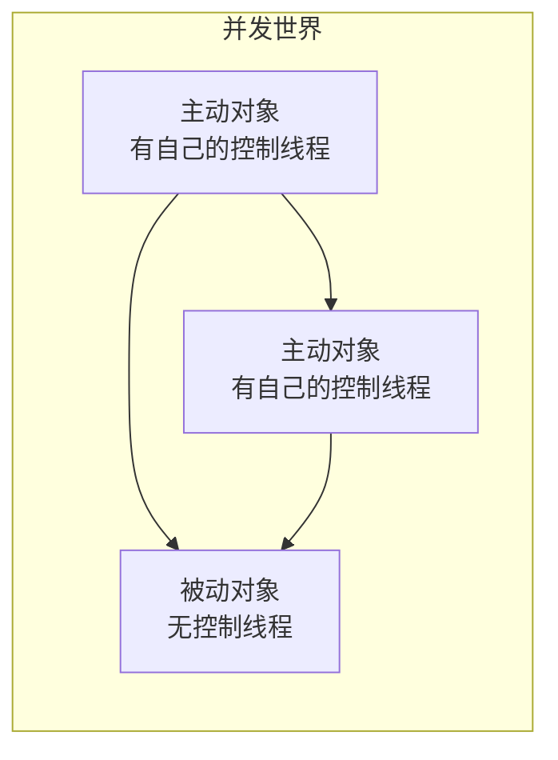
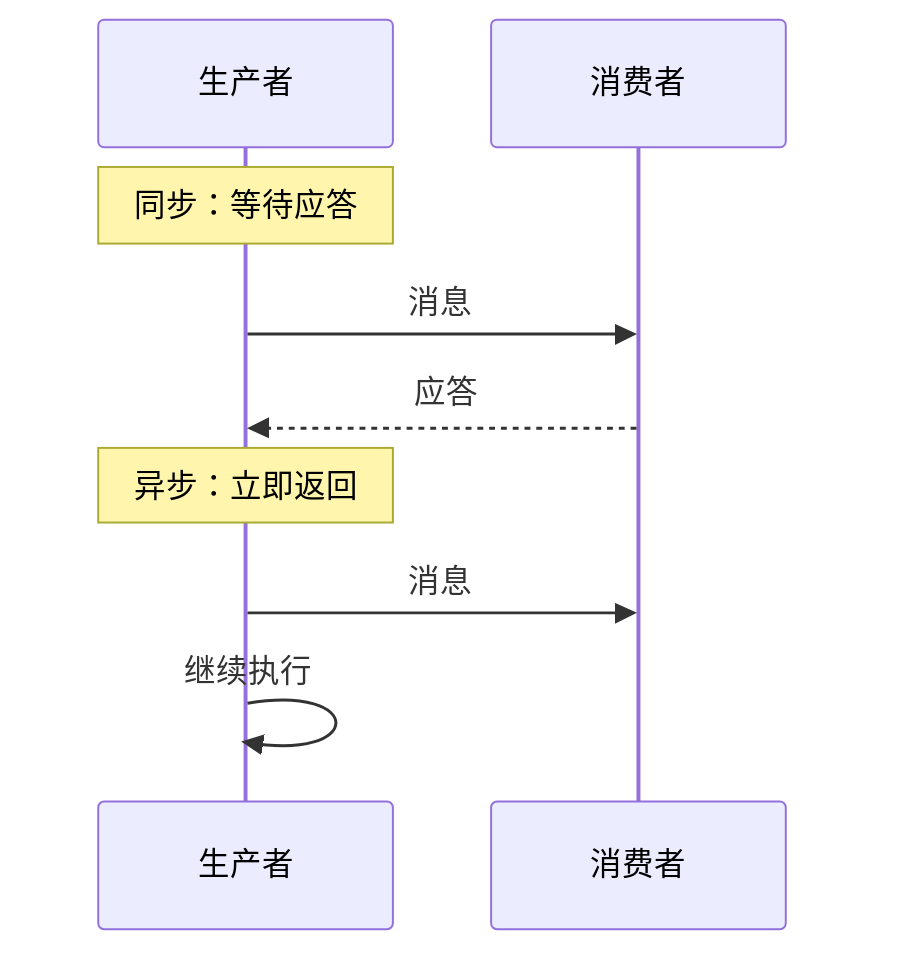
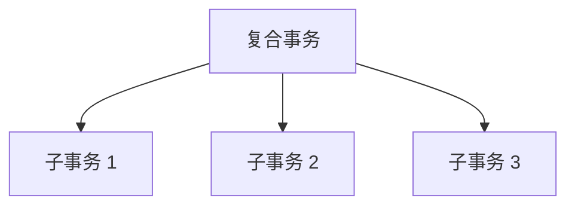

# 并发系统与实时系统的基本概念
### 为什么需要并发

软件系统越来越需要**同时处理多件事情**：一边接收传感器数据，一边响应用户操作，一边与远程服务通信。如果严格按顺序一件一件做，要么响应太慢，要么直接丢数据。并发（concurrency）就是让多个任务在时间上重叠执行；当系统还必须满足**明确的时间限制**（截止期、响应时限）时，就称为实时（real-time）系统。==并发关注"同时做多件事"，实时关注"必须在规定时间内做完"==。

### 并发系统 vs 实时系统

| 维度 | 并发系统 | 实时系统 |
|------|----------|----------|
| 核心要求 | 多任务同时推进 | 结果正确 + 时间正确 |
| 典型场景 | Web 服务器、GUI | 飞机控制、工业自动化 |
| 错过时限 | 通常只是变慢 | 可能造成故障 |
| 任务模型 | 任务、主动对象 | 控制任务、I/O 任务、定时任务 |

### 并发系统中的基本构件

在基于构件的并发设计中，对象分为主动（active）与被动（passive）两类：

==主动对象拥有控制线程，被动对象没有==。被动对象只能在被调用时执行，主动对象则能自主发起动作。

构件之间通过消息通信，分两种：

- **同步消息**：发送方发送后阻塞，等待接收方应答
- **异步消息**：发送方发送后立即继续，==不等待应答==

> [!TIP]
> 判断异步消息就看一点：==发送方发完是否继续干自己的事==。等待应答的是同步，不等的是异步。

### 实时系统中的任务类型

实时系统常把功能划分成几类任务：

| 任务类型 | 触发方式 | 例子 |
|----------|----------|------|
| 控制任务 | 协调其他任务 | 任务调度器 |
| 事件驱动输入任务 | 外部中断 | 按键、传感器中断 |
| 周期性任务 | 定时触发 | 每 100ms 采样 |
| 按需任务 | 内部请求 | 收到命令后执行 |

==控制任务是"管理其他任务"的任务==，不是"控制 I/O 设备"的任务。

### 事务：原子与复合

事务（transaction）是并发与实时系统中保证一致性的单位：

- **原子事务**：不可分割，要么全做要么不做
- **复合事务**：==由若干子事务组成==，整体仍要保持原子性

### 局部自治性

在分布式构件系统中，==局部自治性指单个构件故障不影响其他构件继续运行==。这是并发构件设计的重要优势：系统不会因为一个构件失控而全面崩溃。

> [!WARNING]
> 易混点：
> - "主动对象有无线程"与"是否分布式"无关，别选成"主动在分布式、被动在集中式"
> - "复合事务被分解为子事务"，不是"分解为原子性事务"——子事务本身也可以是复合的
> - 控制任务是管理任务的任务，不是设备驱动任务

> [!IMPORTANT]
> 核心结论：并发=多任务重叠执行；实时=带时间约束的并发；主动对象有控制线程；异步消息不等待应答；复合事务分解为子事务；局部自治性保证单点故障不扩散。
