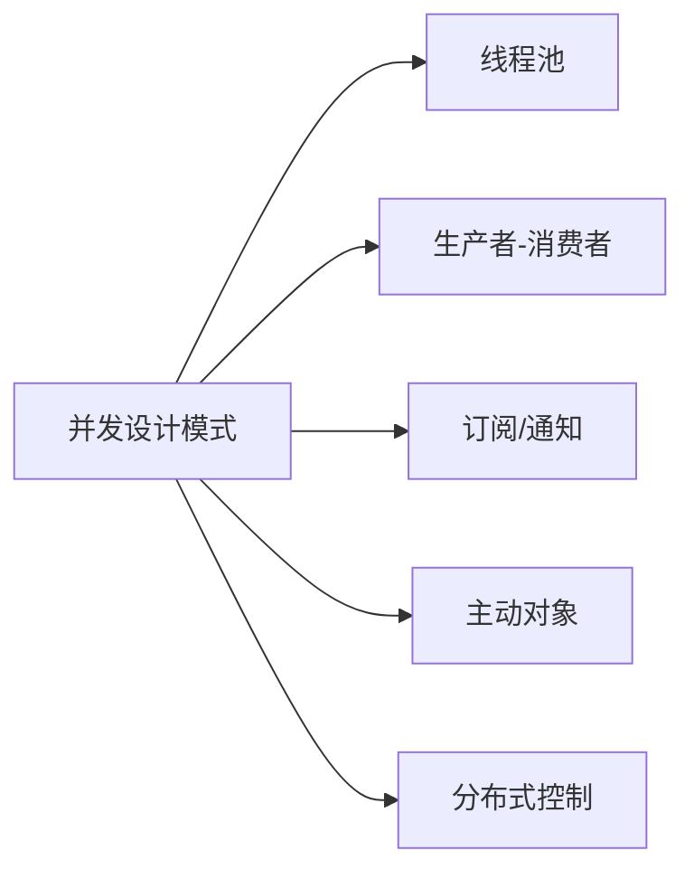
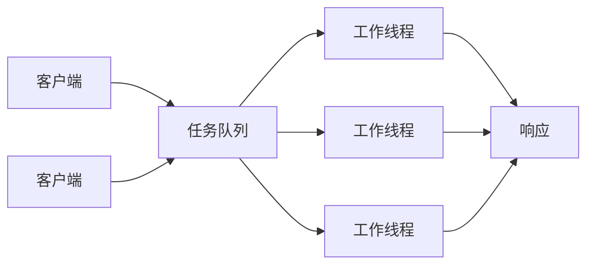

# 并发体系结构设计模式（线程池、生产者-消费者等）

## 它是什么

在需求分析阶段我们画的是"对象协作图"，到了体系结构阶段就要回答：**这些对象由谁、以什么方式并发执行**。并发体系结构设计模式就是一组经过验证的**多任务/多线程组织套路**，把"并发"这件事从临时拼凑的 if-else + 线程，变成可复用、可推理的结构。

常见模式有：

| 模式 | 一句话概括 | 典型场景 |
|---|---|---|
| ==线程池== | 预先创建一组线程，重复使用处理请求 | Web 服务、RPC 服务器 |
| ==生产者-消费者== | 通过缓冲区解耦"产生"与"消费" | 日志、消息队列 |
| ==订阅/通知（观察者）== | 一个消息发给**一组登记成员** | 事件分发、UI |
| ==主动对象== | 方法调用被排队，由对象自身线程执行 | 避免锁的封装 |
| ==分布式控制== | 控制功能分到多个控制构件 | 分布式嵌入式 |
| ==控制任务== | 专门控制其他任务的任务 | 实时调度 |

## 为什么需要

如果每个客户端请求都 `new Thread()`，并发量一高就会：线程创建/销毁开销大、资源耗尽、响应时间不可预测。先问一句：*一个并发服务应该用"一个对象"还是"多个对象"响应请求？*——是 ==多个对象==，每个请求由一个（池中的）对象并发处理，而不是让一个对象排队阻塞。类似地，==生产者-消费者== 用一个有限缓冲区（循环队列）把速率不同的两端解耦，==订阅/通知== 把"一条消息"扇出给**一组已登记的接收者**（注意不是广播给所有人）。

## 怎么做

以线程池 + 生产者-消费者组合为例：

要点：

- **入队/出队加锁**（或用条件变量），缓冲区满则生产者阻塞，空则消费者阻塞。
- ==控制任务== 负责启动/停止/监控其他任务，本身不干业务。
- ==分布式控制== 则把控制功能**分置到多个控制构件**，通过构件间协调提供整体控制（不是"一个中央构件管所有 I/O"）。

## 和相近概念的区别

| 名称 | 关注点 | 与并发模式的关系 |
|---|---|---|
| 设计模式（GoF） | 类/对象协作 | 观察者是其一，但并发模式强调**执行体** |
| 体系结构风格（C/S、分层） | 宏观构件拓扑 | 并发模式是风格之下的**任务组织** |
| 语言级线程 API | 编程细节 | 模式是 API 之上的抽象 |

## 一个算对了的例子

> 订阅/通知模式的通信特点？

四个选项看似都沾边：A 说"一个发送给若干接收者"、C 说"发给所有接收者"、D 说"发给一个组的所有登记成员"。==正确是 D==：**观察者必须先登记（subscribe）**，消息只发给该组已登记成员，A 漏了"登记"，C 的"所有"是广播不是订阅。

> [!WARNING]
> 常见坑：把"订阅/通知"当广播、把"控制任务"当普通 I/O 任务、把"分布式控制"误解为"对多个 I/O 对象做控制"。记住三条关键词：订阅=**登记组**、控制任务=**管任务**、分布式控制=**控制功能分置**。

> [!TIP]
> 记忆口诀：池**复用**、队列**解耦**、订阅**登记**、控制**分置**。
