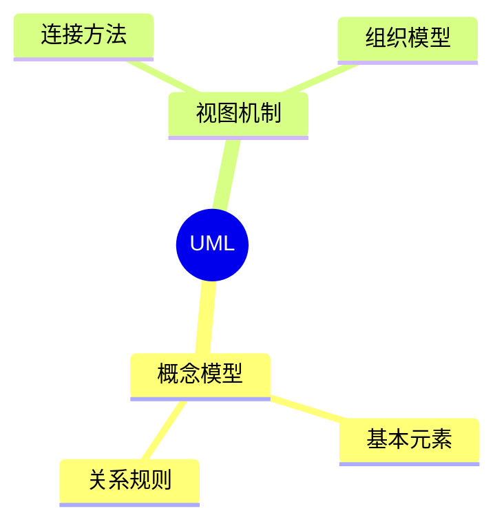

# 建模语言与UML概述

## 什么是建模语言与UML

在编写代码之前，我们如何准确描述一个复杂软件系统的结构、行为与交互？自然语言容易产生歧义，而编程语言又过于底层。==统一建模语言（UML）正是为解决这一矛盾而生的标准化可视化建模语言==。它不是编程方法，也不是开发过程，而是一种用于规约、构造和文档化软件系统制品的通用图形语言。

> [!IMPORTANT]
> UML 是“语言”而非“方法”。它提供表达符号，但不规定开发步骤；具体怎么用、何时用，取决于所选的开发过程或方法学。

## 为什么需要UML

软件开发涉及需求方、设计师、开发者等多类角色，沟通成本高。UML 通过标准化的图形符号消除语义模糊，使不同背景的利益相关者能在同一抽象层次上交流。更重要的是，它将抽象思维具象化，帮助团队在编码前发现设计缺陷，降低后期返工成本。

## UML概念模型与视图机制

UML 的核心在于其==概念模型==，它定义了建模的基本元素（如类、对象、用例、状态等）及其关系。但仅有元素还不够——如何将语言与实际开发衔接？答案是通过“视图”。

> [!NOTE]
> 视图是把建模语言和系统开发时选择的方法或过程连接起来的桥梁。例如，RUP 中的“4+1视图”就是利用 UML 图从不同角度刻画系统。

## 多态：UML中关键的行为语义

在使用 UML 描述类图或序列图时，常需表达“同一操作在不同类中有不同实现”的现象，这正是==多态==。理解多态对正确绘制继承与消息传递至关重要。

考虑以下典型考题：

> 在面向对象设计中多态意味着：
> A. 不同的类可以有相同的名字  
> B. 不同的类可以有相同的接口名  
> C. 不同的类可以有相同的超类名  
> D. 不同的类可以有相同的操作名  

正确答案是 **D**。多态的本质是==不同类对同名操作具有各自独立的实现==，调用时根据实际对象类型动态绑定。选项 A、B、C 描述的是命名或继承结构，并非多态本身。

> [!WARNING]
> 切勿将“接口相同”等同于多态。接口一致只是前提，多态强调的是==运行时行为的差异化响应==。

## 常见误区辨析

| 概念 | 正确理解 | 常见错误 |
|------|----------|----------|
| UML vs 方法 | UML 是表达工具 | 误以为 UML 包含完整开发流程 |
| 多态 vs 重载 | 多态基于继承+动态绑定 | 混淆编译期重载与运行期多态 |
| 视图 vs 图 | 视图是逻辑分组，图是实例 | 认为一张图就是一个视图 |

> [!TIP]
> 记忆口诀：“UML 画什么，方法定怎么用；多态看操作名同、实现异、运行时决。”

掌握这些要点，才能在《软件建模与设计》课程中既读懂 UML 图，又避免概念混淆，为后续用例建模、类图设计打下坚实基础。
