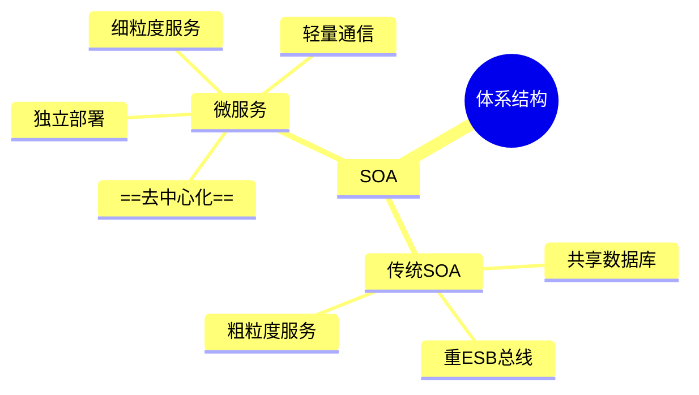
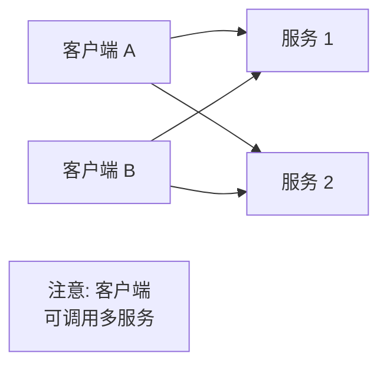

# 微服务架构（Microservices）及其与SOA的关系

# 微服务架构（Microservices）及其与SOA的关系

## 它是什么：从单体到服务的演进

微服务架构是一种将单一应用程序开发为一组小型服务的方法，每个服务运行在自己的进程中，并通过轻量级机制（通常是 HTTP API）进行通信。这些服务围绕业务能力构建，并可通过全自动部署机制独立部署。

在南邮《软件建模与设计》的语境下，我们需明确：**微服务是 SOA（面向服务的体系结构）的一种特定实现风格**，但比传统 SOA 更轻量、更去中心化。

## 为什么需要：解决单体架构的痛点

想象一下，如果整个电商系统是一个巨大的单体应用（Monolith），修改“订单模块”的一个小 Bug 可能需要重新编译、测试并部署整个系统。这导致了：
1. **耦合度高**：牵一发而动全身。
2. **扩展性差**：无法单独对高频访问模块扩容。
3. **技术栈锁定**：难以引入新技术。

微服务通过==服务解耦==和==独立部署==解决了这些问题，允许不同服务使用不同的编程语言和数据存储技术。

## 怎么做：核心特征与建模视角

在 UML 建模中，微服务通常对应于**组件图（Component Diagram）**中的物理构件或**部署图**中的节点。

- **接口定义**：每个微服务暴露清晰的 API（如 RESTful 接口）。在类图中，这表现为`<<interface>>`及其实现类。
- **数据隔离**：每个服务拥有独立的数据库，避免共享数据库带来的强耦合。
- **通信机制**：服务间通过同步（HTTP/RPC）或异步（消息队列）交互。

> [!IMPORTANT]
> 核心区别：传统 SOA 常依赖重型企业服务总线（ESB）进行消息路由和转换，而微服务倾向于==智能端点与哑管道==（Smart Endpoints and Dumb Pipes），即逻辑在服务内部，通信通道仅负责传输。

## 与相近概念的区别：微服务 vs 传统 SOA

| 特性 | 传统 SOA | 微服务架构 |
| :--- | :--- | :--- |
| **通信总线** | 重型 ESB | 轻量级 API / 消息队列 |
| **服务粒度** | 较粗，企业级 | 较细，业务功能级 |
| **数据管理** | 常共享数据库 | ==数据库私有化== |
| **部署方式** | 整体或大模块部署 | 独立容器化部署 |

## 常见的坑：分布式系统的复杂性

不要盲目拆分！微服务引入了分布式系统的固有难题：
1. **网络延迟**：远程调用比本地方法慢得多。
2. **数据一致性**：跨服务事务难以保证 ACID，需采用最终一致性。
3. **运维复杂度**：需要完善的监控、日志聚合和服务发现机制。

> [!WARNING]
> 易错点：许多学生误以为微服务就是“把类拆分成不同项目”。实际上，微服务的边界应依据==领域驱动设计（DDD）==中的限界上下文来划分，而非简单的代码结构。

## 算对了的例子：多客户端/多服务体系结构

回顾考题：*多客户端/多服务体系结构模式与多客户端/单服务体系结构模式的区别何在？*

在传统单体或单服务模式中，一个服务实例处理所有请求。而在微服务或多服务架构中：

- **选项分析**：
    - A/D 描述的是服务端并发能力，单体也能做到。
    - C 描述的是 P2P，非典型 C/S 架构。
    - **B 正确**：在多服务体系结构中，==一个客户端可以向多个服务发送请求==以完成复杂业务。例如，前端页面可能同时调用“用户服务”获取头像，又调用“订单服务”获取列表。

> [!TIP]
> 记忆技巧：微服务的核心是“分”，不仅服务分，客户端对服务的调用关系也变成了“多对多”的网状结构，而非简单的“多对一”。
