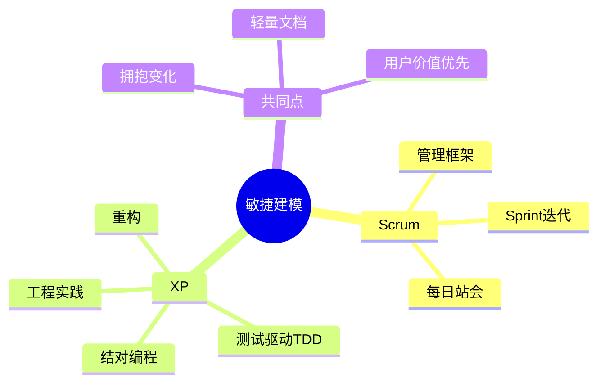
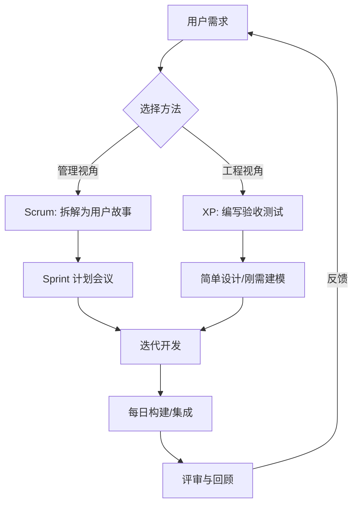

# 敏捷方法论（Scrum、XP）与建模

## 敏捷方法论与建模的融合

在《软件建模与设计》第2章中，我们探讨软件开发过程。传统瀑布模型强调“先建模后编码”，而**敏捷方法论**（Agile）则主张迭代与增量。南邮课程重点考察两种典型敏捷方法：**Scrum** 与 **极限编程（XP）**，以及它们如何与 UML 建模共存。

> [!IMPORTANT]
> 核心观点：敏捷并非抛弃建模，而是==轻量级建模==。模型不再是厚重的文档，而是沟通的工具和设计的草图。

### Scrum 与 XP 的核心区别

Scrum 侧重于**管理框架**，XP 侧重于**工程实践**。二者常结合使用。

| 特性 | Scrum | 极限编程 (XP) |
| :--- | :--- | :--- |
| **核心角色** | Product Owner, Scrum Master, Team | 程序员、客户、教练等 |
| **关键制品** | Product Backlog, Sprint Backlog | 用户故事、测试代码、结对代码 |
| **建模方式** | 仅在 Sprint 规划时做必要分析 | ==刚需建模== (Just-in-time Modeling) |
| **反馈周期** | Sprint (通常2-4周) | 极短迭代 (1-2周)，持续集成 |

### 为什么需要敏捷建模？

在传统 RUP（统一软件开发过程）中，建模贯穿整个生命周期。但在需求频繁变更的场景下，详尽的 upfront 设计往往导致浪费。
*   **过滤现实**：建模是对现实系统的过滤。敏捷建模只过滤出==当前迭代==最核心的逻辑。
*   **沟通媒介**：UML 图（如用例图、类图）用于团队内部对齐理解，而非交付给客户的最终文档。

> [!TIP]
> 记忆口诀：Scrum 管节奏，XP 抓质量；建模为沟通，代码即文档。

### 怎么做：敏捷中的建模实践

1.  **用例建模（需求层）**：
    *   在 Scrum 中，Product Backlog 的条目通常源自**用例**。
    *   使用 UML 用例图识别参与者（Actor）和系统边界。
    *   *注意*：不要过度细化用例流，只需覆盖主成功场景和关键异常。

2.  **静态与动态建模（设计层）**：
    *   **白板建模**：XP 提倡在白板上画类图或序列图，讨论完后擦除，仅保留关键结构到代码中。
    *   **测试驱动开发 (TDD)**：在 XP 中，单元测试代码本身就是一种可执行的“动态模型”，它规定了对象的行为契约。

### 常见误区与坑

> [!WARNING]
> **误区1：敏捷 = 无文档/无模型**。
> 错！敏捷反对的是*过时的*、*无人阅读的*文档。关键的架构决策、接口定义仍需通过 UML 或架构图记录，否则后期维护成本极高。

> [!CAUTION]
> **误区2：混淆 Scrum 角色与 XP 实践**。
> 考试中若问及“结对编程”属于哪个框架，应选 XP；若问及“Sprint 回顾会议”，应选 Scrum。

### 算对了的例子：家庭图书管理系统

假设我们要开发一个“家庭图书管理”模块。

*   **传统做法**：花2周画出完整的类图、序列图、状态图，再开始写代码。
*   **敏捷做法（XP + Scrum）**：
    1.  **用户故事**：“作为管理员，我希望录入新书，以便库存更新。”
    2.  **刚需建模**：在白板上画出 `Book` 类和 `Library` 类的简单关联，确认属性（ISBN, Title）。
    3.  **TDD**：先写测试 `testAddBook()`，断言库中书籍数量+1。
    4.  **实现与重构**：编写代码通过测试，随后重构代码结构，此时可能发现需要引入 `Category` 类，再更新白板模型。

在这个过程中，UML 模型是**演化**的，它服务于当前的代码实现，而非束缚未来的变更。
