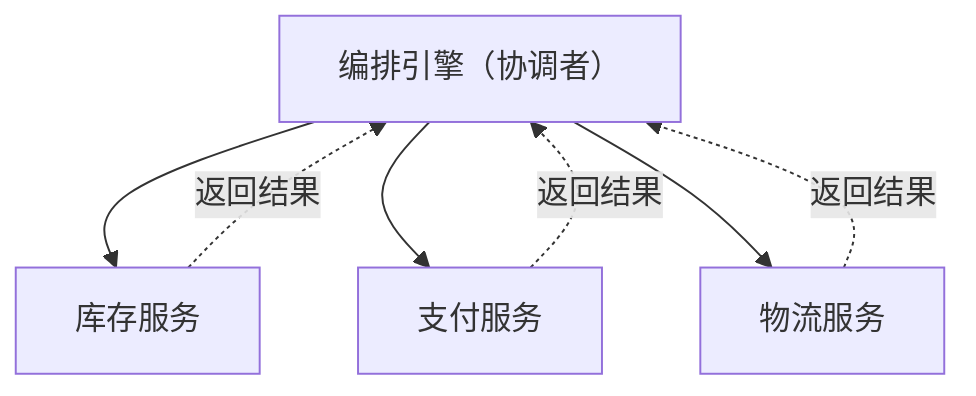
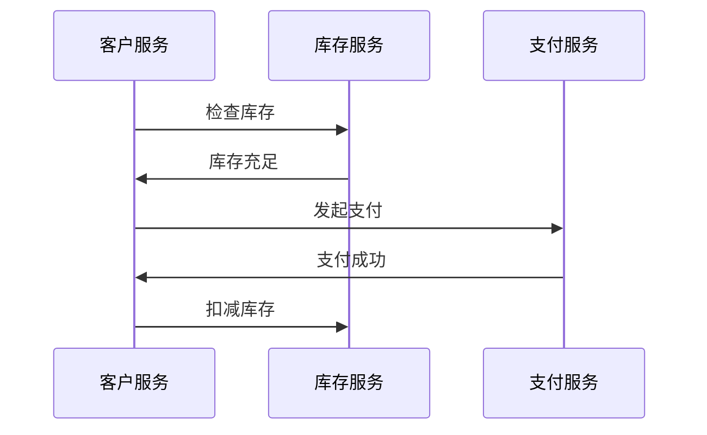

# 服务契约（Service Contract）与服务编排（Choreography）、服务编排（Orchestration）

## 服务契约、服务编排与服务协同

先看一个场景：电商系统中，下单服务需要调用库存服务和支付服务。下单服务怎么知道库存服务能提供什么操作、参数长什么样？如果库存服务由另一个团队开发，双方如何约定接口？这就是**服务契约**要解决的问题。

### 服务契约是什么

**服务契约（Service Contract）** 是服务提供者与服务消费者之间关于“如何调用服务”的正式约定。它通常包含：

| 契约要素 | 说明 | 示例 |
|---------|------|------|
| 服务接口 | 服务提供哪些操作 | `checkStock(itemId, quantity)` |
| 消息格式 | 输入输出的数据结构 | XML Schema / JSON Schema |
| 协议与地址 | 通过什么协议、在哪里调用 | SOAP over HTTP，`/inventory` |
| 服务质量约束 | 性能、安全等非功能性约定 | 响应时间 < 200ms |

> [!IMPORTANT]
> ==服务契约的核心目标是让调用方不依赖提供方的实现细节，只依赖契约本身。== 这就像插座与插头之间只需约定“两孔/三孔、220V”，而不需要知道发电厂内部怎么运转。

**为什么需要服务契约？**  
没有契约，服务消费者只能通过口头沟通或阅读源码来调用服务，这违背了面向服务架构“自治、松耦合”的初衷。契约让双方独立演化——提供方可以重写内部逻辑，只要契约不变，消费者无感知。

### 服务编排（Orchestration）

当一个业务流程需要协调多个服务时，谁来控制调用顺序？**服务编排**引入一个中央协调者（通常是一个可执行的业务流程，如 BPEL 流程引擎），由它来决定：

- 先调用哪个服务、后调用哪个服务
- 如何处理条件分支和异常
- 如何在服务之间传递数据

> [!NOTE]
> 编排中有一个明确的“中心节点”掌控全局。这与乐团指挥（Orchestra）的比喻一致：每位乐手按照指挥的节拍演奏。

### 服务协同（Choreography）

**服务协同**则没有中央协调者。各服务只需约定好彼此交换消息的规则（通常是一个协同契约），每个参与者自己决定何时发送消息、如何响应。继续用比喻：协同更像广场舞——每个人按既定舞步动作，看见别人转圈就跟着转，没有指挥。

### 编排 vs 协同

| 对比维度 | 服务编排 Orchestration | 服务协同 Choreography |
|---------|----------------------|---------------------|
| 控制权 | 中央协调者（引擎） | 分布在每个参与服务中 |
| 流程可见性 | 集中在协调者，易监控 | 分散，需聚合日志才能还原 |
| 耦合度 | 服务间松耦合，但与协调者紧耦合 | 服务只依赖消息契约，整体松耦合 |
| 适用场景 | 流程复杂、需要集中管控 | 参与方独立性强、跨组织协作 |
| 故障处理 | 协调者统一处理回滚/重试 | 各方自行处理异常消息 |

> [!TIP]
> 记法：**Orchestration 有“O”就是有“老大”（协调者）**；**Choreography 看“choreo”（舞蹈）**——舞者互相配合，没有指挥。

### 服务契约与编排/协同的关系

服务契约是单次服务调用的**微观约定**；编排与协同是多服务协作的**宏观组织方式**。在协调式架构中，编排引擎本身也通过各服务的契约调用它们；在协同式架构中，服务间交换的消息格式由协同契约描述，这个契约本质上也是一种服务契约的扩展。

### 结合上面考试的题目

**例题 1（选择题 1）**：关于协商模式，不正确的是 D——“服务主体可以提供一个服务方案报价作为对一个客户主体的服务请求的响应”。

为什么 D 错？在协商模式中，客户先发出**服务提议**（proposal），服务方以**方案报价**响应；而若客户发出的是**服务请求**（request），服务方的响应是**接受或拒绝**，而非报价。请求是“我要执行这个服务”，提议是“我在考虑可能的方案”，两者的响应语义不同。

**例题 2（选择题 7）**：服务不应是“固定的”。服务具有**可复用、可发现、自治**等特性。“固定”与服务动态发现、可替换的核心思想冲突。

**例题 3（选择题 8）**：代理（broker）对服务请求者的价值在于——请求者知道所需服务的类型但不知道确切的服务实例。代理充当注册表，将抽象的服务类型映射到具体的服务提供者地址。

> [!WARNING]
> 选择题 2 的 A 选项“使得服务请求者可以发现它”是服务注册到代理者的原因。但注意不要混淆：**服务注册到代理者 ≠ 服务被重新定位**，后者是代理者可能附加的功能，但非注册的根本目的。

### 常见的坑

1. **误以为编排中的服务之间可以直接互相调用**。在严格编排中，服务间不直接通信，所有交互都经过协调者转发。
2. **误以为协同模式完全没有契约**。协同同样需要契约，只是契约描述的是参与者之间的消息交互协议，而非单一服务的接口。
3. **把服务契约等同于 WSDL**。WSDL 是 Web 服务的一种契约描述方式，但契约还可以用其他形式（如 REST 的 OpenAPI 规范）表达。
