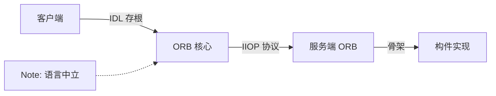

# 构件技术标准（CORBA、COM、EJB等）

# 构件技术标准（CORBA、COM、EJB）

在基于构件的软件体系结构中，**构件**是可独立部署和替换的二进制单元。但不同厂商的构件如何“对话”？这就需要==构件技术标准==作为中间件规范，屏蔽底层语言与操作系统的差异。

## 为什么需要标准？

想象一下：用 C++ 写的 COM 组件想调用 Java 写的 EJB 服务，如果没有统一标准，两者就像讲不同方言的人，无法直接通信。
> [!IMPORTANT]
> 核心作用：**互操作性**。通过定义标准的接口描述语言（IDL）和通信协议，实现跨语言、跨平台的构件复用。

## 三大主流标准对比

| 特性 | CORBA | COM/COM+ | EJB |
| :--- | :--- | :--- | :--- |
| **主导方** | OMG | Microsoft | Sun (Oracle) |
| **语言依赖** | 语言中立 (IDL) | 主要 Windows/C++ | Java 专用 |
| **核心机制** | ORB (对象请求代理) | DLL/注册表 | JVM/RMI |
| **典型场景** | 异构系统集成 | Windows 桌面/服务器 | Java EE 企业应用 |



## UML 中的构件表达

在《软件建模与设计》中，UML 构件图不仅画代码文件，更映射具体的技术标准实例：
- **配置构件**：如 `.dll` (COM)、`.jar` (Java Beans)、Web 页、数据库表。
- **执行构件**：运行时驻留内存的实例，如 COM+ 对象进程。

> [!TIP]
> 记忆技巧：**COM 看注册表，EJB 看容器，CORBA 看 IDL**。

## 常见误区与坑

1.  **混淆接口与实现**：构件标准定义的是**接口规范**，而非具体代码。例如 CORBA 的 IDL 只定义方法签名，不定义逻辑。
2.  **忽视部署环境**：EJB 必须运行在 EJB 容器中（如 WebLogic），不能像普通 Java 类直接 `new`。
3.  **UML 符号误用**：在构件图中，COM+ 对象应标记为 `<<executable>>`，而接口定义为 `<<interface>>`。

> [!WARNING]
> 考试高频点：区分**物理视图**（DLL/JAR）与**逻辑视图**（Interface）。题目若问“执行构件”，必选运行时实例（如 DLL 加载后的内存对象）。

## 典型例题解析

**题目**：某系统需集成遗留的 C++ 模块（Windows 平台）与新的 Java Web 服务，最适合的构件标准组合是？
A. 仅用 COM
B. 仅用 EJB
C. CORBA 桥接 COM 与 Java
D. 纯文本文件交换

**解析**：
- A、B 均具有平台或语言局限性。
- D 效率低且无类型安全。
- ==C 正确==：CORBA 设计初衷即为解决异构系统互操作，可通过 IDL 映射连接 C++ (COM) 与 Java。

```mermaid
sequenceDiagram
    participant C as C++构件
    participant O as CORBA ORB
    participant J as Java构件
    C->>O: 请求 (IDL)
    O->>J: 转发 (IIOP)
    J-->>O: 返回结果
    O-->>C: 封装返回
    Note over C,J: 跨语言透明调用
