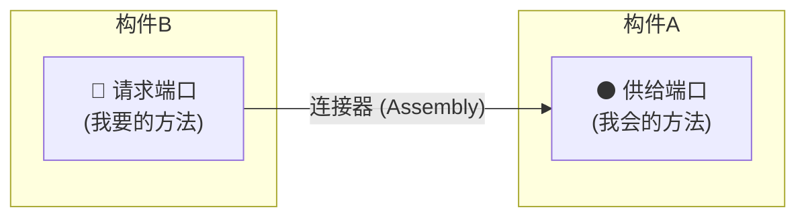

# 构件模型（Component Model）与构件接口规范

## 构件模型与构件接口规范

在软件体系结构设计中，我们需要一种方式将系统拆解为可替换、可独立部署的单元，这就引出了“构件”的概念。

### 什么是构件？

想象一下组装一台电脑。你不需要从晶体管开始制作，而是直接选购显卡、内存条、硬盘。这些零部件各自封装了复杂的内部结构，只通过标准化的插槽（接口）与外界交互。软件工程中的==构件（Component）==正是这样的“软件零部件”。

根据这门课的考核要点，你需要明确构件**不是**什么：

> [!IMPORTANT]
> 构件是一个**复合对象**或**简单对象**，它对外**提供接口**，但它绝对不是一个**操作**（操作是接口内部的具体实现细节）。

这直接解释了那道选择题：“一个操作”之所以错误，是因为构件是功能的**载体**，而非功能本身。

### 为什么需要构件模型？

构件模型定义了构件的**外在形态**与**交互规则**。在 UML 中，我们通过三种具体的制品来理解构件：

1.  **配置构件 (Deployment Component)**：运行时存在的物理替代品，如一个 `.dll` 或 `.exe` 文件。
2.  **工作产品构件 (Work Product Component)**：开发过程的产物，如源码文件或数据库表脚本。
3.  **执行构件 (Execution Component)**：正在运行的实例，因执行配置构件而产生。

### 构件接口规范：供给与请求的协作

如果说构件像一块拼图，那么“接口”就是拼图的凹凸边缘。构件之间必须==严格匹配接口才能连接==。

接口分为两类，我们需要通过一道题的逻辑来推导：

-   **供给接口 (Provided Interface)**：构件**对外承诺**能完成的功能。
    -   **问题**：选择题问“供给接口包含什么？”
    -   **推理**：既然是“供给”给别人的，它必须是构件**内部必须实现的操作**。如果只是内部私有操作而不对外公开，那就不能叫“供给接口”。
    -   **结论**：==供给接口包含构件必须实现的操作==。
-   **请求接口 (Required Interface)**：构件**为了完成自身功能**，需要外界提供的服务。
    -   **推理**：这是构件在向外界“索要”功能，表明它**依赖**某些操作。这些操作不是它自己能做的，而是它**需要使用的**。
    -   **结论**：==请求接口包含构件需要使用的操作==。

> [!TIP]
> **记忆技巧**：供给接口是“我会什么”，请求接口是“我要什么”。

### 如何连接？连接器与委托的规则

构件之间的连线不是随意的，必须遵循严格的供需匹配原则。在考题中，这部分是高频易错点：

**装配连接器 (Assembly Connector)** 的规则是：==一个构件的供给端口连接到另一个构件的请求端口==。必须是由“需要服务”的一方，指向“提供服务”的一方。

**委托连接器 (Delegation Connector)** 发生在复合构件内部。它连接的是：
==外层请求端口到内层供给端口==。

> [!WARNING]
> **常见陷阱**：考试中常把“请求”和“供给”的顺序调换来迷惑人。
> *   **错**：外层供给端口 → 内层请求端口（这是把活往外推，不合逻辑）。
> *   **对**：外层请求端口 → 内层供给端口（外部向复合构件要功能，复合构件把该请求**委托**给内部能实现该功能的子构件）。

### 实战例题解析

让我们用这些规则秒杀文首的真题：

-   **关于构件的描述**：选“一个操作”，因为构件包含多个操作，是操作的集合体，而非单一动作。
-   **构件接口包含**：选“构件外部可见的操作”。接口的定义就是封装后对外暴露的可见部分，不论供给还是请求，最终在该接口上都是可见的行为集合。
-   **连接器连接**：选“一个构件的供给端口到另一个构件的请求端口”。再次强调，要遵循“由需连供”的物理逻辑。
