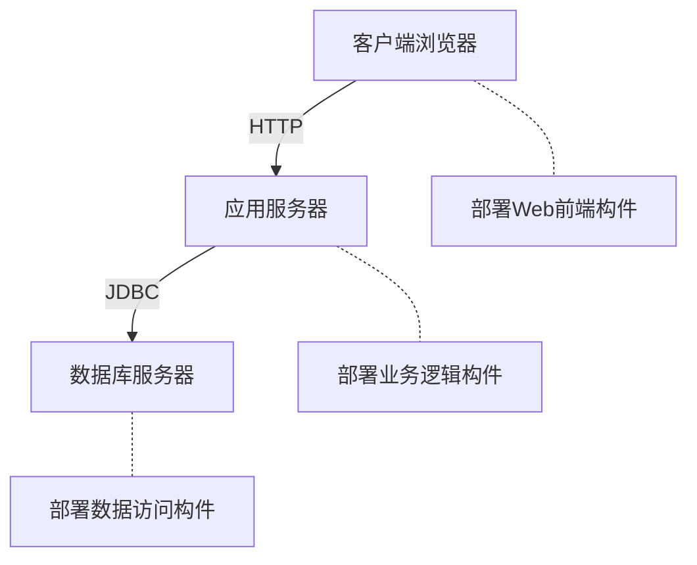

# 构件组装（Component Composition）与部署

## 构件组装与部署

我们先用一个问题开始：当系统由多个构件组成时，这些构件如何协同工作？又如何将它们最终放到真实的服务器上运行？

这就引出了两个关键动作——**构件组装**和**部署**。

### 构件如何连接：组装基础

构件通过**接口**对外暴露功能。在基于构件的软件体系结构中，接口分为两类：

- **供给接口（Provided Interface）**：构件对外承诺“我能做什么”，包含构件==必须实现的操作==。
- **请求接口（Required Interface）**：构件声明“我需要别人做什么”，包含构件==使用的操作==。

组装时，连接器将一个构件的供给接口与另一个构件的请求接口相连。这样，构件之间就能按“提供-使用”的关系完成调用。

> [!IMPORTANT]
> 一个构件的供给接口连接另一个构件的请求接口，而不是同类接口互连。记住这个方向，就不会在接口匹配题上出错。

下面这张图展示了一个简单的组装关系：

### 为什么需要部署图

构件图描述构件的逻辑依赖和组装关系，但它不回答“软件系统最终跑在哪些机器上”。==只有部署图（Deployment Diagram）才能表示系统运行时的物理拓扑结构。==

部署图包含两种核心元素：

- **节点（Node）**：物理硬件或虚拟机，如服务器、客户端。
- **构件实例**：部署在节点上的软件制品。

UML 中，构件图只表示构件的“型”，而==构件的实例形式必须通过部署图表示==。构件代表物理事物，类代表逻辑抽象，因此构件可以放入部署图的节点中，而类不能。

> [!WARNING]
> 常见误区：以为在构件图中就能完成所有物理部署的建模。实际上，构件图不表示实例，部署图才能描述构件实例运行在哪些节点上。

### 部署图的种类与画法

课件中提到了三类构件，都可以出现在部署图中：

1. **配置构件（Deployment Component）**：如动态链接库（DLL）、可执行文件，构成可运行系统。
2. **工作产品构件（Work Product Component）**：开发的产物，如源文件、数据文件。
3. **执行构件（Execution Component）**：系统运行时创建的构件实例。

绘制一个典型的客户机/服务器系统部署图，通常有四步：
1. 确定节点（客户端、服务器、数据库服务器等）。
2. 确定节点间通信路径（如 HTTP、TCP/IP）。
3. 将构件实例放入对应的节点。
4. 标注节点间的关联关系。

### 增量部署与组合关联

课件强调“保证系统处于可部署状态，不允许出现问题的积累”，这指向了**增量部署**的理念：每完成一部分构件，就进行部署验证，而不是所有构件开发完再统一部署。这种方式可以早发现接口不匹配或环境问题。

在关联关系上，要区分：
- **普通关联**：构件间有交互，但生命周期独立。
- **组合（Composition）**：==一种强关联==，表示整体与部分的生命周期绑定关系。如果一个部署单元是另一个的组成部分，就用组合来建模。

### 例题解析

回顾一道典型的选择题：

> 在基于构件的分布式软件体系结构中，下列有关构件部署的说法哪个最全面？
> **答案：D. 在设计和实现之后，构件实例能够部署在分布式地理环境中的不同结点上。**

为什么不是“在设计前”或“实现前”？因为部署的本质是将==已经完成设计和实现的构件==分发到物理节点上运行。设计和实现是部署的前提条件，顺序不可颠倒。

> [!TIP]
> 部署图建模时，先问自己三个问题：运行在哪些机器上？每个构件放在哪里？它们怎么通信？按这个顺序画图，就不会漏掉关键信息。
