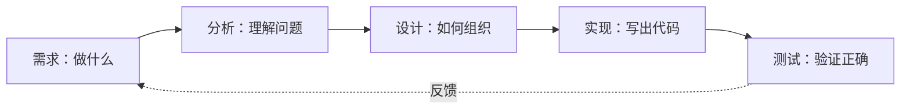
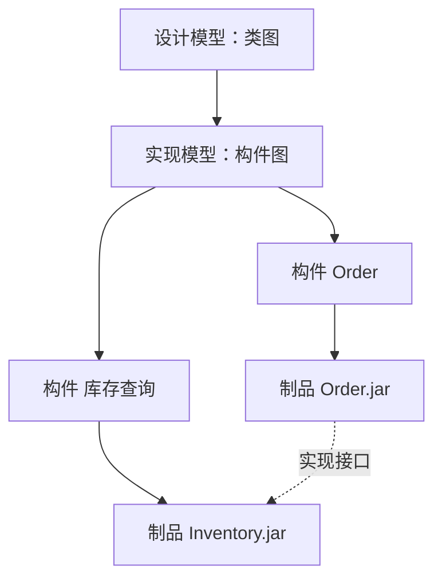
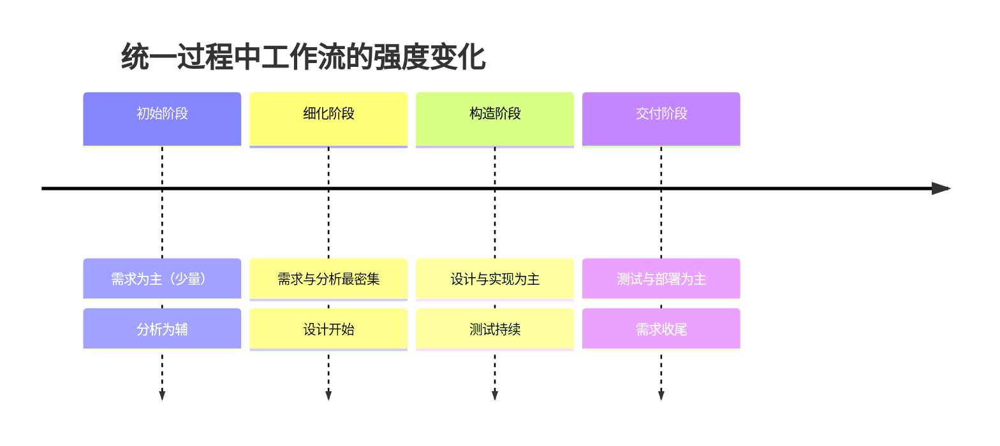

# 统一过程的核心工作流（需求、分析、设计、实现、测试）

## 统一过程的核心工作流

统一过程（Unified Process，UP）将软件开发划分为**四个阶段**（初始、细化、构造、交付）和**五个核心工作流**（需求、分析、设计、实现、测试）。阶段是时间的维度，工作流是内容的维度。一个工作流在生命周期中会跨多个阶段出现，只是在各阶段的**侧重点和强度不同**。

> [!IMPORTANT]
> ==工作流不是阶段==。阶段回答“我们走到哪了”，工作流回答“我们正在做什么类型的活”。在统一过程中，五个工作流在迭代中反复出现，而非像瀑布模型那样一次性顺序走完。

### 为什么需要区分五种工作流

软件开发最大的风险之一，是**过早绑定于某一层次的细节**。如果把“用户要什么”和“代码怎么写”混在一起讨论，需求变更时整个模型都会崩塌。统一过程用五个工作流做**关注点分离**：

- **需求**关注“问题空间”——用户需要什么；
- **分析**关注“问题空间的模型”——现实世界中的概念及其关系；
- **设计**关注“解空间的结构”——系统如何组织、类如何协作；
- **实现**关注“解空间的可执行形式”——代码和构件；
- **测试**关注“验证”——每一层工作流是否被正确转化。

### 五个工作流分别做什么

**需求工作流**：核心活动是需求捕获。通过用例建模精确化、完全化用户需求，描述系统的功能需求和非功能需求。主要产物是用例模型和需求规格说明。问题导向是“==系统该为用户做什么==”。

**分析工作流**：在需求的基础上建立分析模型，用三种分析类来组织对问题域的理解：

| 分析类 | 职责 | 示例 | 定位时机 |
|--------|------|------|----------|
| 边界类 | 系统与外部参与者的交互 | 录入窗口、提交按钮 | 从用例中找交互点 |
| 控制类 | 协调用例中的业务逻辑 | 借书控制器 | 每个用例通常对应一个 |
| 实体类 | 系统需要长期保存的信息 | 书籍、借阅记录 | 从需求描述中提取名词 |

分析阶段只关注**领域概念**，不关心线程、数据库、界面框架等技术细节。

**设计工作流**：将分析模型转换为设计模型，回答“怎么做”。引入技术方案，包括：类的完整定义（属性、操作、可见性）、类之间的关系细化、包结构规划、设计模式的应用。此时“书籍”可能变成 `Book` 类并用 Java 实现，控制类可能被分布到前端控制器和服务层。

**实现工作流**：把设计模型映射到可执行代码。在构件图中，类被打包成构件，构件由制品（如 JAR 文件）实现。例如构件 `Order` 由 `Order.jar` 实现，构件通过接口建立依赖关系。

**测试工作流**：在每次迭代中验证各工作流的产出。测试驱动开发（TDD）在统一过程的敏捷变体中尤其重要：先写测试，再写实现，每次改动后运行自动化测试守住质量底线。

### 在迭代中的分布

五个工作流在不同阶段的**强度**不同：

细化阶段的需求捕获与**分析工作高度重叠**——边捕获需求边建立分析模型；构造阶段建模焦点从分析**转向设计**，实现工作流逐步主导。

> [!WARNING]
> 常见误解：把“分析”理解为画类图，“设计”理解为画时序图。实际上，分析模型中的交互图描述的是**业务概念间如何协作完成用例**，而设计模型中的交互图描述的是**软件类之间的方法调用**。两者用同一种 UML 图，但抽象层次不同。

> [!TIP]
> 判断当前在哪个工作流，可以问一个问题：**如果把“用 Java 实现”这个条件删掉，模型是否依然成立？** 成立的是分析模型；依赖于语言、框架、分布方案的是设计模型。

### 一个贯穿性例子：家庭图书管理系统

需求陈述（节选）：“系统应将书籍按计算机类、非计算机类分别建档，实现按书名、作者、类别、出版社等组合查询；录入时自动生成书号；可修改但不能删除；记录外借情况并显示列表；可按时限统计购买金额与册数。”

**需求工作流**：识别参与者“图书管理员”，用例有“录入新书”“查询书籍”“记录外借”“统计购书”等。用例图中不出现技术细节。

**分析工作流**：从需求文本中提取名词，识别实体类 `书籍`、`借阅记录`；从交互中找边界类 `录入窗口`、`查询窗口`；为每个用例设置控制类，如 `借书控制器`。分析模型不需要考虑数据库表结构。

**设计工作流**：确定 `Book` 类的属性（书名、作者、书号、类别）和操作（查询、修改）；确定 `Book` 与 `BorrowRecord` 的关联为一对多；设计查询控制类如何协调边界类与实体类。此时可以引入具体技术方案，如持久化框架。

**实现工作流**：将 `Book` 类打包为 `library-core.jar` 构件；`录入子系统` 构件依赖 `library-core.jar` 提供的接口。

**测试工作流**：针对“录入时自动生成书号”编写测试用例——录入两本书，验证书号唯一且按规则生成；针对“不能删除”回归测试——调用删除操作，系统拒绝执行。

> [!NOTE]
> 统一过程的五个工作流与 UML 图并非一一绑定，但存在自然对应：需求→用例图，分析→分析类图与交互图，设计→完整类图、包图、状态图，实现→构件图、部署图，测试→用例场景驱动的测试用例。

==核心结论==：五个工作流通过关注点分离，让开发者在正确的抽象层次上思考。需求与分析回答“是什么”，设计与实现回答“怎么做”，测试贯穿始终验证转化的正确性。
