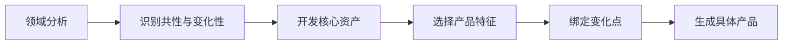

# 核心资产（Core Assets）的识别与开发

## 什么是核心资产

核心资产（Core Assets）是软件产品线（SPL）中==面向多个产品复用的公共资产==，包括公共需求、领域模型、产品线体系结构、可复用构件、接口、测试用例及开发文档等。它们不是某个产品临时留下的代码，而是经过统一规划、能够支持产品族开发的资产。

可以把 SPL 成员理解为“核心部分＋变化部分”：

$$
P_i=C\cup V_i
$$

其中，$C$ 表示各产品共同需要的部分，$V_i$ 表示产品 $i$ 根据特征选择加入的变化部分。核心资产开发关注的不只是 $C$，还要为不同 $V_i$ 的复用和组装提供基础。

## 为什么需要核心资产

如果每个产品都从零开发，相同需求会被重复分析，公共构件会被重复实现，缺陷也可能在多个产品中反复出现。核心资产开发将“一次性建设、多个产品复用”作为目标，有助于缩短开发周期、降低维护成本，并保持产品族在接口、质量和体系结构上的一致性。

## 如何识别与开发

识别时，先确定产品线的领域范围，再比较各产品的需求，区分==共性==与==变化性==。共性是多个产品稳定共享的能力；变化性则通过可选特征、互斥特征、参数或不同实现来表现。识别不能只看“现在有没有相同代码”，还要考虑资产是否稳定、是否具有复用价值，以及变化能否被清楚管理。

开发时通常按以下步骤进行：

1. 建立公共领域模型和特征模型，明确特征之间的依赖与约束。
2. 设计产品线参考体系结构，划分公共部分与变化部分。
3. 在体系结构中设置变化点，并规定允许的变体及绑定条件。
4. 将核心资产实现为带接口、文档和测试的可复用构件。
5. 在具体产品工程中，根据特征配置选择、组合并验证资产。

核心资产应随产品演化持续维护，而不是开发一次后不再调整。

## 与相近概念的区别

| 概念 | 判断标准 | 与核心资产的关系 |
|---|---|---|
| 核心类 | ==所有 SPL 成员都需要的类== | 可成为核心资产的实现组成部分 |
| 默认类 | 未作特殊选择时默认采用的类 | 不一定被所有成员实际使用 |
| 可选类 | 根据产品特征选择加入的类 | 支持变化性，不等于核心类 |
| 核心系统 | 核心类与一些可能的默认类组成的 SPL 成员 | 是资产组合形成的基础产品 |
| 特征组 | 一个 SPL 成员中有着特定使用约束的一组特征 | 用于约束产品配置，不是“任意一组特征” |

> [!IMPORTANT]
> 核心系统不是“只由核心类组成”，而是==核心类＋可能的默认类==；核心类则必须被所有 SPL 成员需要。

## 常见误区

> [!WARNING]
> “可复用”不等于“核心”。只被部分产品选用的类可以是可复用资产，却不能因此称为核心类；可选特征也不能直接当成核心特征。

另一个常见问题是只抽取公共代码，却没有设计变化点和特征约束。这样虽然减少了重复代码，但产品配置仍可能依赖大量人工修改，难以形成真正的软件产品线。

## 例题

**题目：什么是 SPL 的核心系统？**

A. 只由核心类组成的 SPL 成员  
B. 由核心类和一些可能的默认类组成的 SPL 成员  
C. 由核心类和一些可能的可选类组成的 SPL 成员  
D. 由核心类和一些可能的实体类组成的 SPL 成员  

**答案：B。**

核心类提供所有成员共同需要的基础，默认类可以在未作特殊选择时加入，因此核心系统由二者组成。“一些可能的”说明默认类并非必然存在；可选类用于产品变化，实体类只是按业务职责划分的类，都不能用来定义核心系统。
