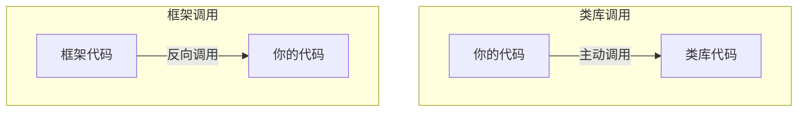
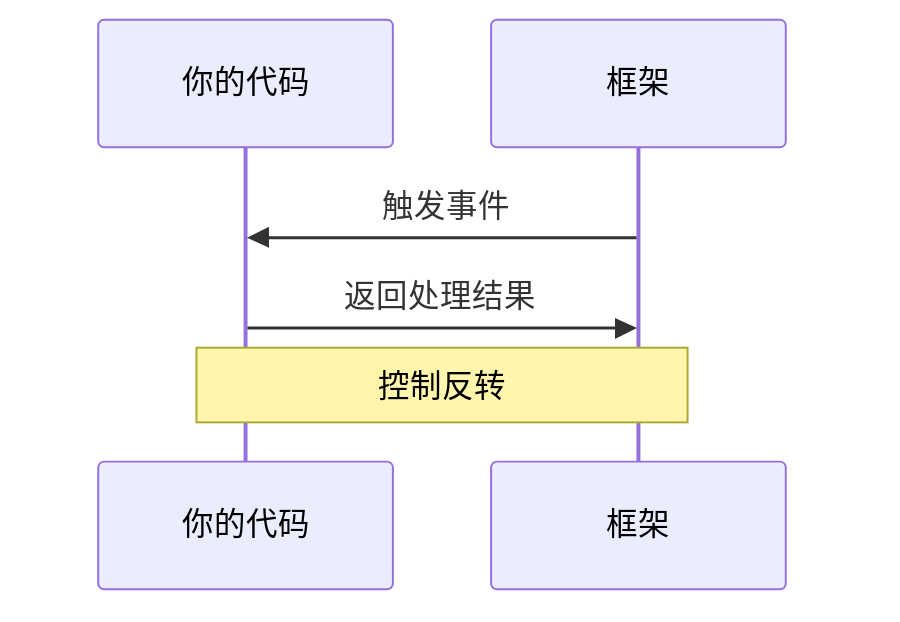

# 框架（Framework）与类库（Class Library）的区别与使用

> [!IMPORTANT]
> 核心结论：==类库是“你调用它”，框架是“它调用你”（控制反转）==。

## 它是什么

在面向对象的软件体系结构中，**类库（Class Library）**是一组可复用类的集合，提供特定功能供开发者主动调用；而**框架（Framework）**不仅包含类库，还定义了系统的整体架构骨架与控制流程。课件中提到的“细化阶段建立架构框架”，正是指用框架来确立系统的高层结构。

思考一个问题：如果你只用了一堆别人写好的类，但程序的 `main` 函数和运行顺序全由你自己决定，这算用了框架吗？不算，这只是使用了类库。

## 为什么需要

- **类库**解决的是==代码级复用==问题，避免重复造轮子（如 UML 建模中的工具类、字符串处理等）。
- **框架**解决的是==架构级复用==问题。它将传统生命周期模型并入迭代框架，更加真实地反映了现实世界，强制规定了构件之间的关系与交互模式（如 MVC），让团队协作有统一的骨架。

## 怎么做

**使用类库**时，你在自己的业务逻辑中直接实例化或调用其方法。例如，在 UML 顺序图中，你的对象向类库对象发送消息。

**使用框架**时，你需要遵循其规则进行扩展。通常利用课件中提到的“泛化关系”，继承框架提供的抽象类或实现其接口，将自定义行为注入框架预留的扩展点中。

## 和相近概念的区别

| 对比维度 | 类库 (Class Library) | 框架 (Framework) |
| :--- | :--- | :--- |
| **调用方向** | 应用程序调用类库 | ==框架调用应用程序== |
| **控制权** | 开发者掌握控制流 | 框架掌握控制流（控制反转） |
| **复用层次** | 代码级复用（单个类/函数） | 架构级复用（子系统、设计模式） |
| **UML 表达** | 表现为依赖或使用关系 | 表现为泛化、实现及包结构 |

> [!NOTE]
> 课件指出“一个系统的框架、模型、子系统等也都可以看作是特殊的包”。在 UML 中，框架常通过包图组织，内部类之间通过接口依赖，一个构件使用（输入）某个接口，另一个构件实现（输出）该接口。

## 常见的坑

> [!WARNING]
> 极易混淆的概念：把“集成多个类库”等同于“使用了框架”。即使引入了几十个类库，只要程序的主控权还在你手里，就依然不是框架。

> [!CAUTION]
> 滥用继承。框架通常要求使用泛化关系来描述公共行为，但如果为了接入框架而强行继承不需要的基类，会导致子类污染，违背“可以将子类的实例用于任何父类被声明使用的地方”的多态原则。

## 算对了的例子

以课件中的“个人图书管理系统”为例：

- **类库的使用**：系统需要按书名、作者组合查询，开发者引入一个第三方的 `StringUtils` 类库，在自己的查询逻辑中主动调用 `StringUtils.compare()` 方法。主控权在开发者。
- **框架的使用**：系统采用某 GUI 框架开发界面。开发者继承框架的 `Window` 类并重写 `onButtonClick()` 方法。当用户点击“录入新书籍”按钮时，是==框架监听到事件后反过来调用==你写的 `onButtonClick()`，且自动按规则生成书号的生命周期也由框架管控。
