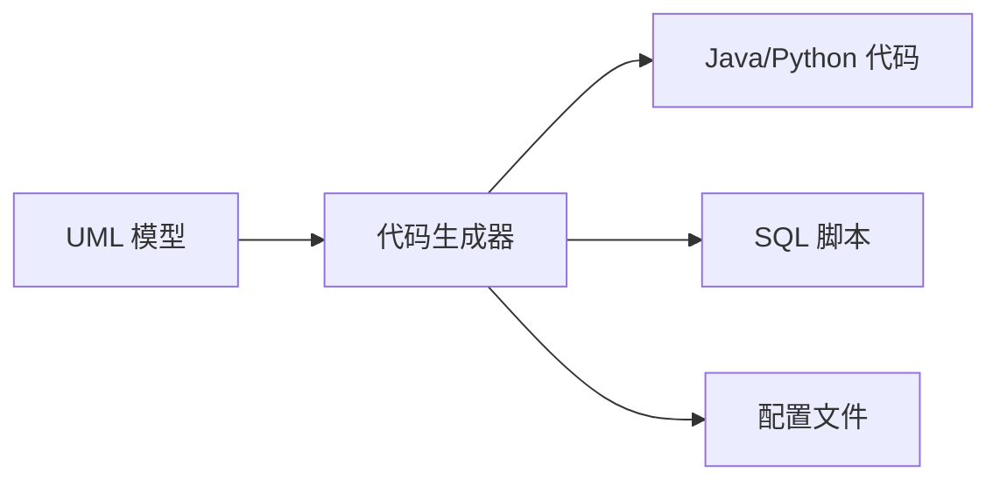
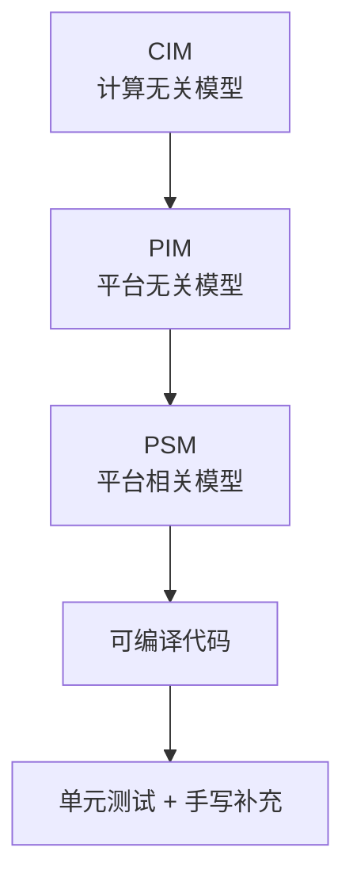
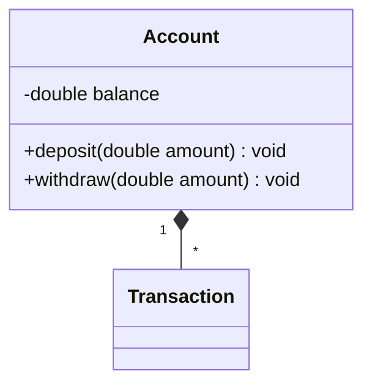

# 模型驱动开发（MDD）与代码生成
在传统软件开发中，我们画 UML 图往往只是为了“文档存档”——画完就丢在一旁，真正写代码时凭记忆和感觉来。你有没有遇到这种情况：类图里明明规定了 `Order` 有 `calculateTotal()` 方法，过了三周写代码时却忘了实现它？模型与代码脱节，正是大量返工和隐性 bug 的温床。

**模型驱动开发（Model-Driven Development, MDD）** 的核心思想就是：==把模型从“文档”升级为“开发制品”==——模型不仅是给人看的图，更是能直接生成代码的精确规格说明。



> [!IMPORTANT]
> MDD 的核心是“模型即代码的源头”：修改模型后重新生成，代码自动保持一致，不再依赖人工同步。

### 为什么需要 MDD

| 传统方式 | MDD 方式 |
|---------|---------|
| 模型画完就搁置，代码另行编写 | 模型是唯一权威来源，代码由模型生成 |
| 需求变更时图和代码都要改，容易不一致 | 只改模型，重新生成即可 |
| 不同人写的代码风格各异 | 生成器保证输出的结构一致性 |
| 重复编写 CRUD、依赖关系等样板代码 | 一次建模，自动生成样板部分 |

MDD 特别适合**结构性强、模式固定**的部分：类骨架、属性访问器、数据库表结构、ORM 映射、接口签名等。业务逻辑复杂且依赖外部环境的部分（如并发调度、复杂算法）通常仍需手写。

### 代码生成怎么做

以 **MDA（Model-Driven Architecture，OMG 提出的 MDD 实现框架）** 为例，模型分三级抽象：



- **CIM**：描述“做什么”，不涉及技术，如用例模型、业务流程。
- **PIM**：描述“怎么做业务”，但**不绑定具体技术平台**。例如类图 + 状态机，但不说用 Java 还是 Python。
- **PSM**：绑定具体平台（如 Java + Spring、MySQL）的模型，由 PIM 经转换规则生成。
- **代码**：由 PSM 经代码模板生成。

> [!TIP]
> 学习时记住这个“抽象梯子”：每向下一级就少一点“业务无关的自由”，多一分“平台相关的约束”。

一个类图元素映射到 Java 代码的简化规则：

| UML 模型元素 | 生成结果 |
|-------------|---------|
| 类 `Account` | `public class Account {}` |
| 属性 `-balance : double` | `private double balance;` |
| 操作 `+ deposit(amount)` | `public void deposit(double amount) {}` |
| 关联 `Account 1 ── * Transaction` | `Account` 中有 `List<Transaction>` 字段 |

### 一个算对了的例子

假设类图中有：



代码生成器按照模板规则输出：

```java
public class Account {
    private double balance;
    private List<Transaction> transactions = new ArrayList<>();

    public void deposit(double amount) {
        // 手写业务逻辑
    }

    public void withdraw(double amount) {
        // 手写业务逻辑
    }
}
```

生成器**不会凭空猜业务逻辑**：方法体留空或抛出 `UnsupportedOperationException`，由开发者在标记区补全。若之后修改类图（如给 `Account` 加一个 `getBalance()` 操作），重新生成后所有相关类和关联自动同步。

### 常见的坑

> [!CAUTION]
> **“生成万能的误区”**：代码生成不等于“零编程”。生成器擅长结构和样板，业务规则、错误处理、性能优化等仍需手写。把生成目录当“只读区”，手写代码放在生成器不覆盖的区域，是实际项目的标准做法。

> [!WARNING]
> **双向同步的坑**：生成之后再手改代码，下一次重新生成会把改动覆盖掉。==单向生成（模型 → 代码）最可靠==；不要企图“反向生成模型”后再来回同步，那会让模型和代码都失去权威性。

> [!NOTE]
> **与“画图即文档”的区别**：普通 UML 图允许省略细节（比如没标可见性也可以“看懂就行”）；MDD 要求模型**精确到能机械化转换的程度**——类型、可见性、重数、关联端名称都必须完整，否则生成出的代码缺胳膊少腿。

### 小结

MDD 的本质是把 UML 从“沟通辅助”提升为“可执行的规格”。它用模型分层（CIM → PIM → PSM → 代码）逐步降低抽象度，用生成器保证模型与实现的结构一致性。它的难点不在“学会用生成工具”，而在**建模时保持足够的精确度**，同时清醒地划分“生成区”与“手写区”。
