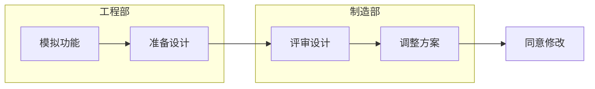
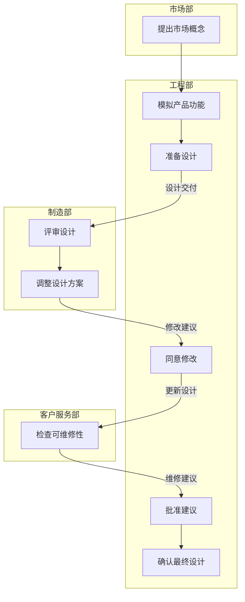

# 泳道（Swimlane）与活动分区

## 泳道与活动分区

### 它是什么

活动图描述“谁在什么时候做什么事”。当一个业务流程涉及多个角色或部门时，如果所有动作节点平铺在一张图上，读者很难一眼看出每个动作由谁负责。==泳道（Swimlane）== 就是把活动图按**责任主体**划分成的纵向或横向分区。每个分区顶部标注负责该分区的对象、角色或部门，该分区内的所有动作节点都由它执行。

> [!IMPORTANT]
> 核心规则只有两条：**动作节点必须且只能落在一条泳道内，不能跨泳道；控制流转移（箭头）可以自由跨越泳道边界**。转移跨越泳道时，表示“责任交接”——一个对象完成动作后，把控制权交给另一个对象。

### 为什么需要它

没有泳道的活动图只能回答“做了什么”，有泳道的活动图同时回答“==谁做的==”。在软件开发中，精化阶段的工作流涉及工程部、制造部、客户服务部等多个部门，泳道把每个部门的职责范围框出来，使跨部门协作一目了然。这对需求沟通、流程审计和职责划分都有直接价值。

### 与“分区（Partition）”的关系

UML 2 中“泳道”的正式术语是 **活动分区（Activity Partition）**。可以这样理解：

| 说法 | 含义 |
|------|------|
| 泳道 | 强调**视觉形态**——像游泳池里一条条分隔的泳道 |
| 活动分区 | 强调**语义本质**——按某种规则对动作节点分组 |

在画图工具和口语中两者混用，考试中见到“活动分区”要能反应过来它指的就是泳道。除了按“角色/部门”划分，分区也可以按业务阶段、地理位置等维度划分，但南邮课件语境下重点是按**负责对象**划分。

> [!NOTE]
> 对象流（Object Flow）可以和泳道同时使用：对象节点同样必须放在某条泳道内，表示该对象此刻处于哪个部门的管辖范围。对象可以随对象流跨越泳道，表示“交付物从一个部门传给另一个部门”。

### 常见误区

> [!WARNING]
> **动作节点跨泳道**是最常见的画图错误。一个动作节点画在两条泳道的分界线上，是语法上不允许的。如果一个动作需要两个部门共同完成，应当拆成两个动作节点，分别放在各自的泳道里，用转移连接。

> [!CAUTION]
> 不要把泳道和“参与者”完全等同。泳道里放的是**动作节点**，不是对象本身。对象既可以出现在自己的泳道里（作为动作的执行者），也可以作为对象流中的**数据**（例如“设计文档”）被传递到另一条泳道，此时它并不执行动作，而是被处理。

### 一个完整的例子

题干要求为儿童游乐设备设计流程画活动图，并体现各部门交互和设计状态变化。下面给出一个基于泳道的活动图（省略对象流的完整刻画，重点展示泳道的使用方式）：

检查一下是否满足规则：

- 每个动作节点（“模拟产品功能”“评审设计”等）都完整地落在唯一一条泳道内，没有跨泳道节点。✅
- 转移箭头从“准备设计”到“评审设计”、从“调整设计方案”到“同意修改”等，都跨越了泳道边界，表示责任交接。✅
- 设计状态的变化可以从节点间的语义读出：市场概念 → 设计草案 → 评审后的调整方案 → 客户服务检查后的最终设计。✅

> [!TIP]
> 画泳道活动图的步骤：先列出所有参与者 → 每个参与者画一条泳道 → 把动作节点放入对应泳道 → 用转移连接它们 → 最后检查“**动作不跨泳道，转移可跨泳道**”。这条口诀能帮你避开绝大多数扣分点。
