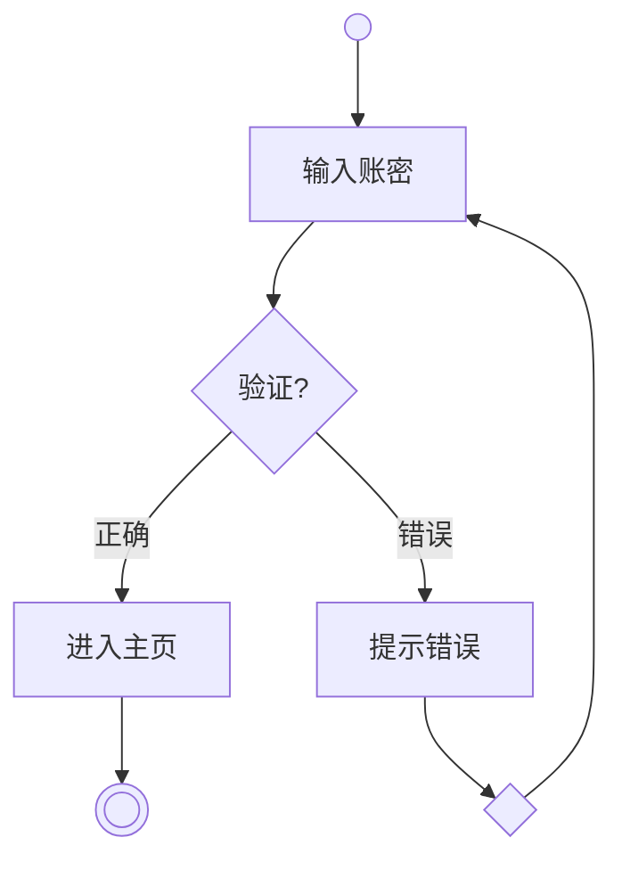

# 活动图的基本元素（活动节点、起始节点、终止节点、判断节点、合并节点）

活动图（Activity Diagram）是 UML 中用于描述系统==动态行为==的图形，本质上是“面向对象版的流程图”。

如果让你描述一个“用户登录”的过程：输入账号密码后，系统要先判断对不对，对了进主页，错了提示重试。这个过程中的每一步操作、每一次选择、流程的开始与结束，该用什么标准符号画出来？这就是活动图基本元素要解决的问题。

## 五大基本元素是什么

课件中将活动图的构成拆解为以下核心元素：

- **起始节点（Initial Node）**：流程的唯一入口。用 ==实心黑圆== 表示，一个活动图只能有一个。
- **终止节点（Final Node）**：流程的终点。用 ==牛眼圆==（圆环套实心圆）表示，可以有多个。
- **活动节点（Action State / Activity Node）**：即动作状态，表示系统或对象执行的一个具体操作（如“验证密码”）。用 ==圆角矩形== 表示。
- **判断节点（Decision / Branch）**：即分支，根据守卫条件（Guard Condition）决定走哪条路径。用 ==菱形== 表示，==一进多出==。
- **合并节点（Merge）**：将多条分支路径重新汇合成一条。也用 ==菱形== 表示，但它是 ==多进一出==。

> [!IMPORTANT]
> 连接这些节点的带箭头实线称为**转移（Transition）**或**动作流（Action Flow）**，表示控制权的传递方向。

下面用 Mermaid 展示这五个元素的协作关系：

> [!NOTE]
> 图中 `Start` 为起始节点，`EndNode` 为终止节点，`Input`/`Home`/`Err` 为活动节点，`Check` 为判断节点，`MergeNode` 为合并节点。

## 为什么需要区分它们

如果不加区分，复杂的业务流程就会变成一团乱麻。比如课件中还提到了**分叉（Fork）和汇合（Join）**以及**泳道（Swimlane）**，它们解决的是并发和职责划分问题；而本节这五个基本元素解决的是==串行逻辑与控制流走向==问题。

| 元素 | 图形 | 进出规则 | 核心作用 |
| :--- | :--- | :--- | :--- |
| 起始节点 | 实心圆 | 0进1出 | 标记起点 |
| 终止节点 | 牛眼圆 | 多进0出 | 标记终点 |
| 活动节点 | 圆角矩形 | 1进1出 | 执行动作 |
| 判断节点 | 菱形 | ==1进多出== | 条件分支 |
| 合并节点 | 菱形 | ==多进1出== | 路径汇聚 |

## 怎么做：画图的三个步骤

1. **定首尾**：先画一个实心圆作为起始节点，明确流程在哪结束并画上终止节点。
2. **排动作**：按时间顺序把动作状态（活动节点）用圆角矩形串起来。
3. **加判断与合并**：遇到“如果…就…”时插入判断节点（菱形），并在各分支执行完毕后用合并节点收拢回主干。

> [!TIP]
> 记忆口诀：**起终定边界，动作排中间；判断一分多，合并多归一。**

## 常见坑与辨析

> [!WARNING]
> **判断节点 vs 合并节点**：两者在 UML 中都是菱形，极易混淆！区分的唯一标准是看流向：==判断节点是 1 个入流、多个出流；合并节点是多个入流、1 个出流==。画图时千万别把箭头方向标反。

> [!CAUTION]
> **合并节点 vs 汇合（Join）**：合并节点只是把几条互斥的路径（如 if-else 的不同分支）在图上“收拢”，不涉及并发同步；而汇合（粗黑横线）要求所有并发线程都到达后才能继续往下走。

> [!NOTE]
> **活动节点 vs 状态图中的状态**：活动图中的动作状态强调的是“正在执行的动作”，通常不可中断且持续时间短；而状态图中的状态强调对象所处的“条件或状况”，可以停留较长时间并等待事件触发转移。
