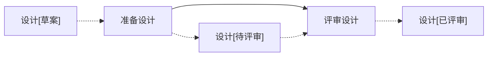
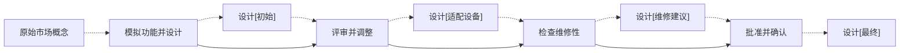

# 活动图的控制流与对象流

活动图不只回答“先做什么、后做什么”，还可以回答“动作之间传递了什么对象，对象的状态怎样变化”。前者由==控制流==描述，后者由==对象流==描述。

## 控制流与对象流是什么

**控制流（Control Flow）**表示动作执行的先后顺序。一个动作完成后，控制令牌沿有向边到达下一个动作，从而触发后续动作。活动图中的顺序、分支、合并、分叉与汇合，本质上都是在组织控制流。

**对象流（Object Stream）**是动作和对象之间的关联，包括依赖关系和对象的应用。它表示动作创建、读取、使用或修改对象，也可表示对象由一个动作传递给另一个动作。

按课件采用的画法：==对象用矩形表示，对象和动作之间用带箭头的虚线连接==，虚线表示对象流。对象节点可标注状态，如 `设计[已评审]`，用来表现同一对象在活动过程中的状态变化。

> [!IMPORTANT]
> 控制流解决“何时执行”，对象流解决“数据或对象如何流动”。动作可以有入转移，入转移可以是动作流，也可以是对象流；但二者表达的含义不能混用。

## 为什么需要对象流

只画控制流，虽然能说明“评审设计”在“准备设计”之后，却看不出评审的对象是什么，也看不出评审后设计发生了什么变化。加入对象流后，可以明确表达：

- 动作需要哪个对象作为输入；
- 动作产生或修改了哪个对象；
- 对象在流程中经历了哪些状态；
- 不同部门通过什么工作成果进行交互。

这对工作流建模尤其重要，因为部门之间交接的往往不是“控制权”本身，而是设计、订单、报告等对象。

## 怎样画

以“准备设计→评审设计”为例，实线表示控制流，虚线表示对象流：

建模时可按以下顺序检查：

1. 先确定动作及其执行顺序，画出控制流。
2. 找出动作之间传递的关键对象，补充对象节点。
3. 根据语义确定虚线方向：对象到动作通常表示输入，动作到对象通常表示输出。
4. 若题目要求体现状态变化，就为对象标注状态，而不是只反复写同一个“设计”。

> [!TIP]
> 做题时先画“谁做什么”的控制流，再补“交接什么”的对象流，最后检查对象状态是否随活动推进而变化。

## 与相近概念的区别

| 概念 | 主要含义 | 常见表示 | 典型问题 |
|---|---|---|---|
| 控制流 | 动作执行的先后关系 | 动作间的实线箭头 | 下一步执行什么 |
| 对象流 | 动作与对象间的输入、输出及使用关系 | 对象与动作间的带箭头虚线 | 哪个对象被传递或修改 |
| 对象节点 | 流程中的对象及其状态 | 矩形，可附状态 | 当前是什么设计版本 |
| 泳道 | 活动或对象的责任归属 | 分区 | 哪个部门负责 |

泳道与对象流也不是一回事：泳道回答“谁负责”，对象流回答“传递了什么”。二者可以同时出现在一张活动图中。

## 完整例子：儿童游乐设备设计

题目涉及工程部、制造部、客户服务部，可用三个泳道划分职责。其对象状态主线为：

其中，制造部的调整要经工程部同意，客户服务部的建议要经工程部批准，最后还要确认最终设计满足目标功能。因此，完整活动图还应在相应位置画出这些控制关系；对象流则清楚展示了设计从“初始”到“最终”的演进。

> [!WARNING]
> 常见错误有三类：把对象流画成普通控制流；只写“设计”而不标状态；把泳道当成对象。尤其不要为了让图“完整”而给每个动作都机械地添加对象节点，只建题目关心的输入、输出和状态变化即可。
