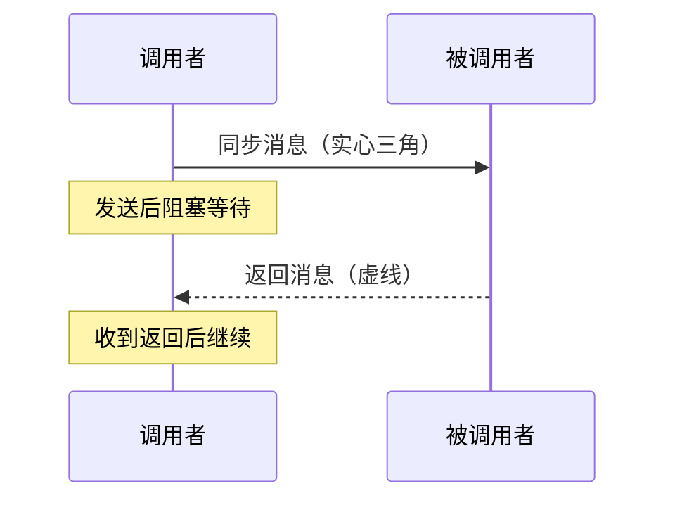
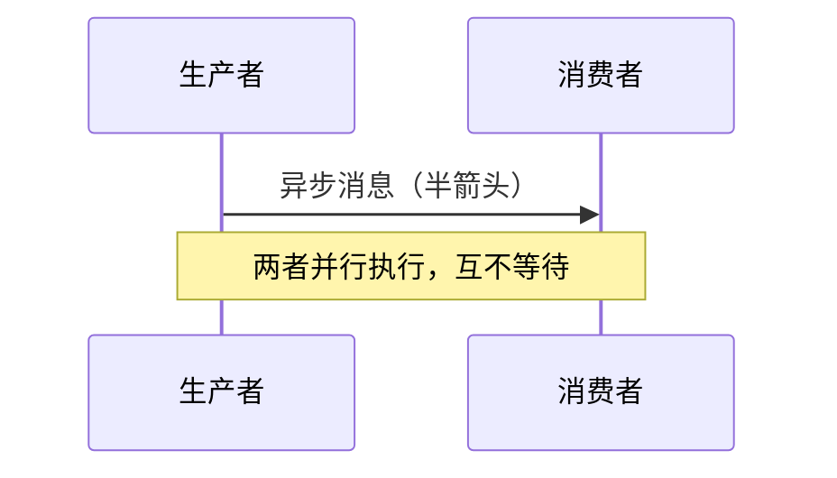
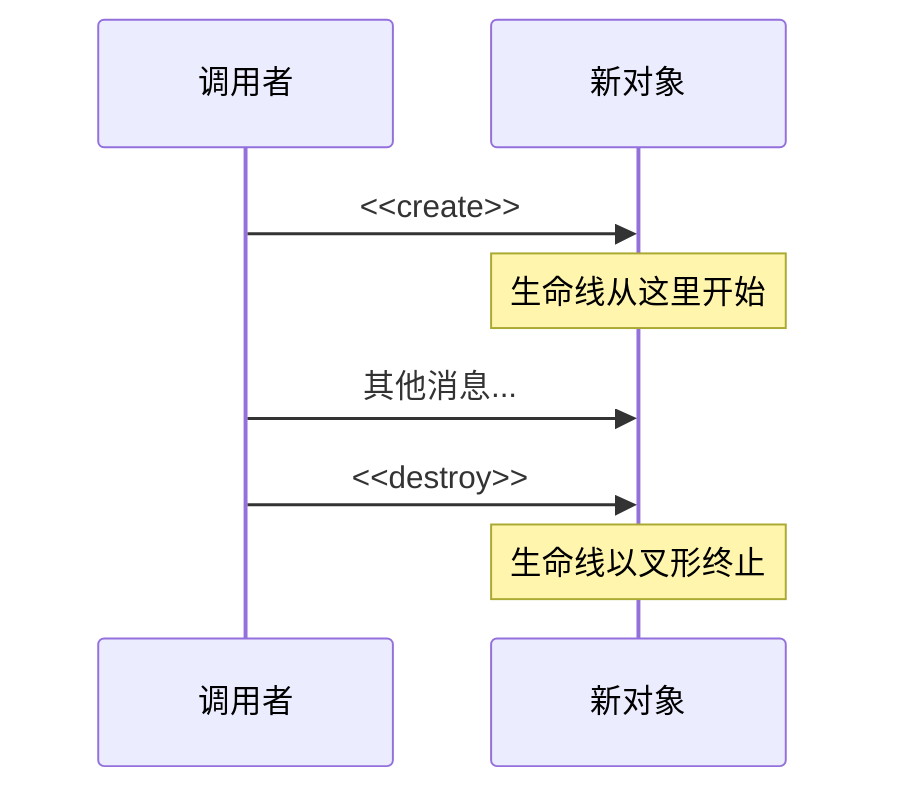

# 消息的类型：同步、异步、返回、创建、销毁

## 消息的类型

在顺序图中，对象之间通过**消息**进行交互。一条消息代表一个对象向另一个对象发出的操作调用或信号传递。根据消息的**发送方是否需要等待接收方处理完成**，消息分为同步消息、异步消息、返回消息，以及用于对象生命周期的创建消息和销毁消息。

先想一个问题：你去餐厅点餐，告诉服务员“来一碗牛肉面”。说完之后，你是站在那里等服务员把面端来才做下一件事，还是说完就坐下来刷手机？前者就是**同步**，后者就是**异步**。

### 同步消息

==同步消息表示发送方必须等待接收方处理完毕并返回后，才能继续执行后续操作。==

- 符号：带**实心三角**的实线箭头。
- 语义：发送方在消息发出后进入阻塞状态，直到收到配对的**返回消息**。
- 一个同步消息通常配有一个返回消息。

> [!IMPORTANT]
> 在顺序图中，返回消息**可以省略**。因为同步消息隐含了“一定会返回”，激活期的结束本身就暗示了返回发生。但若返回值很重要（例如查询结果），应用带叉形箭头的虚线显式画出。

### 异步消息

==异步消息表示发送方发出消息后不等待接收方处理，立即继续执行自己的后续操作。==

- 符号：带**半箭头**（叉形或实心三角）的实线箭头。
- 语义：发送方和接收方**并行**执行各自的活动。
- 异步消息的接收者通常是**主动对象**，即不需要消息驱动就能自行执行动作的对象。

课本例子：生产者向消费者发送一条消息后，**生产者不等待消费者的应答**，继续自己的生产工作——这正是异步通信。

### 同步 vs 异步

| 维度 | 同步消息 | 异步消息 |
|---|---|---|
| 发送方是否等待 | 等待返回后才能继续 | 不等待，立即继续 |
| 与返回消息的关系 | 一定配对返回消息 | 不强制要求返回 |
| 发送方与被调用方 | 串行执行 | 并行执行 |
| 箭头符号 | 实心三角 | 半箭头 |
| 典型场景 | 方法调用、查询请求 | 通知、事件、消息队列 |

### 返回消息

返回消息是**被调用对象向调用者发回结果或确认**的消息，通常与同步消息配对。

- 符号：**虚线**箭头，末端为叉形或实心三角，线上可标注返回值。
- 例如，`Restaurant` 类维护所有预约信息，收到查询请求后**返回特定的预约**，这条虚线箭头就携带了预约对象作为返回值。

> [!TIP]
> 记忆口诀：**“同步实心等回执，异步半箭不回头；返回虚线带结果，创建立方毁大叉。”**

### 创建消息与销毁消息

对象的生命周期也由消息来驱动。

- **创建（create）**：利用构造方法创建对象，对象一创建，**生命线就开始**。符号为消息箭线上标注 `<<create>>`，箭头指向新对象的生命线**顶部**（位置不在顶部说明对象早已存在）。
- **销毁（destroy）**：对象生命终止，用**较大的叉形符号**标在生命线末端。符号为消息箭线上标注 `<<destroy>>`。

课本例子：数据库事务对象 `:事务` 由标有 `<<create>>` 的消息触发创建，由 `<<destroy>>` 消息触发销毁。

### 回调与返回的区别

容易混淆。

| 维度 | 回调 | 返回 |
|---|---|---|
| 消息类型 | 异步消息 | 与同步消息配对的返回 |
| 发送方行为 | 不等待，继续执行 | 必须等待 |
| 触发时机 | 事件发生或操作完成时主动通知 | 被调用方处理完毕即刻返回 |
| 配对关系 | 不强制 | 与同步消息严格配对 |

> [!WARNING]
> 回调发送的是异步消息，并非任何异步消息都要有配对的回调消息；而返回消息与同步消息严格绑定。

### 例子：生产者与消费者

**题：** 一个生产者向一个消费者发送了一条消息。哪种情况是异步消息通信？

**解：** 异步消息通信的核心是发送方**不等待接收方的应答**，发出后立即继续自己的活动。对应选项 B。

**题：** 哪种情况是带回复的同步信息通信？

**解：** 同步通信中发送方发出消息后**必须等待接收方的应答**，阻塞直到返回消息到达。对应选项 A。

---

回到餐厅的例子：你点餐后如果站在前台等人端面——同步；点完直接坐下玩手机，面好了服务员叫你——异步，那声“面好了”就是回调。
