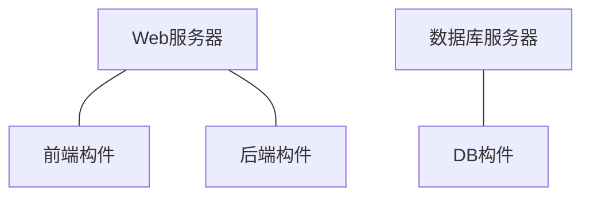
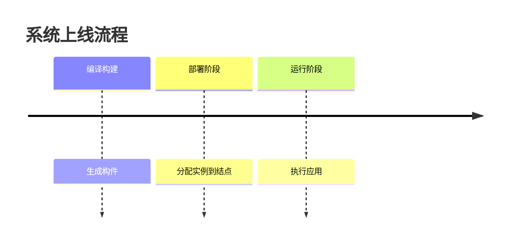

# 物理图（Physical Diagram）在系统实现中的应用

> [!IMPORTANT]
> 物理图（Physical Diagram）是 UML 中用于描述系统==物理实现与部署结构==的图形，包含构件图（Component Diagram）和部署图（Deployment Diagram）。

## 它是什么，为什么需要

在面向对象分析与设计中，类图、用例图解决的是“系统做什么”和“逻辑上怎么组织”的问题。但代码写完后，一个现实问题摆在面前：这些软件模块最终打包成什么形式？又该放到哪台机器上运行？

物理图正是为了回答这两个问题而存在的。它将视角从逻辑设计拉回到物理实现：

- **构件图**：展示系统的物理组成单元（构件）及其依赖关系。
- **部署图**：展示硬件结点（Node）以及构件实例在这些结点上的分布。

## 怎么做：从构件到部署

构件（Component）是系统中可替换的物理部件，如 `.dll`、`.jar`、`.exe` 文件。构件图用带两个小矩形突起的方框表示构件，用虚线箭头表示依赖。

部署图的核心元素是**结点**（用立体盒子表示），代表物理计算资源（服务器、PC、移动设备等）。建模时，需要把构件实例“放”进结点中。

> [!TIP]
> 记忆口诀：**构件管“打包”，部署管“上架”**。构件图关注软件模块间的接口与依赖；部署图关注软硬件的映射关系。

## 相近概念的区别

| 对比维度 | 类图 / 逻辑视图 | 构件图 | 部署图 |
| :--- | :--- | :--- | :--- |
| **抽象层次** | 逻辑设计 | 物理实现 | 物理部署 |
| **核心元素** | 类、接口、关联 | 构件、接口 | 结点、通信路径 |
| **关注重点** | 结构与行为规约 | 模块封装与依赖 | 硬件拓扑与分配 |

> [!NOTE]
> 类图中的类是逻辑概念，而构件图中的构件是物理文件。多个类可以打包进同一个构件中。

## 常见的坑

> [!WARNING]
> 部署应用时，到底发生了什么？很多同学会误以为部署就是“执行”。

请思考：当你把一个 `.war` 包拷贝到 Tomcat 服务器上时，程序跑起来了吗？并没有，你只是完成了文件的放置。因此，部署的本质动作是==把构件实例分配给硬件结点==，而不是执行或实例化。

> [!CAUTION]
> 画图时别把“构件”直接画在部署图的结点上而不加说明。严格来说，部署图中结点上放置的是**构件实例**（Artifact Instance），而非构件类型本身。

## 真题演练

来看一道期末考试选择题：

**题目**：在部署应用时：
A. 会执行应用
B. 会执行构件实例
C. 会把构件实例分配给硬件结点
D. 会实例化构件实例

**解析**：
部署（Deployment）发生在系统运行之前。我们梳理一下时间线：

- A、B 选项中的“执行”属于运行阶段的行为，不是部署阶段的任务。
- D 选项中“实例化构件实例”语义重复且不准确，构件实例化通常指运行时创建对象，而部署阶段处理的是静态分配。
- C 选项准确描述了部署的核心操作：建立构件实例与硬件结点之间的映射关系。

> [!IMPORTANT]
> 答案选 **C**。部署应用的本质就是==把构件实例分配给硬件结点==。
