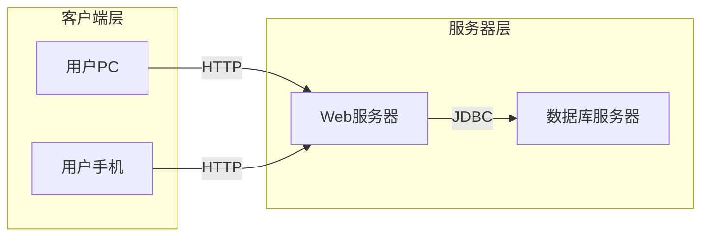
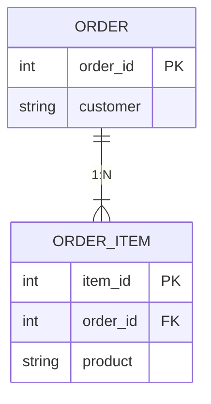

# 物理建模（Physical Modeling）的概念

## 物理建模是什么

物理建模（Physical Modeling）是在**逻辑模型**（类图、用例实现、交互图）已经稳定之后，进一步回答"系统**实际怎么部署、怎么存数据、怎么在硬件上跑起来**"的建模活动。它把前面抽象出来的类、子系统、用例实现，映射到具体的**计算环境**上：节点、网络、数据库表、文件。

可以这样想：逻辑建模告诉你系统"应该做什么"，物理建模告诉你系统"**在哪里做、用什么做、数据放在哪**"。

## 为什么需要物理建模

没有物理模型，开发团队无法判断：

- 系统要部署在几台服务器上？客户端和服务器怎么划分？
- 哪些类要持久化到数据库？怎么映射成表？
- 各子系统之间通过网络还是本地调用通信？

物理建模的核心产物是**物理图（Physical Diagram）**，主要包括两类：

| 图 | 作用 | 关键元素 |
|---|---|---|
| **部署图** | 描述软件在硬件节点上的分布 | 节点（Node）、连接（Connection）、构件（Component） |
| **构件图** | 描述代码模块的组织和依赖 | 构件、接口、依赖关系 |

## 怎么做：两条核心映射规则

### 子系统划分

系统通常划分为三类子系统，职责各不相同：

| 子系统类型 | 职责 | 例子 |
|---|---|---|
| **输入/输出子系统** | 处理人机交互、数据展示 | 用户接口子系统 |
| **控制子系统** | 协调各子系统的工作流程 | 业务调度模块 |
| **服务子系统** | 提供底层通用功能 | 日志服务、权限服务 |

> [!IMPORTANT]
> **用户接口子系统属于输入/输出子系统**，不是控制子系统，也不是服务子系统。它的核心职责是数据的输入与展示，不包含业务调度逻辑。

### 类到数据库表的映射

逻辑模型中的**聚合关系**（整体-部分）映射到关系表时，有几种策略。以"订单（整体）— 订单项（部分）"为例：

| 策略 | 做法 | 特点 |
|---|---|---|
| **同主键映射** | 部分表的主键 = 整体表的主键 | 两部分"一对一"或"强组合"时使用 |
| **外键映射** | 部分表增加一个外键指向整体表主键 | 最常用，支持一对多 |
| **独立主键** | 部分表有自己的主键，另加外键 | 部分本身需独立标识时 |

> [!WARNING]
> 映射聚合结构时，**聚合表和部分表的主键通常不同**：部分表有自己的主键，同时用外键引用聚合表。认为"两表主键必须相同"是错误说法——只有强组合（部分不能脱离整体存在）时才可能共用主键。

## 常见误区

| 误区 | 纠正 |
|---|---|
| 物理建模就是画网络拓扑图 | 物理建模还包括数据映射、构件划分，不只是网络 |
| 聚合映射时两表主键必须一致 | 只有特定场景才共用主键，一般部分表有独立主键 |
| 用户接口属于控制子系统 | 用户接口是**输入/输出子系统**，控制子系统负责调度协调 |

## 例题精讲

> 一个用户接口子系统是一种：
> A. 控制子系统　B. 服务子系统　C. 客户端子系统　D. 输入/输出子系统

**答案：D**

解析：用户接口子系统的职责是接收用户输入、向用户展示输出，属于典型的**输入/输出子系统**。控制子系统负责协调各子系统间的工作流程，服务子系统提供通用底层支持，均不符合用户接口的定位。

> [!TIP]
> 记住口诀：**"界面管进出，控制管调度，服务管支持"**——三类子系统职责一目了然。
