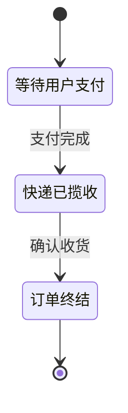
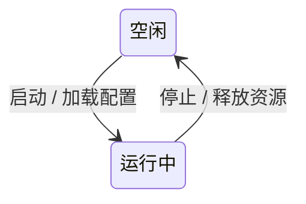

# 状态（State）、转换（Transition）与事件（Event）

# 状态（State）、转换（Transition）与事件（Event）

状态机图的核心任务，是回答一个对象“**在什么情况下，发生什么变化，去到哪一步**”。如果把一个对象的生命周期想象成一条时间线，那么这条线是由一个个**状态**和它们之间的**转换**编织起来的，而每次转换的推动力，就是**事件**。

要理解这三个元素，不妨从一个问题开始：一个网上订单，从用户提交到最终完成，它到底经历了什么？它会“等待付款”，也会“配送中”，还可能“已取消”。每一个阶段，就是对象的一个状态；付完款、拣完货，就是触发转换的事件。

## 状态：对象在某一刻的“快照”

在 UML 中，状态是指一个模型元素在生存期内的**一种稳定状况**——在这个状况里，它要么在满足某些条件，要么在执行某些活动，要么在等待某个事件发生。

> [!IMPORTANT]
> 状态不是瞬间的动作，而是一个**有限的时间段**。对象进入某个状态后，会停留一段时间，直到被某个事件触发离开。

状态用一个带圆角的矩形表示，内部可以细分为三个框：
- **名称框**：写状态的名字，比如“待付款”。
- **内部转移框**：记录这个状态下可以响应但不触发离开的事件和动作。
- **嵌套框**：如果是组合状态，就在这里面画出它的子状态机。

从建模角度看，一个对象属性的取值组合可以有很多，但只有那些**明显影响行为**的属性才叫**状态属性**。建模时要根据状态属性来划分有意义的状态，而不是把所有取值组合都画出来。

上图是一个简单订单对象的状态机。三个圆角矩形就是三个状态，箭头是转换。

### 简单状态与组合状态

- **简单状态**：没有嵌套的子状态，结构扁平。
- **组合状态（超状态）**：内部嵌套了另一个子状态机，用来表达更复杂的活动序列。采用组合状态可以把凌乱的转移线理顺，让图面清晰，也能分清主次。

组合状态内部还可以细分为：
- **顺序子状态**：子状态一个接一个地顺序执行，互不重叠。
- **并发子状态**：多个子状态机同时并行执行，各自走自己的流程，最后汇聚到一起。

## 转换：从“这里”到“那里”的跨越

转换描述的是两个状态之间的**联系**。当源状态的对象接收到某个事件，并且监护条件成立（如果有的话），就会执行相应的动作，然后迁移到目标状态。

一个完整的转换包含五个信息：
- **源状态**：从哪来。
- **目标状态**：到哪去。
- **事件**：触发转换的激励。
- **监护条件**：一个布尔表达式，为真才允许转换发生。
- **动作**：转换过程中执行的原子操作。

在状态机图上，转换用一条带箭头的实线表示，标注格式为：

> `事件 [监护条件] / 动作`

### 三种特殊的转换

下面这三种情况很容易混淆，考试时也常出现：

| 类型 | 说明 | 关键区分 |
|------|------|----------|
| 自转移 | 从状态出发又回到自己 | 会触发入口动作和出口动作 |
| 内部转移 | 响应事件但**状态不变** | 不触发入口/出口动作 |
| 自动转移 | 活动执行完后自动触发离开 | 没有显式事件标注 |

> [!WARNING]
> 自转移和内部转移都“看起来没离开当前状态”，但自转移会重新进入并执行 `entry` / `exit` 动作，内部转移不会。如果考题问“哪种转移不改变状态”，答案是**内部转移**。

## 事件：触发这一切的“导火索”

事件是**一个有意义的出现的说明**，它在某个时间和空间发生，并立即触发一个状态转换。UML 中事件的描述格式是：

> `事件名称 [参数表]`

常见的事件类型如下表所示：

| 事件类型 | 示例 | 含义 |
|----------|------|------|
| 调用事件 | `pay(order)` | 操作被调用 |
| 时间事件 | `after(2 sec.)` | 计时到期 |
| 改变事件 | `when(temp>120)` | 条件从假变真 |
| 信号事件 | `send signal` | 收到异步信号 |

> [!TIP]
> 记忆口诀：**移**（转换）动三件套——**事件叫门，条件看门，动作出门**。事件是来敲门的，条件决定开不开，动作就是走出去的动作。

## 常见的坑

- 把“动作”当成“状态”来命名。状态是持续存在的，动作是一闪而过的。例如“验证密码”是动作，状态应该叫“验证中”。
- 混淆“自动转移”和“时间事件转移”。自动转移是活动完成就自动走，时间事件必须显式写 `after(...)`。
- 在画并发状态时忘记每个子区域都要有自己的初始态和终止态。

## 一道题，算对了才算懂

> **题目**：状态机类封装了什么？
> A. 状态转换表  
> B. 状态图  
> C. 机器当前状态  
> D. 状态转换表和机器的当前状态  

思路：状态机不光要记录“可以怎么变”（转换表），还要知道“自己现在在哪”（当前状态），两者缺一不可。所以选 **D**。

用同样的思路去理解上面那张订单状态机图——它画出了所有可能的状态和转换路径（相当于转换表），运行时订单对象始终知道自己处在“待付款”“已发货”还是“已完成”中（当前状态）。两者兼备，才是一个完整封装的状态机。
