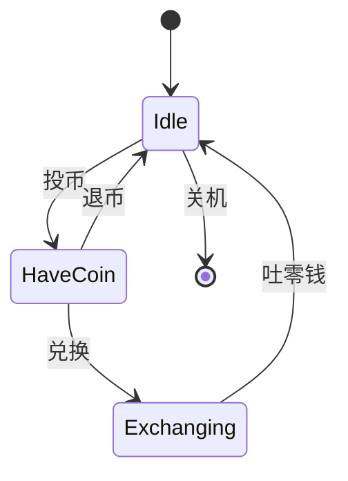
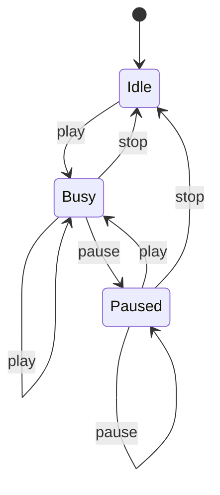
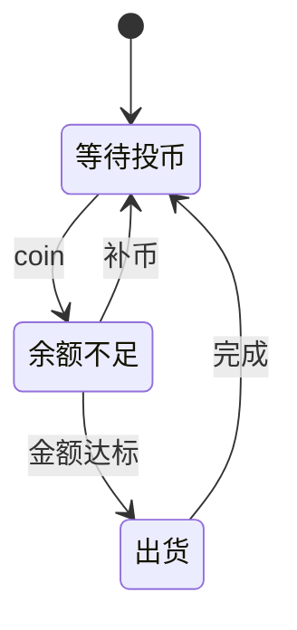
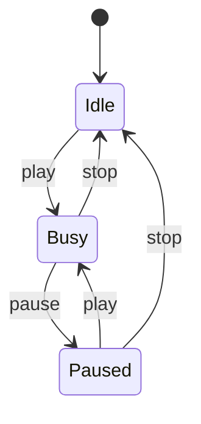

# 状态机图的应用（以exchange、play、coin为例）

## 状态机图的应用（exchange / play / coin）

状态机图（State Machine Diagram）描述 ==一个对象在其生命周期内，因事件驱动而发生的状态转移==。第 7 章前几节讲"语法"（状态、转移、事件、动作），这一节进入"实战"：用 exchange（换零钱机）、play（播放器按钮）、coin（投币/售货机）三个例子把语法落地。

它和类图的区别：类图刻画"对象长什么样"（属性、操作），状态机图刻画"对象怎么随时间变化"。==同一个类的两个对象，可以同时处于不同状态==，所以状态是"对象级"的运行时语义，不是"类级"的结构语义。

## 三个典型例子

### exchange：换零钱机（coin 的原型）

机器初始在 `Idle`（空闲）；用户投入硬币 → `HaveCoin`；按下兑换按钮 → `Exchanging`（吐零钱）→ 回到 `Idle`。若在 `HaveCoin` 状态下按下"退币"，直接回 `Idle` 并退币。

### play：播放器的暂停按钮（高频考点）

这是课件里反复强调的例子，也是最常考的一个：

- `Busy`（播放中）按下 play → 保持 `Busy`；
- `Busy` 按下 pause → 进入 `Paused`；
- `Paused` 按下 play → ==进入 `Busy`==（"建模暂停按钮"版本）；
- `Paused` 按下 pause → ==仍处 `Paused`==（"使用历史状态"版本）。

同样一个按钮，建模方式不同，行为就不同。这说明 ==状态机图不是画图，是"规格说明书"==——两条转移语义你必须选一条写清楚。

[!WARNING]
`Paused` 状态下按 `play` 的两条写法是易错点：=="进 Busy"是普通建模，"仍 Paused"是使用历史状态 H（history）==。答题时必须看题目给的是哪一版，写反就错。

### coin：投币售货机（coin 作为事件/守卫的综合例子）

投币事件本身可能是"事件"（coin），也可能带参数（金额）。转移上常写守卫条件，如 `coin(amount≥price) / 出货`：

## 转移五要素与记法

一条转移的形式化写法：

$$
\text{事件} \ [\text{守卫}] \ / \ \text{动作}
$$

例如 `coin(amount ≥ price) [余额足够] / 出货`：事件触发，守卫为真才转移，动作是转移过程执行的副作用。

| 要素 | 含义 | 例子 |
| --- | --- | --- |
| 事件 | 触发转移的输入 | `coin`、`play` |
| 守卫 | 转移成立的条件 | `[amount ≥ price]` |
| 动作 | 转移中执行的操作 | `/ 出货` |
| 源状态 | 转移起点 | `HaveCoin` |
| 目标状态 | 转移终点 | `Exchanging` |

[!TIP]
记忆口诀：==一条转移 = "事件 + [守卫] / 动作"，三者缺一用占位符==。画图时先抓"状态集合"，再补"事件驱动"的转移，最后补守卫与动作。

## 和相近概念的区别

- **活动图**：面向"流程/用例"，节点是动作；状态机图面向"对象"，节点是状态。
- **类图**：静态结构；状态机图：动态行为。
- **顺序图**：多对象协作时序；状态机图：单对象内生命周期。

[!NOTE]
状态机图是"白盒"建模——==状态是对象的内部视图，外部只能看到事件==。设计时状态数不宜过多，一般 3～7 个为宜；否则要拆分子状态或改用活动图。

## 常见的坑

1. **忘记终态** `[*]`：`Idle --> [*]` 必须画出来，否则对象永不出生命周期。
2. **无事件的转移**：除非是"自动转移"（如初始化），否则必须写触发事件。
3. **守卫与事件混淆**：`[ ]` 是条件（必须配合事件），不是另一种触发方式。
4. **play 案例两种语义混写**：同一个 `Paused --> Busy` 或 `Paused --> Paused` 只能选一种，不要在同一张图上同时出现而不加说明。

## 一个"算对了"的例子

> 题目：为播放器建模。已知 `Busy` 按 `pause` 进 `Paused`，且要求"`Paused` 按 `play` 进入 `Busy`（建模暂停按钮版本）"。

**答案**（只取关键转移）：

[!IMPORTANT]
==核心结论==：状态机图的"应用"部分考的是 ==把业务规则（按钮、投币、兑换）翻译成"状态 + 事件 + 守卫 + 动作"的转移集合==；同一个按钮（如 `play`）在不同建模约定下转移不同，==答题时必须明确写清语义==。
