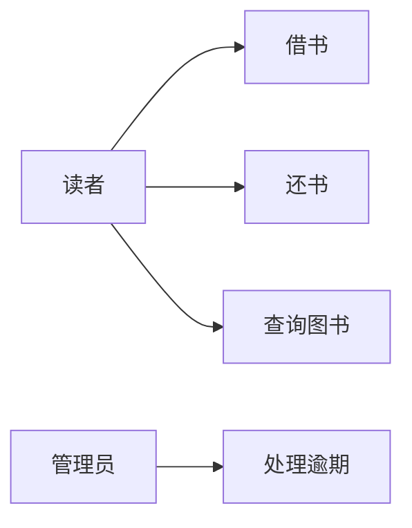
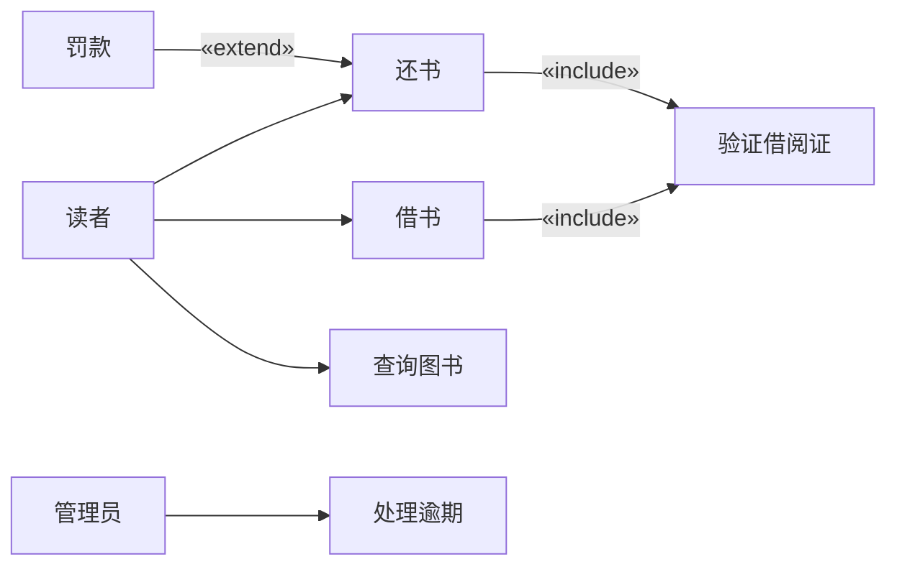
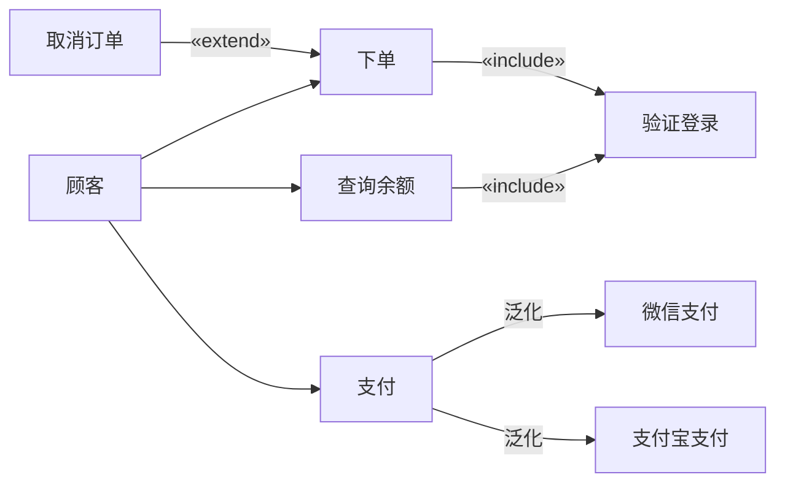

# 用例图的绘制与元素（系统边界、关联、包含、扩展、泛化）

## 用例图是什么

用例图是需求建模中最常用的一种图，它不解释系统内部如何工作，只回答一个问题：==系统为谁提供哪些服务==。图中只有两个主角——**参与者**（Actor）和**用例**（Use Case），以及它们之间的几种关系。

> [!IMPORTANT]
> 用例图从用户视角描述系统功能边界，不涉及内部实现，是后续类图、顺序图的源头。

## 为什么需要用例图

在项目早期，需求往往散落在会议记录、访谈笔记里。用例图的价值在于：

1. **划定系统边界**：明确什么归系统管，什么不归系统管。
2. **识别用户角色**：发现所有会“碰”系统的人或外部系统。
3. **梳理功能全貌**：把用户期望变成一张可检查、可讨论的视图。
4. **驱动后续建模**：每个用例背后，都对应一组对象交互与代码结构。

## 五种核心元素与关系

### 参与者与用例之间的关联

关联用一条实线表示，含义是该参与者**启动**了该用例。

> [!WARNING]
> 除了被包含用例和扩展用例，==每个用例都必须至少由一个参与者启动==。如果图中出现没有参与者指向的独立用例，通常意味着你漏掉了触发者。

### 系统边界

系统边界是一个矩形框，把属于当前系统的用例框在里面，参与者放在外面。它在一开始就逼你回答：==哪些功能是我们要做的，哪些是外部系统提供的==。

### 泛化

用于参与者之间或用例之间。画法是一条实线加空心三角箭头，箭头指向父用例（或父参与者）。

- **参与者泛化**：比如“注册用户”和“管理员”都有“登录”行为，你可以抽出一个抽象的“用户”，让两者继承它，从而复用同一套用例关联。
- **用例泛化**：当一个父用例有多个变形时使用，比如“支付”可泛化为“微信支付”和“支付宝支付”。

### 包含

包含用一条虚线箭头加 `<<include>>` 标注，==从基础用例指向被包含用例==。

什么时候用？两个特征判断：

1. **多个用例有公共步骤**：比如“查询余额”和“转账”都需要“验证身份”，把验证身份抽成被包含用例。
2. **一个用例太大，需要拆解**：把大的“下单”拆成“选择商品”、“填写地址”等子用例。

> [!TIP]
> 记忆诀窍：**“必执行”用 Include**。基础用例每次执行，都必须调用被包含用例，就像函数里调用了一个必执行的子函数。

### 扩展

扩展也用虚线箭头，但加 `<<extend>>` 标注，==从扩展用例指向基础用例（被扩展用例）==。

关键差异：

- 基础用例**不必知道**扩展用例的存在，它只提供“扩展点”。
- 扩展用例**不是完整独立用例**，没有参与者直接指向它，只是插入到基础用例身上的一段行为片段。
- 执行基础用例时，==扩展用例不一定执行==（只在特定条件下触发）。

> [!NOTE]
> 常见扩展场景：异常处理（如“取消订单”扩展自“下单”）、可选分支（如“使用优惠券”扩展自“结算”）。

### 包含与扩展的对比

| 关系 | 箭头方向 | 是否必须执行 | 基础用例依赖扩展用例吗 | 典型用途 |
|------|----------|--------------|------------------------|----------|
| Include | 基础用例 → 被包含用例 | 每次必执行 | 知道并主动调用 | 公共步骤复用 |
| Extend | 扩展用例 → 基础用例 | 条件触发 | 不知道扩展的存在 | 可选/异常行为 |

> [!WARNING]
> 最易混淆的坑：**执行父用例一定会执行 include 用例，但不一定会执行 extend 用例**。考试常从这里出辨析题。

## 怎么画：一步步构建用例图

假设你要为“图书馆借书系统”建模，可以按这个顺序来：

1. **确定系统边界**：画一个矩形，标上“图书馆系统”。
2. **找参与者**：谁用系统？读者、管理员。
3. **找出每个参与者的核心用例**：读者借书、还书、查询图书；管理员处理逾期。
4. **发现公共步骤，用 Include 抽取**：借书和还书都需要“验证借阅证”——抽出为被包含用例，从“借书”和“还书”各引一条 `<<include>>` 虚线指向它。
5. **发现可选分支，用 Extend 建模**：还书时如果超期，会触发“罚款”——从“罚款”引一条 `<<extend>>` 虚线指向“还书”，在“还书”中标明扩展点“检查逾期”。
6. **如果有参与者的公共行为，用泛化抽象**：读者和管理员都用“登录”，可泛化出一个“用户”参与者。

## 一个算对了的例子

题目要求：画出某购物系统的用例图，要求包含“下单”、“支付”、“取消订单”，其中支付包括微信支付和支付宝支付，取消订单是对下单的扩展，下单必须验证登录。

分析拆解：

- “支付”是父用例，“微信支付”和“支付宝支付”用**泛化**指向它。
- “取消订单”用 `<<extend>>` 指向“下单”。
- “下单”和“查询余额”都需要“验证登录”，用 `<<include>>` 指向它。

> [!CAUTION]
> 注意箭头的方向！“取消订单”扩展“下单”，箭头是从扩展用例（取消订单）指向基础用例（下单），不要画反。
