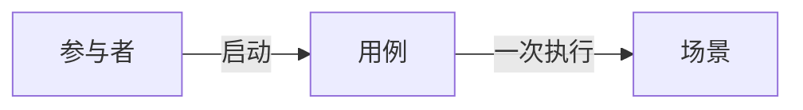

# 用例（Use Case）与参与者（Actor）的定义

## 先想一个问题：系统“为谁做”“做什么”

在《软件建模与设计》第 3 章里，==用例建模是一种描述系统功能性需求的方法==。先问自己：一个软件系统，谁会用它？每个使用者希望系统帮他完成什么有价值的事？这两个问题的答案，分别对应**参与者（Actor）**与**用例（Use Case）**。

## 它是什么

- **参与者 Actor**：在系统外部、与系统交互的人、设备或其他系统。每个参与者可以参加一个或多个用例。
- **用例 Use Case**：对系统与参与者之间**交互动作序列**的说明；==用例的执行必须给参与者带来可见价值==。用例只说“做什么（what）”，不说“怎么做（how）”。
- **场景**：是用例的一次完整、具体执行过程。用例与场景的关系，就像类与对象的关系。

## 为什么需要它

用例图从用户角度描述系统功能，标明参与者及其与用例的关联。在需求分析阶段，先用它建立需求模型：系统输入输出先在用例模型里描写，后面才进静态模型；它能增进用户、设计和开发人员之间的沟通。

## 怎么做：用例建模步骤

1. 找参与者与其希望的系统行为，命名为用例（动词短语）。
2. 公共行为抽成新用例，用**包含（Include）**关系复用；特殊/可选行为用**扩展（Extend）**关系插入。
3. 编写用例描述（前置条件、基本事件流、扩展事件流等）。
4. 绘制用例图。

关系要点对比：

| 关系 | 方向 | 是否必须执行 | 能否单独跑 |
|---|---|---|---|
| 关联 | 参与者→用例 | 启动用例 | — |
| 包含 | 基础→被包含 | ==每次都执行== | 被包含可单独 |
| 扩展 | 扩展→基础 | 不一定执行 | 扩展不能单独 |

## 和相近概念的区别

- **包含 vs 扩展**：执行父用例一定执行包含用例；执行父用例不一定执行扩展用例。
- **用例 vs 场景**：类是抽象，对象是实例；用例是抽象，场景是实例。

## 常见坑

[!WARNING]
> 用例粒度别太细。一般一个系统控制在 **20 个用例左右**；用例是系统级抽象描述，不是细化设计。

[!CAUTION]
> 别把“怎么做”写进用例。用例只描述功能性需求与交互序列，实现细节属于设计模型。

## 一个算对了的例子

考题问：“什么是可变点？”选项有“一个可变用例 / 一个可替换用例 / 一个用例中可发生变化的位置”等。按课术语，==用例可变点是一个用例中可发生变化的位置==，所以选 B 项表述对应的答案。同理，“可选用例”是部分产品线成员所需的用例，不是“不用开发的用例”。

> [!IMPORTANT]
> 记住：Actor 在外部，Use Case 给价值，Include 必执行，Extend 不一定，场景是实例。
