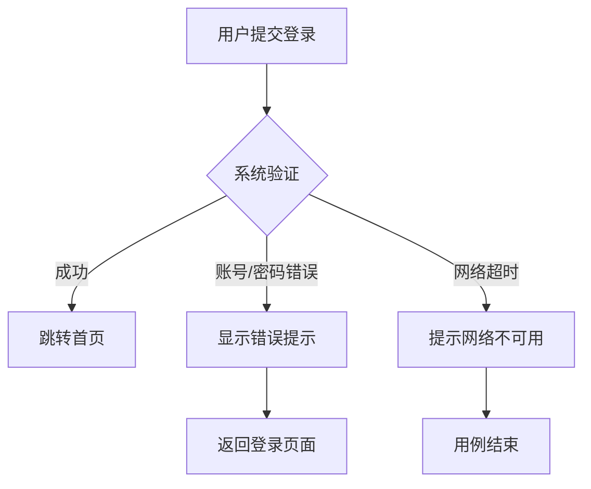

# 用例规约（Use Case Specification）的编写

## 用例规约的编写

在用例图上，一个椭圆只能告诉你“用户要登录系统”，却无法说清登录的**完整交互过程**、**异常情况**和**业务规则**。这些细节正是用例规约（Use Case Specification）要做的事。

### 用例规约是什么

用例规约是一份结构化的文字描述，把用例图中的“椭圆”展开为完整的契约。它通常包含以下核心字段：

| 字段 | 说明 |
|---|---|
| 用例名称 | 动宾短语，如“登录系统” |
| 参与者 | 发起者与辅助系统 |
| 前置条件 | 用例开始前必须为真的系统状态 |
| 后置条件 | 用例结束后系统必须达成的状态 |
| 基本路径 | ==“阳光大道”——一切正常时的交互步骤==（主成功场景） |
| 扩展路径 | ==“岔路口”——异常或分支的替代步骤==（备选事件流） |
| 触发事件 | 谁、用什么方式触发了这个用例 |

### 为什么需要它

没有规约的椭圆只是“占位符”。规约解决三个实际问题：

1. **消除歧义**：开发人员看到“取消订单”，不知道已支付订单能否取消、退款由谁触发。规约用扩展路径明确这些分支。
2. **发现遗漏**：写基本路径时，你自然会追问：“如果密码错了呢？”“如果网络超时了呢？”每问一次，就多一条扩展路径。
3. **测试依据**：测试用例直接按照规约的基本路径和扩展路径逐条编写，覆盖率直观可控。

### 怎么写：基本路径 + 扩展路径

写规约的核心技巧是**先走通基本路径，再逐一追问“如果……会怎样”**。

基本路径用“参与者做什么，系统做什么”的编号交互描述：

```
基本路径：
1. 用户点击“登录”
2. 系统显示登录页面
3. 用户输入账号密码，点击提交
4. 系统验证账号密码正确，跳转至首页
```

写完第 4 步后开始追问：
- 如果账号不存在？
- 如果密码错误？
- 如果网络超时？

每个问题对应一条扩展路径，并明确它从基本路径的哪一步**插入**：

```
扩展路径：
3a. 账号不存在或密码错误：
    3a1. 系统显示错误提示“账号或密码错误”
    3a2. 返回基本路径第 2 步
3b. 网络超时：
    3b1. 系统提示“网络不可用，请稍后重试”
    3b2. 用例结束
```



>[!IMPORTANT]
> 扩展路径的编号（如 `3a`）指明了它**从哪一步分叉**，这是后续追踪需求的关键索引，绝不是可有可无的装饰。

### 用例可变点

题目中提到的“用例可变点”（Variability Point），指的正是==用例中可发生变化的位置==（选项 B）。

在编写扩展路径时，某一步存在多种可能的处理方式，但**当前规约暂不在此处展开**，就可以标记为可变点。它常见于产品线工程或需求尚未明确的场景，例如“3a. 支付方式在该可变点可扩展为信用卡、支付宝、微信支付”。它不是一个独立用例（排除 A、C），也不是扩展路径的起点（排除 D）。

### 常见误区

>[!WARNING]
> **基础路径写得太长**：把密码错误、验证码错误全都塞进基本路径。==基本路径只保留“一切顺利”的场景==，所有分支都进扩展路径。

>[!CAUTION]
> **扩展路径不写出口**：每条扩展路径必须写明结束方式——是返回到基本路径某一步，还是直接结束用例。悬在半空的分支等于没写。

>[!TIP]
> 判断一条步骤应该放在用例规约里还是领域规则里的标准：如果它描述了“系统在某种条件下做出何种反应”，它属于用例规约的扩展路径。如果它是一条不依赖具体交互的纯粹业务约束（如“会员折扣最高不超过 30%”），则更适合写入领域模型或业务规则文档，在规约中只需引用。
