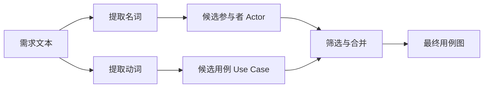
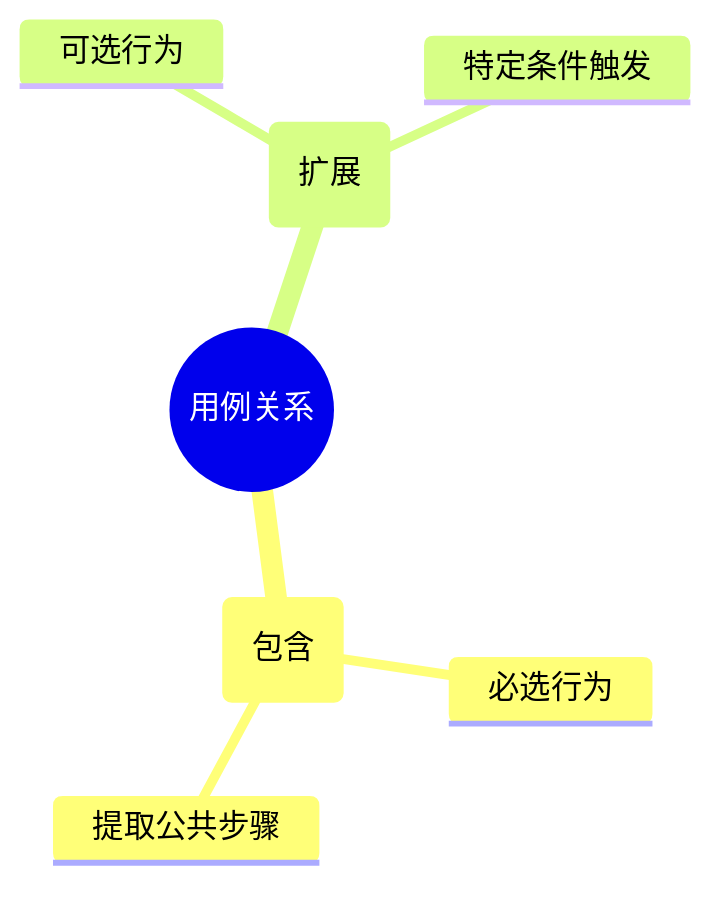

# 用例识别方法与最佳实践

## 用例识别的核心逻辑

用例（Use Case）是系统为外部参与者提供的、可观测的**有价值**的服务单元。识别用例的本质，不是罗列功能按钮，而是回答：**“谁（Actor）通过系统完成了什么目标（Goal）？”**

> [!IMPORTANT]
> ==核心结论==：一个用例必须对应一个完整的业务目标，而非单个操作步骤。

如何判断是否找到了正确的用例？试着问自己：如果去掉这个步骤，用户的目标还能达成吗？如果能，它可能只是用例内部的“扩展流”或“包含关系”，而非独立用例。

## 常用识别方法：名词-动词分析法

在需求文档中，通过提取**参与者（名词）**和**交互行为（动词）**来初步候选用例。

1.  **找参与者**：系统外的人、组织或其他系统。
2.  **找目标**：参与者希望系统做什么？
3.  **抽象合并**：将“录入姓名”、“录入电话”合并为“注册新用户”。

## 最佳实践与常见误区

识别用例时，学生最容易陷入“功能分解”的陷阱，将用例画成了流程图。

| 维度 | 正确的用例建模 | 错误的功能分解 |
| :--- | :--- | :--- |
| **视角** | 用户视角（黑盒） | 系统内部实现（白盒） |
| **粒度** | 完整业务目标（如：下单） | 单一操作（如：点击提交） |
| **命名** | 动宾结构（如：支付订单） | 过程描述（如：验证密码） |

> [!WARNING]
> ==高危误区==：不要把“登录”当作核心业务用例，除非系统是身份认证中心。对于电商系统，“登录”通常是“下单”的前置条件或扩展流。

## 典型例题解析

**场景**：某图书馆系统。读者可以查询书籍、预约书籍；管理员可以上架书籍、处理逾期罚款。

**错误识别**：
1. 输入ISBN号
2. 显示书籍信息
3. 点击预约按钮

**正确识别**：
1. **查询书籍**（参与者：读者）
2. **预约书籍**（参与者：读者）
3. **上架新书**（参与者：管理员）
4. **处理罚款**（参与者：管理员）

> [!TIP]
> **检验技巧**：每个用例应能独立产生业务价值。若“显示书籍信息”单独存在无意义，它应归属于“查询书籍”用例的内部步骤。

## 关系辨析：Include vs Extend

在用例细化时，需区分两种依赖关系：

-   `<<include>>`：基用例**必须**执行被包含用例（如：取款 -> 验证密码）。
-   `<<extend>>`：基用例**可能**执行扩展用例（如：取款 -> 余额不足提示）。

> [!NOTE]
> 箭头方向：`include` 指向被包含者；`extend` 指向基用例。记忆口诀：**“包含去公用，扩展加异常”**。
