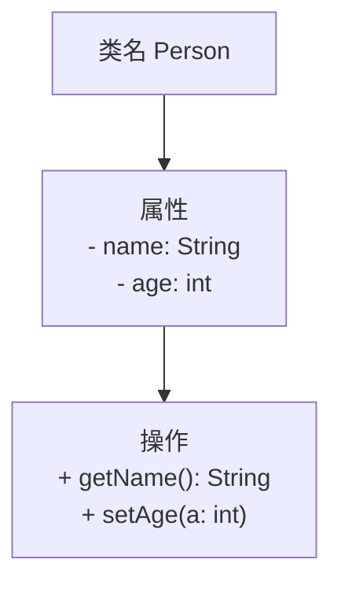
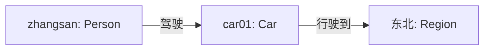

# 类（Class）与对象（Object）的概念

## 从"老张开车去东北"说起

先想一个问题：要写一段程序描述"老张开车去东北"，你会怎么写？

```c
// 程序1：本质上非OO
老张.开车(东北);        // 还是"数据 + 函数"的老思路
```

面向对象的做法是把**数据和操作绑在一起**，让对象自己干活：

```java
// 程序2：OO 思路
老张.去(东北);          // 老张是主体，自己决定怎么去
车.启动(); 车.行驶();
```

关键差别在于：OO 里**对象是数据处理的主体**，它接收消息、处理自己的数据；不同对象各自独立处理自己的数据，本质上具有并行工作的属性。这就是封装带来的**主动性和并行性**。

## 类与对象：模板与实例

类（Class）是**对具有相同数据和相同操作的一组相似对象的抽象定义**，是支持继承的抽象数据类型、对象实例化的模板；一个对象就是类的一个实例。

> [!IMPORTANT]
> ==类是对象的模板，对象是类的实例。==类定义了对象的特征，分为**属性**（定义类实例存储的数据，每个对象有自己特有的属性值）和**操作**（实现类的服务功能，可被本类对象请求执行）。

对象的形式化定义：

$$\text{对象} ::= \langle ID,\ MS,\ DS,\ MI \rangle$$

- $ID$：对象的标识或名字
- $MS$：对象中操作的集合
- $DS$：对象的数据结构
- $MI$：对象受理的消息集合（对外的接口）

## UML 图标

**类的 UML 图标**（三栏矩形）：



**对象的 UML 图标**（实线矩形，无操作框，对象名格式为 `对象名:类名`）：

```mermaid
flowchart TD
    A["zhangsan: Person"] --> B["name = \"张三\"<br/>age = 25"]
```

> [!WARNING]
> ==对象图标不含有操作框==，只含对象名分隔框和属性值列表（状态列表）。每个对象都是**唯一的、可标识的**，即使属性值相同也是不同对象。

## 属性的两个关键细节

**可视性**：

| 标记 | 含义 | 可见范围 |
|------|------|----------|
| `+` / public | 公共属性 | 外部对象可访问 |
| `#` / protected | 保护属性 | 本类及子类对象可访问 |
| `-` / private | 私用属性 | 仅本类对象使用 |
| `~` / package | 包属性 | 同一包内其他类可见 |

**属主范围**：

- **实例**：每个实例对象各有一份自己的属性值
- **分类符**：整个类只有一份值，所有实例共享

> [!TIP]
> 构造操作（构造函数）的属主范围是分类符，UML 中**必须带下划线**，或用构造型 `<<constructor>>` 标示。

> [!NOTE]
> 区分"操作"与"方法（Method）"：**操作是被对象调用的一个过程，方法是过程体**——在有多态性时二者有区别。

## 对象图

对象图是**类图的实例**，表示对象与对象之间的链接关系，表达了系统的对象模型——这是软件开发 OO 方法学的核心。



对象间的关系意味着**导航**，代表一个对象对另一对象的引用；多重性规定该类中有多少个对象参与该关联。程序设计语言和 UML 都是强类型的，不允许链接任意类的对象。

## 常见考点辨析

- **类接口** = 类外部可见的操作（选 B），不是内部细节
- **信息隐藏对象** = 封装数据的被动对象（选 B）
- **多态** = 不同的类可以有相同的操作名（选 D）
- **子程序**不是面向对象概念（选 D）
- 菜单、窗口、按钮是 GUI 类；**个人识别码**不是（选 D）
