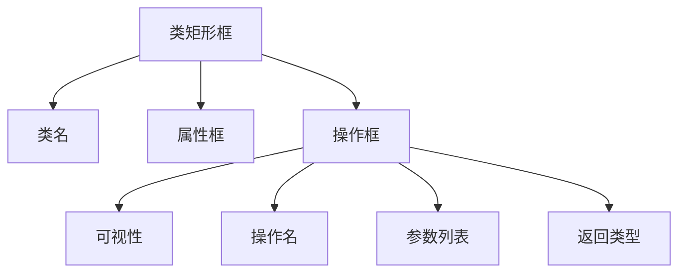
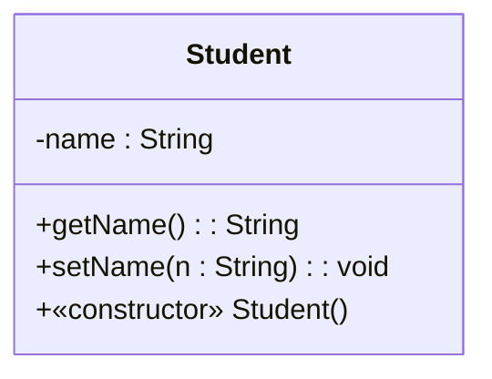
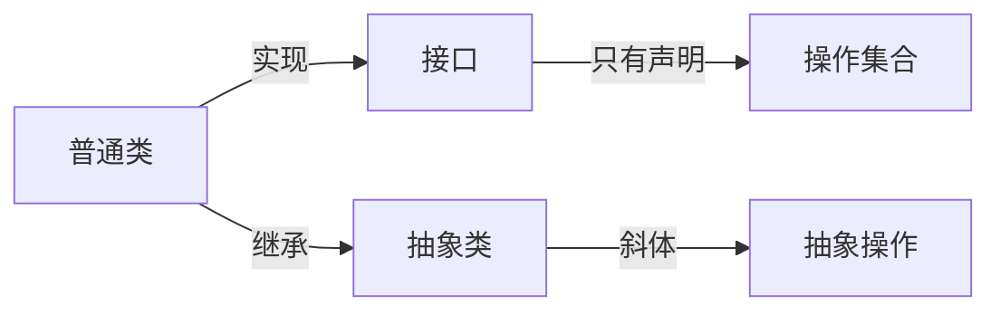

# 类图的元素：属性、操作、可见性

## 它是什么

类是==对具有相同数据和操作的一组相似对象的抽象定义==。在 UML 中用实线矩形框表示，矩形框被分隔成若干框，分别包含类的名字、属性、操作等成分。

其中，==属性==描述类的静态数据特征，==操作（operation，也称方法）==描述类的动态行为特征：定义类实例的算法或服务，可以被本类的对象请求执行，从而发生某种行为。一个类可以有多个操作，也可以==没有一个操作==——没有操作的类常用来表达接口或数据表。

## 操作的书写格式

UML 中操作的标准格式为：

$$\text{[可视性]} \ \text{操作名} \ [(\text{参数列表})] \ [: \text{返回列表}] \ [\{\text{性质}\}]$$

- **可视性**：表示方法与含义同属性（`+` public、`#` protected、`-` private、`~` package）。
- **操作名**：在类中==唯一==。
- **参数列表**：可选项，由逗号分隔的形式参数组成。
- **返回列表**：由逗号分隔的返回值类型表达式组成，形如 `返回类型` 或 `返回名字 = 类型, …`。
- **性质**：花括号 `{}` 中的文字串，说明操作的附加信息，可选项。

## 可见性与属主范围

可见性决定谁能看到并调用这个操作；属主范围决定它是「每个对象各一份」还是「整个类共享一份」。==分类符属主范围的操作用下划线标注==。

> [!IMPORTANT]
> **构造函数必须带下划线**，表示属主范围是分类符；也可以用构造型 `<<constructor>>` 标示。

## 操作 vs 方法

| 术语 | 含义 |
|------|------|
| 操作 (Operation) | 被对象调用的一个过程，是**声明/规约** |
| 方法 (Method) | 过程体，是**具体实现** |

有多态性时二者不再等价：一个操作可以对应多个方法（子类重写）。

## 接口与抽象类

- **接口**：一组操作的集合，==只有操作的声明而没有实现==，即定义了类的==外部可见操作==。
- **抽象类**：不能被实例化，一般至少含一个抽象操作。类名与抽象操作名均用==斜体==表示。

## 常见的坑

> [!WARNING]
> - 对象图标==不含操作框==（对象是属性值+操作的封装，但画图时省略操作框）。
> - 接口类问题别选「操作的内部细节」——接口恰恰==不定义实现细节==。
> - 「操作的型构（signature）」只是操作名+参数+返回类型，范围比「外部可见操作」窄。

## 例题

**题**：什么是类接口？

- A. 定义了类操作的内部细节
- B. 定义了类的外部可见操作
- C. 定义了类操作的参数
- D. 定义了类操作的型构

**解**：接口是「一组操作的集合，只有声明没有实现」，描述的是外部能调用什么，而非内部怎么做。A 错在「内部细节」，C/D 只描述了型构的一部分。

> [!TIP]
> 答案 **B**。记住一句口诀：==接口只说"能做什么"，不说"怎么做"==。
