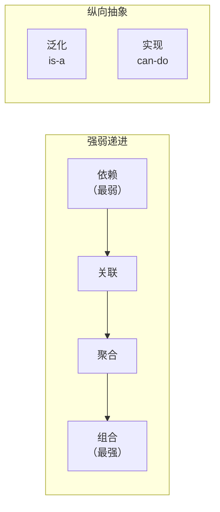

# 类之间的关系：关联、聚合、组合、依赖、泛化、实现

类与类之间不是孤立的。用例和对象被识别出来后，下一步就是把它们==连成一张静态结构网==：谁是谁的一部分、谁复用谁的行为、谁只是临时用到谁。UML 用六种关系刻画这张网，考试和建模题的核心就是==根据语义选对关系、画对符号==。

## 六种关系总览

| 关系 | 符号 | 语义 | 生命周期 |
|------|------|------|----------|
| 依赖 | 虚线箭头 `-->` | 使用即依赖 | 无绑定 |
| 关联 | 实线（可带箭头） | 结构上有联系 | 各自独立 |
| 聚合 | 空心菱形 `◇—` | has-a，弱整体-部分 | 各自独立 |
| 组合 | 实心菱形 `◆—` | contains-a，强整体-部分 | ==同生共死== |
| 泛化 | 实线空心三角 `—▷` | is-a，继承 | 层次绑定 |
| 实现 | 虚线空心三角 `--▷` | 类实现接口 | 契约绑定 |

## 整体-部分：聚合还是组合？

判断的关键问题：==部分离开整体还能独立存在吗？==

- **聚合（Aggregation）**：能。圆和多边形是图形格式的聚合类——图形格式变了，圆和多边形依然存在。菱形画在**整体**一端。
- **组合（Composition）**：不能。圆由点组成、多边形由点组成，整体消亡则点无意义。组合也可以把成分类直接写进组合类的属性框，右上角标多重性，名字写成 `角色名:类名`。

> [!TIP]
> 记符号：空心"聚"（还能散），实心"合"（焊死了）。菱形永远挨着整体那一侧。

## 纵向关系：泛化与实现

**泛化（Generalization）**是继承。子类继承父类的属性和操作，==子类实例可以出现在父类声明的任何位置==，由此支撑多态——外界调用相同，各子类实现不同。但注意边界：子类可以重新定义继承来的**操作**，却**不能重新定义属性**（覆盖属性是继承不允许的）。

**实现（Realization）**是类与接口之间的契约。接口只有操作声明、没有属性、没有实现，由实现类补全方法体。实现类是主动"履行"接口的那一方。

> [!WARNING]
> 不要把"调用接口的类"当成实现类。调用方只是依赖接口，==实现接口的类才是 realization 的源端==。

## 最弱的依赖

一个元素 b 的改变会影响 a，则 a 依赖于 b。课件强调：==关联、泛化、实现在本质上都是依赖==，只是语义更强。依赖本身细分四类：使用依赖（use/call/parameter/send/instantiate）、抽象依赖（trace/refine/derive）、授权依赖（access/import/friend）、绑定依赖（bind）。

## 做对了的例题

**题目**：下列哪些对象应被分配到同一子系统？A. 属于同一复合对象一部分的对象 B. 客户端与服务对象 C. 用户接口与实体对象 D. 彼此相关联的对象。

**答案：A**。组合（复合）关系是最强的结构耦合——部分与整体同生共死，天然应划进同一子系统。D 是干扰项：普通关联只是弱耦合，跨子系统的关联很常见，不能作为分配依据。

**再看一题**：将聚合层次映射到关系表，哪项不正确？——"聚合表和部分表有相同的主键"是错的。聚合关系中两类各自独立，==主键不同==，且整体表的主键作为外键出现在部分表中（方向别搞反）。

> [!IMPORTANT]
> 建模答题三步：先问"是不是 is-a"（是则泛化/实现）；不是再问"是否整体-部分"（是则按生命周期分聚合/组合）；剩下结构上的长期联系用关联，临时使用用依赖。
