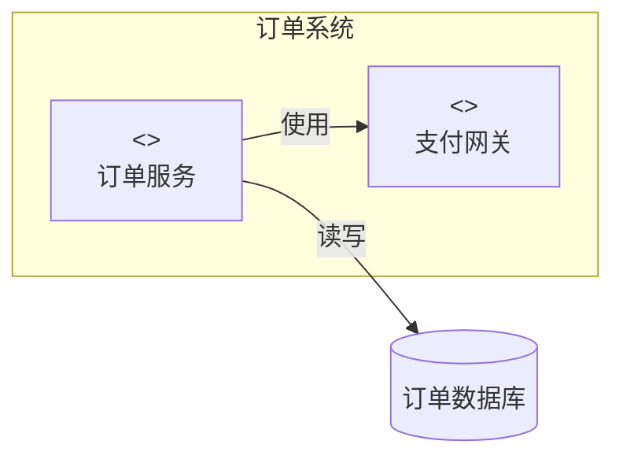
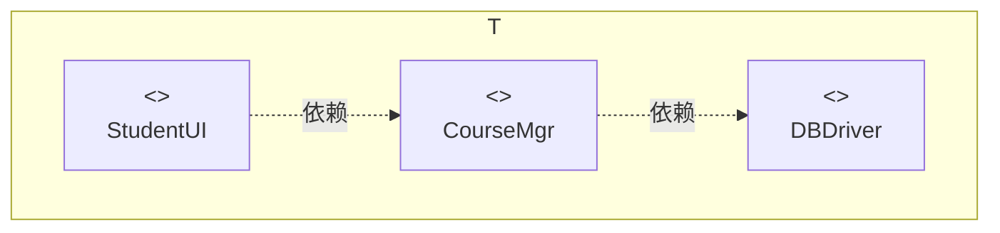

# 组件图（Component Diagram）的符号与用途

> [!IMPORTANT]
> 组件图（构件图）是 UML 物理建模的核心，用于描述系统的==物理结构==与==构件间依赖关系==。

## 它是什么

在代码写完、类图画好后，我们面对的是成百上千个 `.java`、`.dll` 或 `.jar` 文件。这些文件如何组织？谁调用谁？这就是组件图要回答的问题。

组件（Component）是系统中==可替换的物理部件==，它封装了实现并对外提供一组接口。

根据课件，构件分为三类：

| 构件类型 | 英文 | 含义 | 举例 |
| :--- | :--- | :--- | :--- |
| 配置构件 | Deployment Component | 运行环境的基础设施 | 操作系统、JVM |
| 工作产品构件 | Work Product Component | 开发过程产出的源文件 | `.java`、`.h` 源码 |
| 执行构件 | Execution Component | 运行时被加载执行的模块 | `.dll`、`.jar` |

## 符号与画法

组件的标准 UML 符号是一个矩形，右上角带有“两个小矩形凸起”的图标（也可用 `<<component>>` 标记）。构件间的关系主要用==带箭头的虚线==表示依赖（Dependency）。

> [!TIP]
> 记忆口诀：**“方框带双耳，虚线表依赖”**。实线箭头一般不用于普通依赖，而是用于关联或组装关系。

## 为什么需要它

试想：如果没有组件图，开发人员只知道有哪些类，却不知道最终打包成几个 `.jar`，部署时哪个包依赖哪个库，系统一升级就容易漏发文件或引发版本冲突。组件图将逻辑设计映射到==物理实现==，明确了编译、链接和运行时的依赖拓扑。

## 怎么做：一个完整例子

假设我们要画一个“学生选课系统”的组件图。系统包含 UI 界面、业务逻辑和数据访问层，运行在 Tomcat 上。

**步骤：**
1. **识别工作产品构件**：`StudentUI.java`、`CourseMgr.java`。
2. **识别执行构件**：编译后的 `course-mgr.jar`、`db-driver.jar`。
3. **识别配置构件**：`Tomcat Server`。
4. **画出依赖**：UI 依赖业务逻辑，业务逻辑依赖数据库驱动，它们都部署在 Tomcat 上。

> [!NOTE]
> 上图展示了执行构件之间的依赖。若需表达物理节点分布，则应结合 8.2 节的部署图（Deployment Diagram）。

## 与相近概念的区别

初学者极易混淆组件图与类图、部署图：

| 对比维度 | 类图（Class Diagram） | 组件图（Component Diagram） | 部署图（Deployment Diagram） |
| :--- | :--- | :--- | :--- |
| **建模阶段** | 逻辑建模 | ==物理建模== | 物理建模 |
| **核心元素** | 类、接口、方法 | 构件（`.jar`/`.dll`） | 节点（服务器/设备） |
| **关注点** | 对象间的静态结构 | 代码模块的==物理依赖== | 硬件拓扑与软件分配 |

> [!WARNING]
> **常见坑**：考试画图时，把“类”直接塞进组件图里。记住，组件图里的方块代表的是==物理文件/模块==（如 `Order.dll`），而不是某个具体的 `class Order`。一个组件内部可以包含多个类。

> [!CAUTION]
> 另一个高危误区是混淆三种构件。如果题目问“源代码文件属于哪种构件”，必须答==工作产品构件==；如果问“运行时的动态链接库”，则是==执行构件==。配置构件通常指支撑运行的平台或中间件。
