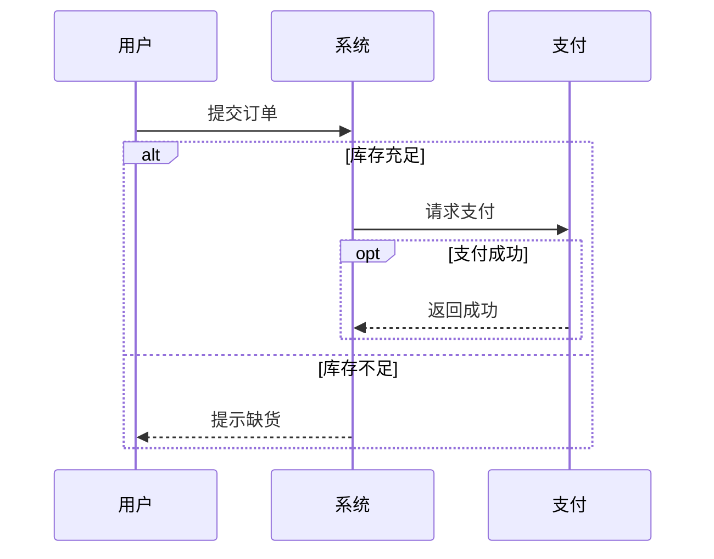

# 顺序图的组合片段（alt、opt、loop、par等）

## 组合片段是什么

顺序图里，一条消息序列往往不够表达真实交互：有时要根据条件二选一，有时某段消息可发可不发，有时同一段交互要重复多次。UML 把这些“带控制结构的局部交互”框起来，称为**组合片段（Combined Fragment）**：外框左上角写操作符，框内放消息序列，必要时用水平虚线分成若干操作数，并标注**监护条件**。

> [!IMPORTANT]
> 核心判断：==alt 是多选一，opt 是可执行可不执行，loop 是重复执行，par 是并行执行==。它们描述的是消息序列的控制方式，不是对象的状态变化。

## 四种操作符怎么用

| 操作符 | 含义 | 典型写法 | 阅读要点 |
|---|---|---|---|
| `alt` | 备选，多条件分支 | 各操作数写 `[条件]` | 任何场合只发生一个备选序列 |
| `opt` | 可选，单条件片段 | `opt [余额充足]` | 条件成立执行，否则整段跳过 |
| `loop` | 循环，多次执行 | `loop(1,n)`、`loop(10)` | 由循环次数和监护条件说明 |
| `par` | 并行，各片段可并发 | 各操作数写并行序列 | 不表示固定先后次序 |

`alt` 类似“多路分支”：例如支付成功走一条消息序列，支付失败走另一条。`opt` 只有一个可选片段，例如“若库存不足，则发送缺货提示”；条件不成立时，不产生该片段中的消息。`loop` 则把一段交互重复执行，`loop(1,n)` 表示至少 1 次、至多 $n$ 次，`loop(10)` 表示按指定次数执行，`loop [for each Item]` 表示对每个商品项重复处理。

## 一个读图例子

“系统依次处理订单中的每个商品；若商品有货则扣减库存，否则记录缺货；全部处理完后返回结果。”应这样建模：最外层用 `loop [for each Item]`，循环体内部用 `alt`，分为 `[有货]` 与 `[无货]` 两个操作数。若题意只是“有货时才扣减库存，无货时不做任何处理”，则把扣减库存放进 `opt [有货]` 即可。

这个例子最容易想错的一点是：**循环与分支谁包谁？** 既然每个商品都可能走不同分支，就应当是 `loop` 包住 `alt`，而不是用 `alt` 包住整个循环。

> [!WARNING]
> 不要把 `opt` 当成 `alt` 的简写。`opt` 只有“执行或跳过”，没有另一个备选分支；需要明确画出“否则执行什么”时，应使用 `alt` 的多个操作数。

> [!TIP]
> 做题先圈题干关键词：“如果……否则……”优先 `alt`；“如果……就……”优先 `opt`；“每个、反复、最多 n 次”优先 `loop`；“同时、并发”才考虑 `par`。最后检查监护条件是否写在对应片段上，循环范围是否框准。
